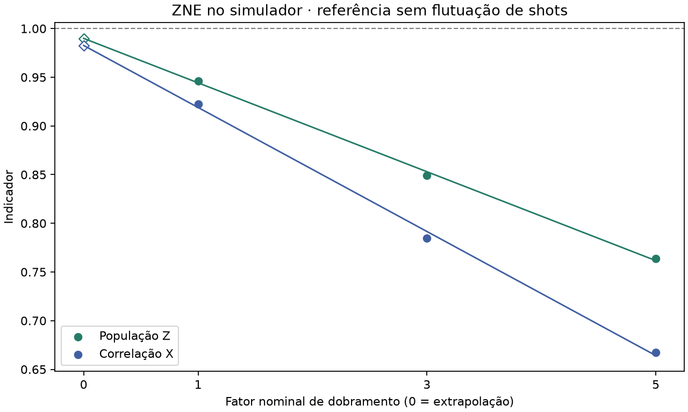

# Mitigação de ruído em circuitos quânticos: comparação de técnicas usando o estado GHZ como referência

> **Rascunho de 2 de novembro de 2026.** Autoria, orientação e instituição: *a preencher.* Este documento é a primeira etapa de uma pesquisa em andamento. As técnicas e os circuitos serão ampliados, e cada nova etapa entra como um experimento numerado (ver [seção 6](#6-conclusão-e-trabalhos-futuros)).
>
> **Escopo.** Este repositório trata da frente de **mitigação de ruído**. A modelagem de ruído é uma frente separada, conduzida por João Paulo, em [quantum-modeling](../quantum-modeling/README.md).

## Resumo

Computadores quânticos atuais devolvem resultados que se afastam dos ideais por causa do ruído. Técnicas de mitigação procuram estimar o resultado correto sem corrigir o equipamento. Comparamos técnicas de mitigação usando como referência o estado GHZ, cuja resposta ideal é conhecida em duas bases de medição, com dois indicadores: a população em Z (PZ) e a correlação em X (CX). Em hardware da IBM, PZ caiu de 0,922 para 0,109 quando o GHZ cresceu de 5 para 50 qubits. Em cinco qubits, uma construção que segue as conexões físicas reduziu as portas de dois qubits de 13 para 4 e elevou PZ de 0,833 para 0,888 e CX de 0,566 para 0,774. A calibração de leitura, em três rodadas no IBM Fez, aproximou os indicadores do ideal em 0,070 a 0,072 (PZ) e 0,148 a 0,164 (CX). Em simulação com ruído conhecido, a calibração recuperou a distribuição anterior à leitura, mas não desfez o erro das portas, e a extrapolação a ruído zero levou PZ de 0,9463 a 0,9899 no cálculo exato, com maior incerteza. Os resultados valem para o GHZ de cinco qubits e para as condições descritas; não permitem ainda classificar as técnicas entre si.

**Palavras-chave:** mitigação de erros quânticos; estado GHZ; erro de leitura; extrapolação a ruído zero; IBM Quantum.

## 1. Introdução

Um circuito quântico executado em hardware real produz distribuições de resultados diferentes das previstas pela teoria. A diferença vem de várias fontes de ruído ([fundamentos/ruido.md](fundamentos/ruido.md)). Uma única sequência de bits, como `00001` quando esperávamos `00000`, não revela em que etapa o desvio surgiu: na preparação, nas portas ou na leitura.

**Pergunta de pesquisa.** Quanto cada técnica de mitigação aproxima os indicadores de um circuito do valor ideal, a que custo e para qual fonte de ruído?

**Estratégia.** Começamos pelo estado GHZ, porque sua resposta ideal é conhecida em duas bases. Isso permite medir o desvio, aplicar uma técnica e medir de novo com a mesma régua. Quando uma técnica estiver caracterizada no GHZ, repetiremos a comparação em outros circuitos, definindo para cada um o resultado ideal e seu indicador ([fundamentos/indicadores.md](fundamentos/indicadores.md)).

**Contribuições desta etapa.**

1. Seis experimentos, quatro em hardware da IBM e dois em simulação, documentados com dados, circuitos e código.
2. Três técnicas avaliadas com os mesmos indicadores: construção com menos portas, calibração de leitura e extrapolação a ruído zero.
3. Um protocolo reprodutível, com tabelas geradas direto dos dados, para acrescentar novas técnicas.

## 2. Fundamentação

**Fontes de ruído.** Preparação, portas, decoerência, leitura e amostragem finita atuam em momentos diferentes e pedem técnicas diferentes. Um ajuste de leitura, por exemplo, não desfaz o erro de uma porta que já alterou o qubit antes da medida. [Detalhes e exemplo](fundamentos/ruido.md).

**Técnicas.** Mitigação não é correção de erros: busca estimativas melhores de valores esperados, sem qubits adicionais. A tabela mostra a situação de cada técnica.

| Técnica | Fonte que ataca | Situação |
| --- | --- | --- |
| Construção com menos portas | Portas, decoerência | Medida na IBM |
| Calibração de leitura (matriz completa) | Leitura | Medida na IBM |
| Extrapolação a ruído zero (ZNE) | Portas | Simulada |
| Twirling de Pauli | Ruído coerente | Planejada |
| Desacoplamento dinâmico | Decoerência | Planejada |
| Cancelamento probabilístico de erros (PEC) | Portas | Planejada |

Descrição de cada técnica e referências: [fundamentos/tecnicas.md](fundamentos/tecnicas.md) e [fundamentos/referencias.md](fundamentos/referencias.md).

## 3. Método

### 3.1 Circuito e indicadores

O GHZ de cinco qubits é (|00000⟩ + |11111⟩)/√2. Em Z, produz apenas `00000` ou `11111`.

- **PZ** = (contagem de `00000` + contagem de `11111`) / total de shots. Valor ideal: 1.
- **CX** = fração de sequências com número par de bits 1 − fração com número ímpar, medida após girar a base para X. Valor ideal: 1. Uma mistura clássica de `00000` e `11111` daria 0, e por isso CX distingue o GHZ dessa mistura.

Os dois indicadores **não determinam a fidelidade** do estado. Definições e exemplos com contas: [fundamentos/indicadores.md](fundamentos/indicadores.md).

### 3.2 Experimentos

| # | Experimento | Onde | Backend | Data | Shots por circuito |
| --- | --- | --- | --- | --- | ---: |
| 1 | [Escala do GHZ, 5 a 50 qubits](experimentos/01_ghz_escala/README.md) | IBM | não registrado (código usa `ibm_kingston`) | não registrada | 1.000 |
| 2 | [Controles de estados conhecidos](experimentos/02_controles/README.md) | IBM | `ibm_kingston`, `ibm_fez` | 20 e 21 de out. de 2026 | 1.000 |
| 3 | [Construção com menos portas](experimentos/03_ghz_conectado/README.md) | IBM | `ibm_fez` | 21 de out. de 2026 | 1.000 |
| 4 | [Calibração de leitura, 3 rodadas](experimentos/04_mitigacao_leitura/README.md) | IBM | `ibm_fez` | rodada 3: 1º de nov. de 2026 | 1.000 |
| 5 | [Validação simulada](experimentos/05_validacao_simulada/README.md) | PC (Qiskit Aer) | modelo sintético | 1º de nov. de 2026 | 1.000 |
| 6 | [ZNE simulada](experimentos/06_zne_simulado/README.md) | PC (Qiskit Aer) | modelo sintético | 1º de nov. de 2026 | 1.000 |

### 3.3 Intervenções

**Construção do circuito.** Comparamos o GHZ original, em que o qubit 0 interage com todos os outros, com uma construção em árvore que segue as conexões físicas (raiz no qubit 2; ligações 2→1, 2→3, 1→0, 3→4). O estado ideal é o mesmo. Medimos portas de dois qubits e profundidade após a compilação.

**Calibração de leitura.** Em cada rodada, preparamos as 32 sequências de cinco bits e medimos como cada uma foi registrada. As frequências formam a matriz **A**. Com **p** as frequências observadas do GHZ, resolvemos **A q = p** e calculamos PZ e CX a partir de **q**. A conta ilustrada com um bit e uma rodada real está no [experimento 4](experimentos/04_mitigacao_leitura/README.md).

**Extrapolação a ruído zero.** Em simulação, executamos três versões do GHZ conectado com 4, 12 e 20 portas CX (fatores 1, 3 e 5), ajustamos uma reta aos indicadores e lemos o valor no fator 0.

### 3.4 Incerteza

Usamos *bootstrap* com 5.000 réplicas por rodada, reamostrando contagens de calibração e do GHZ e refazendo todo o cálculo. Para o ganho (ajustado − bruto), as duas versões usam as mesmas contagens do GHZ em cada réplica. O intervalo de 95% vai do percentil 2,5 ao 97,5. Para comparações simples entre dois circuitos usamos o erro padrão analítico. O bootstrap cobre só a variação de amostragem dentro de uma rodada.

### 3.5 Simulação

A simulação usa o Qiskit Aer em CPU, com **parâmetros sintéticos** de leitura e de ruído nas portas ([tabela de parâmetros](experimentos/05_validacao_simulada/README.md#método)). Em cada cenário calculamos também a **referência exata** do modelo, sem flutuação de shots.

### 3.6 Reprodutibilidade

Todas as tabelas deste documento são geradas dos arquivos em [dados](dados/README.md) por `scripts/gerar_tabelas.py`. Os comandos que não acessam a IBM estão em [scripts/README.md](scripts/README.md). **Os programas das pastas de experimento 1 a 4 enviam jobs à IBM quando executados.**

## 4. Resultados

### 4.1 O desvio cresce com o tamanho do circuito (experimento 1)

*Figura 1. Fração das 1.000 medidas que deram todos zeros ou todos uns, para GHZ de 5 a 50 qubits. [Tabela e conta](experimentos/01_ghz_escala/README.md).*

PZ caiu de 0,922 (5 qubits) para 0,109 (50 qubits). O experimento não separa o efeito do número de qubits do efeito do número de portas e do roteamento.

### 4.2 Estados simples também mostram desvio (experimento 2)

Em controles sem emaranhamento, os qubits 0 e 1 isolados acertaram 97,3% a 99,2% das vezes no Fez. No Kingston, o qubit 0 preparado em `0` devolveu `0` em apenas 24,9% das medidas, enquanto o qubit 1 acertou todas. Os dados não permitem atribuir uma causa. [Tabela completa](experimentos/02_controles/README.md).

### 4.3 Menos portas melhoram os indicadores brutos (experimento 3)

No Fez, o GHZ original de cinco qubits ficou com 13 portas de dois qubits e profundidade 35. O conectado ficou com 4 portas e profundidade 13.

**Tabela 1. Diferenças entre construções, em unidades de erro padrão de amostragem.**

<!-- TABELA:construcoes_testes -->
| Comparação | Indicador | Primeiro | Segundo | Diferença | EP da diferença | Diferença em EP |
| --- | --- | ---: | ---: | ---: | ---: | ---: |
| Mesmo circuito original em dois jobs | PZ | 0,834 | 0,833 | -0,001 | 0,017 | -0,1 |
| Conectado menos original, base Z | PZ | 0,833 | 0,888 | 0,055 | 0,015 | 3,6 |
| Conectado menos original, base X | CX | 0,566 | 0,774 | 0,208 | 0,033 | 6,3 |
<!-- /TABELA:construcoes_testes -->

A primeira linha é um controle: o mesmo circuito original em dois jobs deu valores praticamente iguais. As duas diferenças entre construções ficam acima de 3 erros padrão. Os valores são **brutos** (sem correção de leitura). [Detalhes](experimentos/03_ghz_conectado/README.md).

### 4.4 A calibração de leitura aproxima os indicadores do ideal (experimento 4)

Em cada rodada, 34 circuitos × 1.000 shots, totalizando 102.000 medidas. Na rodada 3, `00000` apareceu 454 vezes e `11111` apareceu 441 vezes. Então PZ bruto = (454 + 441)/1.000 = 0,895. O valor ajustado, 0,9648, foi calculado a partir das mesmas contagens.

**Tabela 2. PZ e CX brutos e ajustados.**

<!-- TABELA:rodadas -->
| Rodada | PZ bruto → ajustado | CX bruta → ajustada |
| ---: | --- | --- |
| 1 | 0,8730 → 0,9436 | 0,7960 → 0,9440 |
| 2 | 0,8640 → 0,9360 | 0,7960 → 0,9481 |
| 3 | 0,8950 → 0,9648 | 0,8060 → 0,9702 |
<!-- /TABELA:rodadas -->

*Figura 2. Indicadores brutos e ajustados em cada rodada, com um erro padrão.*

Nas três rodadas, os dois indicadores ficaram mais próximos de 1. Os seis intervalos de 95% do ganho ficam acima de zero. O ajuste aumenta o erro padrão. [Ganhos, intervalos e conta passo a passo](experimentos/04_mitigacao_leitura/README.md).

### 4.5 A calibração não desfaz o erro das portas (experimento 5)

No simulador escolhemos o erro e calculamos a referência exata.

**Tabela 3. Indicadores do modelo antes e depois da leitura.**

<!-- TABELA:cenarios -->
| Cenário | Construção | PZ antes da leitura | PZ após a leitura | CX antes da leitura | CX após a leitura |
| --- | --- | ---: | ---: | ---: | ---: |
| Ideal | original | 1,0000 | 1,0000 | 1,0000 | 1,0000 |
| Ideal | conectado | 1,0000 | 1,0000 | 1,0000 | 1,0000 |
| Só leitura | original | 1,0000 | 0,8366 | 1,0000 | 0,6957 |
| Só leitura | conectado | 1,0000 | 0,8366 | 1,0000 | 0,6957 |
| Leitura e portas | original | 0,8409 | 0,7065 | 0,7690 | 0,5350 |
| Leitura e portas | conectado | 0,9463 | 0,7924 | 0,9224 | 0,6417 |
<!-- /TABELA:cenarios -->

Com erro só na leitura, a calibração recupera o valor anterior à leitura (PZ = 1). Com erro também nas portas, o valor recuperável é o que chega à leitura: 0,8409 (original) ou 0,9463 (conectado). [Parâmetros e figuras](experimentos/05_validacao_simulada/README.md).

### 4.6 Extrapolação a ruído zero (experimento 6)

**Tabela 4. ZNE na referência exata do modelo.**

<!-- TABELA:zne -->
| Fator de ruído | Portas CX | PZ (referência do modelo) | CX (referência do modelo) |
| ---: | ---: | ---: | ---: |
| 1 | 4 | 0,9463 | 0,9224 |
| 3 | 12 | 0,8490 | 0,7847 |
| 5 | 20 | 0,7637 | 0,6676 |
| 0 (extrapolado) | — | **0,9899** | **0,9826** |
<!-- /TABELA:zne -->

*Figura 3. Círculos: fatores 1, 3 e 5. Losangos: extrapolação ao fator 0. A linha tracejada marca o ideal.*

A extrapolação aproximou PZ e CX de 1, sem chegar a 1: o ajuste linear tem viés. Com 1.000 shots por circuito, o erro padrão aumentou em todos os três blocos. [Resultados por bloco](experimentos/06_zne_simulado/README.md).

### 4.7 Síntese

**Tabela 5. As três técnicas testadas.** As condições diferem (valores brutos, ajustados e simulados). **Não é um ranking.**

<!-- TABELA:sintese -->
| Técnica | Onde | Variação nos indicadores | Custo |
| --- | --- | --- | --- |
| Construção com menos portas | IBM Fez, valores brutos | PZ +0,055; CX +0,208 | 9 portas CX a menos (13 → 4); nenhum shot extra |
| Calibração de leitura | IBM Fez, 3 rodadas | PZ +0,070 a +0,072; CX +0,148 a +0,164 | 32 circuitos de calibração por rodada; erro padrão maior |
| Extrapolação a ruído zero | Simulação, referência exata | PZ 0,9463 → 0,9899 (fator 1 → extrapolado) | 3 versões do circuito, até 20 CX; erro padrão maior; viés da reta |
<!-- /TABELA:sintese -->

## 5. Discussão

**O que os dados sustentam.**

- Em cinco qubits no Fez, a calibração de leitura aproximou PZ e CX do ideal nas três rodadas.
- A construção com menos portas apresentou indicadores brutos melhores que a original, por mais de 3 erros padrão nos dois indicadores.
- No modelo simulado, a calibração compensa a leitura, e o erro das portas permanece.

**O que não sustentam.**

- **Eliminação do erro das portas.** O ajuste de leitura não o atinge. A ZNE só foi testada em simulação.
- **Fidelidade do estado.** PZ e CX são propriedades parciais.
- **Efeito isolado da leitura.** A calibração prepara estados por portas e pode incorporar erros de preparação.
- **Ordem entre técnicas.** Condições, qubits e dados diferem, e algumas medidas são brutas e outras ajustadas.
- **Resultados para outros circuitos ou mais qubits.** A matriz completa cresce como 2ⁿ × 2ⁿ e exige 2ⁿ calibrações.

**Limitações específicas.**

1. **Backends e datas.** Os experimentos 2 a 4 usam backends e dias diferentes. O GHZ conectado de 50 qubits (Fez, 21 de outubro) **não é comparável** à série de escala (código para Kingston, data desconhecida).
2. **Número de repetições.** São três rodadas e três blocos simulados. Cada comparação do experimento 3 é um único job.
3. **Deriva.** O bootstrap não inclui variação do equipamento entre dias. O desvio dos controles do Kingston (experimento 2) indica que o estado do equipamento pode variar muito.
4. **Quasiprobabilidades.** Estimativas ajustadas podem ter componentes negativas ou indicadores acima de 1. Não as recortamos.
5. **Modelo sintético.** As magnitudes da simulação valem para o modelo, não para o Fez. A auditoria registra um desvio de até 3,2 erros padrão entre o valor ajustado e o modelo exato, com critério amplo de sanidade (6), que não é teste de cobertura.
6. **ZNE.** A extrapolação linear tem viés e amplia a incerteza.

## 6. Conclusão e trabalhos futuros

Nesta etapa, o GHZ de cinco qubits serviu de referência para três técnicas. A calibração de leitura e a construção com menos portas melhoraram os indicadores medidos na IBM, e a simulação mostrou que elas atuam em fontes de ruído diferentes. A ZNE foi avaliada apenas em simulação.

**Próximos passos propostos** (nada abaixo foi executado em hardware; detalhes em [docs/plano_experimentos.md](docs/plano_experimentos.md)):

1. **Protocolo do experimento 5 na IBM:** três blocos de 40 circuitos, cada um com sua calibração, no mesmo equipamento, com controles independentes (120.000 medidas). Execução depende de decisão específica.
2. **Piloto de ZNE na IBM** (126.000 medidas), após o item 1.
3. **Mais qubits.** Comparar um modelo fatorizado ou escalável de leitura com a matriz completa em cinco qubits, antes de ampliar.
4. **Novas técnicas** no GHZ: twirling de Pauli, desacoplamento dinâmico e PEC ([fundamentos/tecnicas.md](fundamentos/tecnicas.md)).
5. **Outros circuitos**, depois que as técnicas estiverem caracterizadas no GHZ.

**Como acrescentar uma etapa.** Copie [experimentos/_modelo](experimentos/_modelo/README.md), preencha pergunta, indicador, controle e critério de sucesso antes de executar, guarde as contagens em `dados/` e acrescente uma linha na tabela da [seção 3.2](#32-experimentos) e em [tecnicas.md](fundamentos/tecnicas.md).

## Referências

As referências completas, com links verificados, estão em [fundamentos/referencias.md](fundamentos/referencias.md). As principais:

- Greenberger, Horne e Zeilinger (1989), estado GHZ.
- Bravyi et al. (2021), mitigação de erros de medição. *Physical Review A* 103, 042605.
- Temme, Bravyi e Gambetta (2017), extrapolação a ruído zero. *Physical Review Letters* 119, 180509.
- Giurgica-Tiron et al. (2020), ZNE digital.
- Wallman e Emerson (2016), compilação aleatória. *Physical Review A* 94, 052325.
- Viola, Knill e Lloyd (1999), desacoplamento dinâmico. *Physical Review Letters* 82, 2417.
- van den Berg et al. (2023), PEC com modelos de Pauli–Lindblad esparsos. *Nature Physics*.

## Mapa do repositório

| Pasta | Conteúdo |
| --- | --- |
| [fundamentos](fundamentos/README.md) | Ruído, técnicas, indicadores e referências. |
| [experimentos](experimentos/README.md) | Uma pasta por experimento, com método, conta e resultado, e os programas históricos. |
| [dados](dados/README.md) | Contagens brutas da IBM, resultados processados e dados simulados. |
| [scripts](scripts/README.md) | Análise, simulação, geração de tabelas e figuras, sem acesso à IBM, exceto `recuperar_job.py`. |
| [tests](tests/README.md) | Testes automatizados. |
| [figuras](figuras/README.md) | Gráficos da análise das três rodadas e da ZNE. |
| [docs](docs/README.md) | Relatórios de apoio e o [arquivo](docs/arquivo/README.md) de documentos anteriores. |
