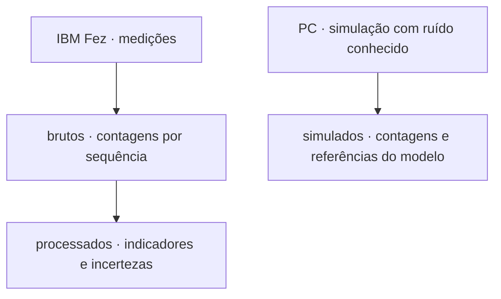
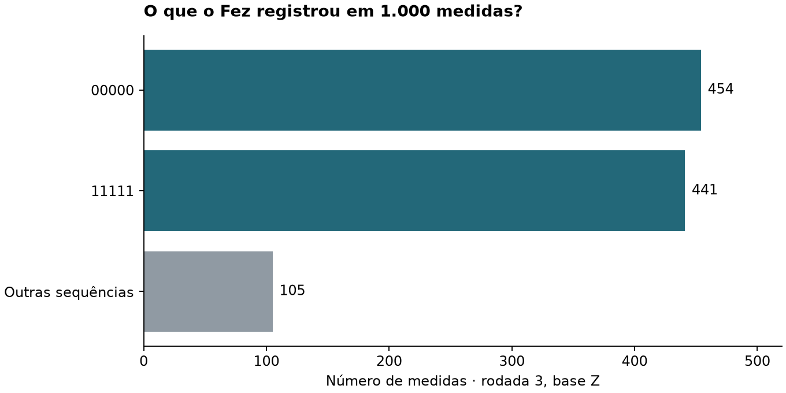

# Dados experimentais e simulados

[Índice do livro](../README.md) · [Dicionário dos arquivos](../docs/livro/10-codigo-dados/README.md)

## Origem dos dados

Na rodada 3, as duas barras azuis somam 454 + 441 = 895 medidas. A barra cinza reúne as outras 105. Dividir 895 por 1.000 dá **89,5% observado**. O ajuste de leitura estimou **96,48%** usando essas mesmas contagens e a calibração.

[Ver as contagens no JSON](brutos/04_mitigacao_leitura/repeticoes/rodada_03.json) · [Ver o cálculo e sua incerteza](processados/README.md)

## Onde encontrar cada tipo de dado

| Pasta | Origem e uso |
| --- | --- |
| [brutos](brutos/README.md) | Contagens experimentais reais preservadas e metadados disponíveis |
| [processados](processados/README.md) | Tabelas e análises derivadas dos registros reais |
| [simulados](simulados/README.md) | Contagens e análises geradas no PC com modelos definidos |

Os 102.000 shots das três rodadas reais e os 486.000 shots simulados são conjuntos diferentes. Não os agregue em uma única amostra experimental. A série histórica de escala e a linha de base da modelagem também têm seus próprios registros.

Frequências brutas são inteiros não negativos. Indicadores ajustados são estimativas e podem sair do intervalo físico; consulte os erros e o método. Para rastrear uma figura, siga o JSON processado até seu arquivo bruto e job ou manifesto.
