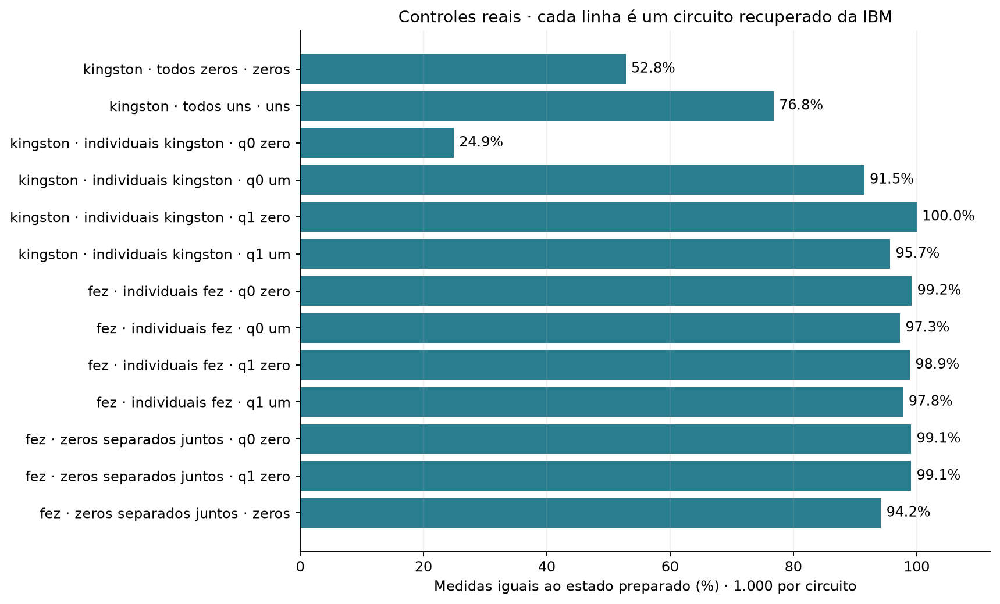

# Controles de estados conhecidos · arquivos da IBM

Cada barra mostra a porcentagem de medidas iguais ao estado preparado, em 1.000 medidas. As linhas identificam teste, backend e circuito. Os controles incluem preparação e leitura.

| Arquivo | Conteúdo |
| --- | --- |
| [dbbrrnpgv2cc73e922r0.json](dbbrrnpgv2cc73e922r0.json) | todos zeros, no ibm_kingston. Contagens de cada circuito, data, operações e mapeamento das medidas. |
| [dbbrrnpgv2cc73e922r0.qpy](dbbrrnpgv2cc73e922r0.qpy) | Circuitos compilados do mesmo job, na ordem dos índices do JSON. |
| [dbbsd47i0auc73948300.json](dbbsd47i0auc73948300.json) | todos uns, no ibm_kingston. Contagens de cada circuito, data, operações e mapeamento das medidas. |
| [dbbsd47i0auc73948300.qpy](dbbsd47i0auc73948300.qpy) | Circuitos compilados do mesmo job, na ordem dos índices do JSON. |
| [dbcbsopgv2cc73ea1300.json](dbcbsopgv2cc73ea1300.json) | individuais kingston, no ibm_kingston. Contagens de cada circuito, data, operações e mapeamento das medidas. |
| [dbcbsopgv2cc73ea1300.qpy](dbcbsopgv2cc73ea1300.qpy) | Circuitos compilados do mesmo job, na ordem dos índices do JSON. |
| [dbcc4g9gv2cc73ea1j10.json](dbcc4g9gv2cc73ea1j10.json) | individuais fez, no ibm_fez. Contagens de cada circuito, data, operações e mapeamento das medidas. |
| [dbcc4g9gv2cc73ea1j10.qpy](dbcc4g9gv2cc73ea1j10.qpy) | Circuitos compilados do mesmo job, na ordem dos índices do JSON. |
| [dbcc5ggc77vs7385vfsg.json](dbcc5ggc77vs7385vfsg.json) | zeros separados juntos, no ibm_fez. Contagens de cada circuito, data, operações e mapeamento das medidas. |
| [dbcc5ggc77vs7385vfsg.qpy](dbcc5ggc77vs7385vfsg.qpy) | Circuitos compilados do mesmo job, na ordem dos índices do JSON. |

[Resultados calculados](../../processados/02_controles/README.md). Identificação conferida pelas operações, medidas e distribuição ideal dos circuitos recuperados.
