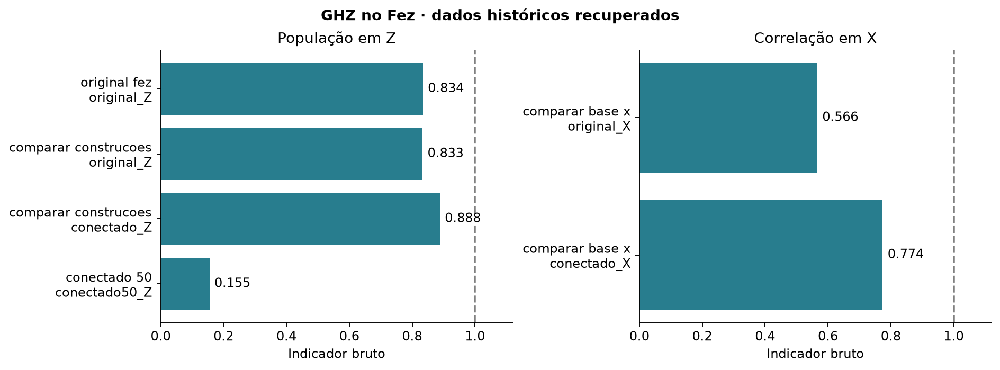

# Construções GHZ · arquivos da IBM

O painel Z mostra PZ e o painel X mostra a correlação. Cada barra corresponde a um circuito real. A linha em 1 marca o ideal. A execução conectada de 50 qubits usa backend e data diferentes da série histórica de escala.

| Arquivo | Conteúdo |
| --- | --- |
| [dbccaqpgv2cc73ea21fg.json](dbccaqpgv2cc73ea21fg.json) | original fez, no ibm_fez. Contagens de cada circuito, data, operações e mapeamento das medidas. |
| [dbccaqpgv2cc73ea21fg.qpy](dbccaqpgv2cc73ea21fg.qpy) | Circuitos compilados do mesmo job, na ordem dos índices do JSON. |
| [dbcccpc24mrc73cjb6bg.json](dbcccpc24mrc73cjb6bg.json) | comparar construcoes, no ibm_fez. Contagens de cada circuito, data, operações e mapeamento das medidas. |
| [dbcccpc24mrc73cjb6bg.qpy](dbcccpc24mrc73cjb6bg.qpy) | Circuitos compilados do mesmo job, na ordem dos índices do JSON. |
| [dbcco2fi0auc73dum8i0.json](dbcco2fi0auc73dum8i0.json) | comparar base x, no ibm_fez. Contagens de cada circuito, data, operações e mapeamento das medidas. |
| [dbcco2fi0auc73dum8i0.qpy](dbcco2fi0auc73dum8i0.qpy) | Circuitos compilados do mesmo job, na ordem dos índices do JSON. |
| [dbch2kpgv2cc73eabim0.json](dbch2kpgv2cc73eabim0.json) | conectado 50, no ibm_fez. Contagens de cada circuito, data, operações e mapeamento das medidas. |
| [dbch2kpgv2cc73eabim0.qpy](dbch2kpgv2cc73eabim0.qpy) | Circuitos compilados do mesmo job, na ordem dos índices do JSON. |

[Resultados calculados](../../processados/03_ghz_conectado/README.md). Identificação conferida pelas operações, medidas e distribuição ideal dos circuitos recuperados.
