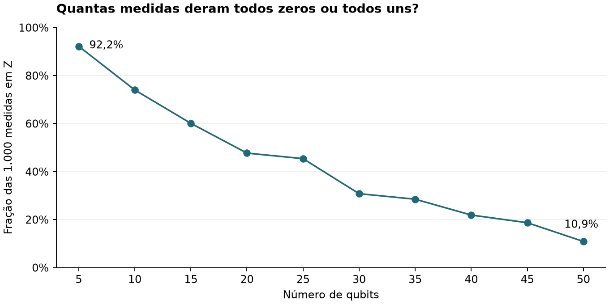

# Registros experimentais preservados

[Dados](../README.md) · [História experimental](../../docs/livro/05-experimentos-reais/README.md)

| Arquivo | Conteúdo e limite |
| --- | --- |
| [ghz_05_a_50.txt](01_ghz_escala/ghz_05_a_50.txt) | Dez seções de contagens; contexto histórico incompleto |
| [GHZ_leitura_dbccq67i0auc73dumdk0.json](04_mitigacao_leitura/GHZ_leitura_dbccq67i0auc73dumdk0.json) | Primeira rodada na comparação, 34 circuitos |
| [GHZ_leitura_dbccri9gv2cc73ea3630.json](04_mitigacao_leitura/GHZ_leitura_dbccri9gv2cc73ea3630.json) | Segunda rodada na comparação, 34 circuitos |
| [rodada_03.json](04_mitigacao_leitura/repeticoes/rodada_03.json) | Terceira rodada com contagens, timestamps, versões, opções e análise original |
| [rodada_03.qpy](04_mitigacao_leitura/repeticoes/rodada_03.qpy) | Circuitos compilados preservados da terceira rodada |

Não há aqui arquivos de contagens separados de todos os controles históricos ou do GHZ conectado de cinquenta qubits. Não deduza ausência de erro ou sucesso experimental a partir da existência de um script.

As três rodadas possuem 1.000 shots por circuito. O código de análise lê esses arquivos sem alterá-los. Os metadados das primeiras duas são mais limitados; datas ou versões ausentes não foram preenchidas por inferência. A [organização](../../docs/organizacao.md) explica a origem e os ajustes de importação.

## Como ler a série de escala

Leia da esquerda para a direita. Cada ponto representa 1.000 medidas de um tamanho de circuito. No primeiro ponto, 922 medidas deram todos zeros ou todos uns; no último, 109. A linha liga tamanhos consecutivos para facilitar a leitura. A queda descreve essa série histórica; as contagens sozinhas não separam os efeitos do tamanho, roteamento e calibração. [Contagens originais](01_ghz_escala/ghz_05_a_50.txt) · [Tabela usada na figura](../processados/resumo_escala.csv)
