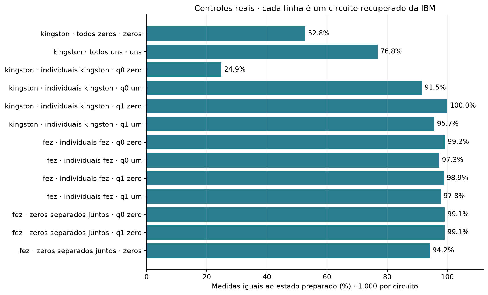

# Controles de estados conhecidos · resultados

Cada barra mostra a porcentagem de medidas iguais ao estado preparado, em 1.000 medidas. As linhas identificam teste, backend e circuito. Os controles incluem preparação e leitura.

| Arquivo | Conteúdo |
| --- | --- |
| [resultados_recuperados.json](resultados_recuperados.json) | Uma linha por circuito, com job, backend, contagens resumidas, indicadores e custo compilado. |

[Contagens e circuitos de origem](../../brutos/02_controles/README.md) · [Voltar](../README.md)
