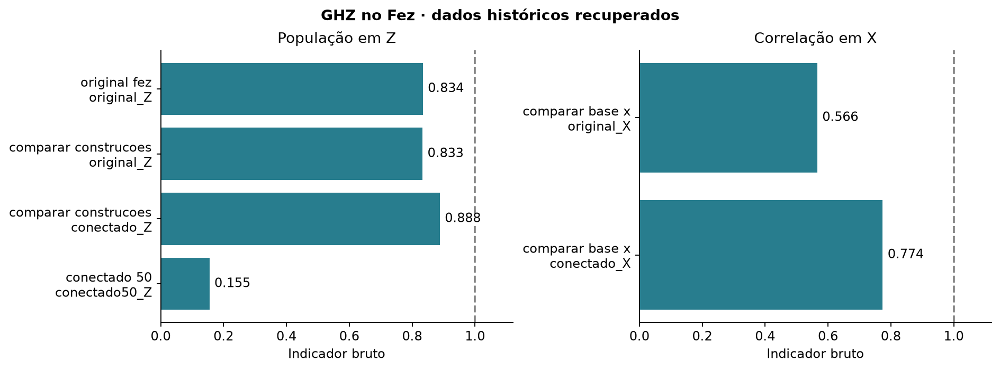

# Construções GHZ · resultados

O painel Z mostra PZ e o painel X mostra a correlação. Cada barra corresponde a um circuito real. A linha em 1 marca o ideal. A execução conectada de 50 qubits usa backend e data diferentes da série histórica de escala.

| Arquivo | Conteúdo |
| --- | --- |
| [resultados_recuperados.json](resultados_recuperados.json) | Uma linha por circuito, com job, backend, contagens resumidas, indicadores e custo compilado. |

[Contagens e circuitos de origem](../../brutos/03_ghz_conectado/README.md) · [Voltar](../README.md)
