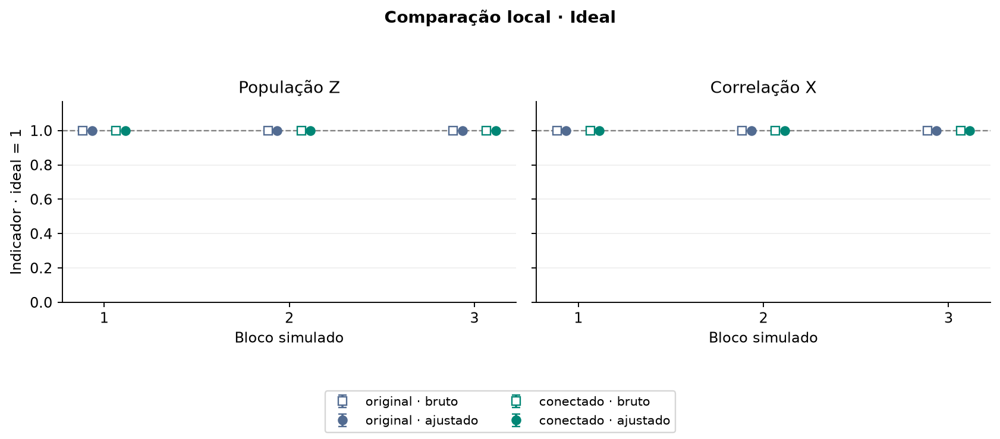
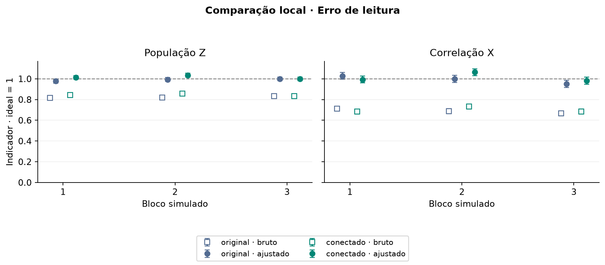
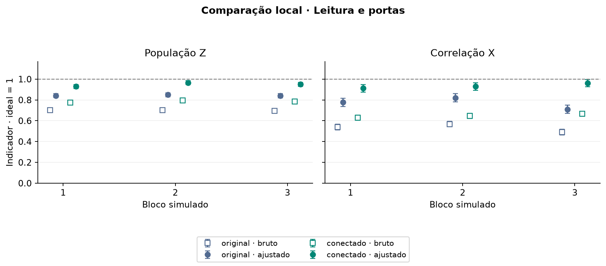

# Comparação de circuitos · todos os blocos

Cada gráfico apresenta os três blocos de um cenário. Quadrados vazios mostram os indicadores brutos; círculos preenchidos mostram os ajustados. Azul representa o circuito original, verde o conectado. As barras são um erro padrão e a linha em 1 marca o ideal.

## Circuitos ideais

## Erro de leitura

## Erro de leitura e portas

Cada circuito foi medido 1.000 vezes. Cada bloco usa sua própria calibração. Os indicadores ajustados podem ultrapassar 1 por flutuação da amostragem.

[Lista de arquivos e blocos](../validacao_2026_11_01/README.md) · [Modelo de ruído e sementes](../validacao_2026_11_01/manifesto.json)
