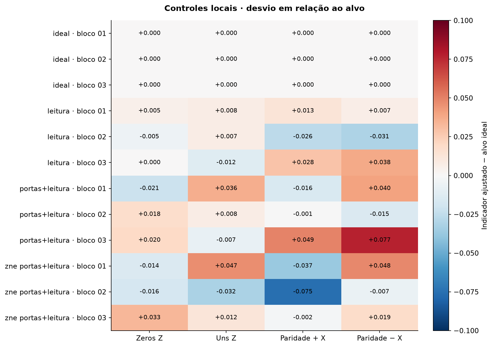

# Controles independentes · todos os blocos

Cada linha identifica um cenário e um bloco. Cada coluna corresponde a um controle. O número na célula é o indicador ajustado menos seu alvo ideal. Branco indica proximidade de zero, vermelho um desvio positivo e azul um negativo. Os alvos são 1 para zeros, uns e paridade positiva, e −1 para paridade negativa.

O gráfico mostra valores centrais. Os erros padrão e intervalos de cada controle estão no arquivo de análise do bloco. Os controles usam amostras independentes da calibração.

[Arquivos por cenário e bloco](../validacao_2026_11_01/README.md)
