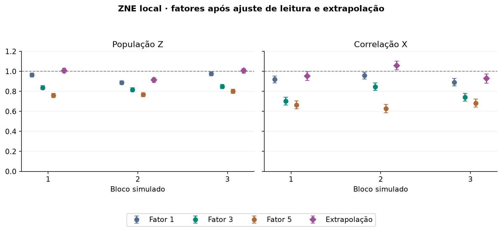
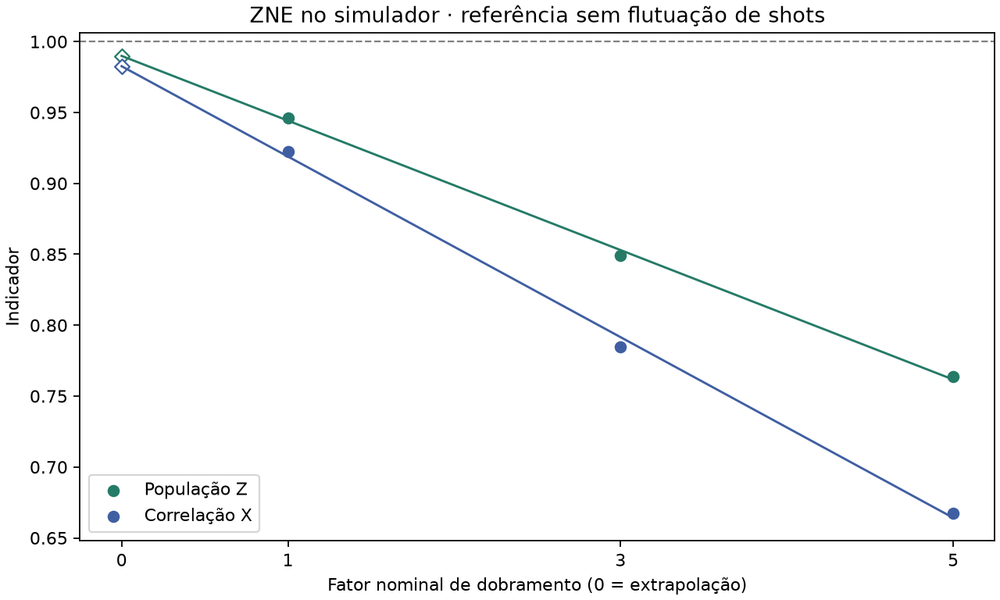

# ZNE · fatores e resultados dos três blocos

Simulamos versões do GHZ com 4, 12 e 20 portas CX. Elas correspondem aos fatores 1, 3 e 5. Os indicadores foram ajustados pela calibração da leitura e usados em uma extrapolação linear ao fator zero.

Cada grupo de pontos pertence a um bloco. Os círculos mostram os três fatores após mitigação da leitura. O losango é a extrapolação. As barras mostram um erro padrão; a linha em 1 marca o ideal. Estimativas podem ultrapassar 1. A incerteza acompanha a diferença entre blocos.

Esta segunda figura mostra o cálculo do modelo sem flutuação de shots. As previsões no fator zero são aproximadamente 0,9899 em Z e 0,9826 em X. A distância até o ideal indica o erro de aproximar a resposta por uma reta.

[Arquivos de cada bloco e resultados completos](../validacao_2026_11_01/README.md)
