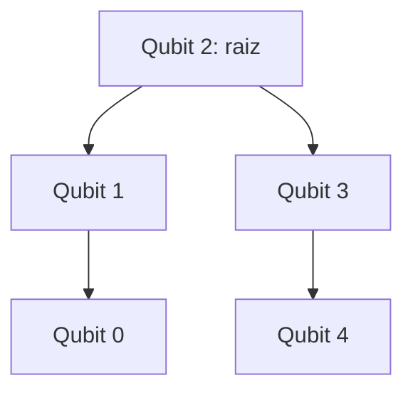

# 03. Construção, compilação e medidas em Z e X

[← Anterior](../02-fundamentos/README.md) · [Índice do livro](../../../../README.md) · [Próximo →](../04-mitigacao-leitura/README.md)

## Dois circuitos para o mesmo alvo

A construção original aplica H no qubit lógico 0 e CX de 0 para cada outro qubit. A conectada de cinco qubits aplica H em 2 e usa as conexões (2,1), (2,3), (1,0), (3,4). No modelo ideal, ambas produzem o mesmo GHZ positivo.

O desenho representa as interações da preparação, não a distribuição física completa do processador IBM.

## Compilação e roteamento

O circuito lógico diz o que queremos fazer. A compilação traduz isso para portas e conexões permitidas. Quando dois qubits lógicos precisam interagir sem uma ligação física direta, o compilador pode inserir roteamento, por exemplo com operações SWAP. O circuito continua implementando a intenção lógica, mas passa a usar mais operações físicas.

Contamos portas de dois qubits e profundidade porque ambas ajudam a caracterizar o custo da construção. Profundidade é o número de camadas de operações segundo as dependências do circuito; não é automaticamente tempo em segundos. No mapa sintético local não há durações de portas, e o manifesto registra a duração como ausente.

A construção conectada procura evitar operações extras. Isso é uma hipótese física razoável, mas uma comparação causal exige controlar backend, qubits, calibração, shots e condições de execução. Dois números obtidos em momentos diferentes não isolam perfeitamente o efeito da construção.

## Medição em Z

Medimos diretamente e calculamos

$$P_Z=\frac{N_{00000}+N_{11111}}{N}.$$

Se 895 de 1.000 resultados pertencem a esses dois estados, PZ = 0,895. Os outros 105 resultados correspondem a uma fração 0,105 fora dessa população. Não exigimos uma divisão exata entre zeros e uns em uma amostra finita.

## Medição em X

Aplicamos H em cada qubit antes da medição padrão. Isso permite medir X usando a leitura em Z. Um resultado com quantidade par de bits 1 recebe peso +1; um resultado ímpar recebe peso −1:

$$C_X=\langle X^{\otimes5}\rangle=\frac{N_{par}-N_{ímpar}}{N}.$$

Com 903 resultados pares e 97 ímpares, CX = 0,806. A fração de paridade par é $(1+C_X)/2=0,903$. Portanto, **correlação 0,806 não é 80,6% de resultados pares**.

No GHZ positivo ideal de cinco qubits, há 16 sequências de paridade par, cada uma com probabilidade 1/16 na base X. `11111` é ímpar; não tem o mesmo papel que na base Z.

## A ordem dos bits importa

Nas contagens usadas neste projeto, a representação textual é `c4 c3 c2 c1 c0`: o bit clássico 0 está à direita. `00001` corresponde a c0 = 1. Isso não implica que o qubit físico 0 sempre esteja associado a c0 após roteamento: precisamos consultar o mapeamento das medições. A [documentação de ordenação de bits do Qiskit](https://quantum.cloud.ibm.com/docs/en/guides/bit-ordering) distingue representação textual, índices e desenhos de circuitos.

Em `protocolo_local.py`, `medidas()` lê o mapa físico → clássico e `reordenar()` aplica esse mapa às probabilidades. A análise também permuta linhas e colunas da matriz de leitura. Uma matriz numericamente correta aplicada na ordem errada pode produzir uma correção física errada.

## Controles do protocolo novo

| Controle | Preparação e base | Resultado ideal da métrica |
| --- | --- | ---: |
| Zeros | `00000`, medido em Z | Probabilidade de `00000` = 1 |
| Uns | `11111`, medido em Z | Probabilidade de `11111` = 1 |
| Mais | Cinco $\lvert +\rangle$, medidos em X | Paridade = +1 |
| Menos | $\lvert −\rangle$ no qubit 0 e $\lvert +\rangle$ nos outros, medidos em X | Paridade = −1 |

Na ordem q4...q0, o último controle é `++++−`; o resultado ideal após a rotação de medida é `00001`. Esses controles têm contagens independentes das usadas na calibração. Eles também incluem preparação e mudança de base; no hardware, não são uma medição pura e isolada do erro de leitura.

**Ligação com o código:** a construção está em [protocolo_local.py](../../../../scripts/protocolo_local.py), e a versão histórica com escolha de raiz está em [comparar_construcoes.py](../../../../experimentos/03_ghz_conectado/comparar_construcoes.py).

---

[← Anterior](../02-fundamentos/README.md) · [Índice do livro](../../../../README.md) · [Próximo →](../04-mitigacao-leitura/README.md)
