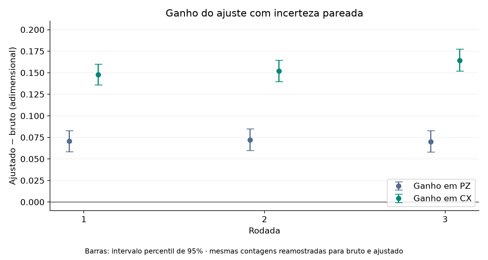

# 06. Incertezas, bootstrap e interpretação

[← Anterior](../05-experimentos-reais/README.md) · [Índice do livro](../../../../README.md) · [Próximo →](../07-simulacao-local/README.md)

## Três fontes de variação diferentes

Amostragem finita faz o resultado variar mesmo com hardware estável. Deriva do hardware muda as probabilidades ao longo do tempo. Um modelo inadequado pode introduzir viés sistemático. Nosso bootstrap representa principalmente a primeira fonte, condicionada ao modelo estimado; não inclui automaticamente as outras duas.

Para uma fração PZ estimada em N shots, o erro padrão binomial aproximado é

$$EP(P_Z)=\sqrt{P_Z(1-P_Z)/N}.$$

Para a média de uma variável de paridade que vale +1 ou −1:

$$EP(C_X)=\sqrt{(1-C_X^2)/N}.$$

Essas fórmulas ajudam a conferir o bootstrap dos valores brutos. O erro do valor ajustado também depende da calibração e da inversão; não é obtido simplesmente substituindo a probabilidade ajustada na fórmula binomial.

## Como o bootstrap funciona aqui

1. Usamos as frequências observadas como probabilidades de um modelo multinomial.
2. Sorteamos novas contagens para cada circuito de calibração, mantendo seus shots.
3. Sorteamos novas contagens GHZ.
4. Recalculamos a matriz, a solução ajustada e os indicadores.
5. Repetimos e medimos a dispersão das estimativas.

Na comparação das três rodadas reais são 5.000 réplicas por rodada, com sementes registradas. A análise originalmente salva na rodada 3 usava 300; ela permanece intacta. Na validação local são 2.000 por bloco. Portanto, pequenas diferenças entre erros padrão de relatórios antigos e novos não significam mudança das contagens reais.

## Ganho pareado e calibração compartilhada

O ganho é $\Delta=ajustado-bruto$. Como ambos vêm das mesmas medidas, não são independentes:

$$Var(\Delta)=Var(ajustado)+Var(bruto)-2Cov(ajustado,bruto).$$

Reutilizamos a mesma amostra GHZ dentro de cada réplica para calcular ambos. Na comparação local entre construções, os dois GHZ têm amostras separadas, mas compartilham a mesma calibração reamostrada. A mesma ideia vale para os fatores do ZNE. Somar erros como se tudo fosse independente perderia essas relações.

## Como ler ± e intervalos

Nas tabelas principais, `valor ± erro` significa **um erro padrão**. Não é um intervalo de confiança de 95%. Nos intervalos bootstrap usamos os percentis 2,5 e 97,5 das réplicas. Eles são intervalos individuais, sem correção para múltiplas comparações; não são garantia de que a probabilidade física real esteja dentro deles em um caso específico.

| Rodada | PZ ajustado ± EP | CX ajustado ± EP |
| --- | ---: | ---: |
| 1 | 0,9436 ± 0,0130 | 0,9440 ± 0,0235 |
| 2 | 0,9360 ± 0,0136 | 0,9481 ± 0,0228 |
| 3 | 0,9648 ± 0,0125 | 0,9702 ± 0,0229 |

Os intervalos individuais do ganho ficaram acima de zero nas seis combinações de rodada e indicador. Isso descreve o efeito do ajuste sob o modelo, não uma demonstração independente de que todo esse ganho veio exclusivamente do detector.

## Distância ao ideal e custo estatístico

A redução descritiva do desvio ao ideal é

$$R=1-\frac{|1-ajustado|}{|1-bruto|}.$$

Ela não é a fração de erros físicos eliminados. Por exemplo, diminuir a distância de 0,10 para 0,04 equivale a R = 60%, mas não identifica a origem desses desvios. A expressão também não é útil quando o denominador é zero.

Uma estimativa pode se aproximar do ideal e ficar mais incerta. Isso ocorre aqui: o ajuste amplifica parte da flutuação e acrescenta a incerteza da calibração. Não devemos apresentar apenas o valor central mais favorável.

## O que verificamos e o que não testamos

O script verifica nomes, bitstrings, shots, normalização, resíduo da inversão e concordância dos indicadores da rodada 3 com os salvos. Compara EP bruto bootstrap com a fórmula analítica usando tolerância relativa de 6%. Interrompe se uma calibração bootstrap ultrapassar o limite de condição usado; não seleciona silenciosamente réplicas favoráveis.

Não juntamos contagens de calibrações diferentes para fabricar uma única estimativa mais precisa. Não demonstramos tendência temporal com três execuções e datas incompletas. Também não foi realizado um estudo amplo de cobertura dos intervalos bootstrap. Para o código e os resultados completos, veja [comparar_rodadas.py](../../../../scripts/comparar_rodadas.py) e [comparacao_rodadas.json](../../../../dados/processados/comparacao_rodadas.json).

---

[← Anterior](../05-experimentos-reais/README.md) · [Índice do livro](../../../../README.md) · [Próximo →](../07-simulacao-local/README.md)
