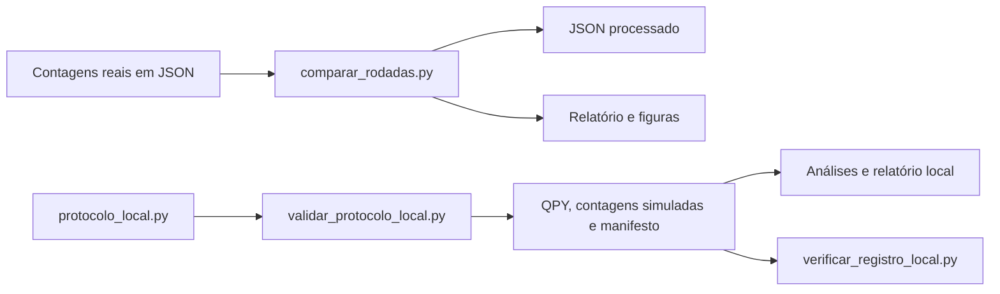

# 10. Guia do código e dicionário de dados

[← Anterior](../09-reproducao/README.md) · [Índice do livro](../../../../README.md) · [Próximo →](../11-historico-limites/README.md)

## Do dado ao relatório

## Responsabilidades do código local

| Arquivo | Funções principais e responsabilidades |
| --- | --- |
| [resumir_resultados.py](../../../../scripts/resumir_resultados.py) | `escala()` lê o texto histórico; `mitigacao()` calcula os dois JSONs históricos; `salvar()` escreve CSV |
| [comparar_rodadas.py](../../../../scripts/comparar_rodadas.py) | `carregar()` valida dados; `metricas()` calcula PZ/CX; `analisar()` inverte e reamostra; `graficos()` e `relatorio()` geram derivados |
| [protocolo_local.py](../../../../scripts/protocolo_local.py) | Circuitos, compilação, modelo de ruído, ordenação de bits, inversão e análise compartilhada |
| [validar_protocolo_local.py](../../../../scripts/validar_protocolo_local.py) | Organiza cenários/blocos, executa Aer, salva QPY/JSON, produz referência e relatório |
| [verificar_registro_local.py](../../../../scripts/verificar_registro_local.py) | Confere integridade e coerência dos registros concluídos |

Em `protocolo_local.py`, `preparacao()` constrói U; `ghz()` acrescenta dobramento e base; `circuitos()` agrega calibração e controles; `compilar()` adapta ao mapa sintético. `medidas()`, `reordenar()` e a permutação dentro de `analisar()` tratam o mapa físico/clássico. `ruido()` define canais; `referencia_exata()` calcula distribuições sem shots; `vetor()` valida contagens; `pesos()` escolhe o observável; `corrigir()` resolve a inversão; `intercepto()` calcula ZNE linear.

Os módulos novos têm proteção `if __name__ == '__main__'` nos pontos de entrada e não importam o cliente IBM. Os programas históricos de hardware não seguem todos essa separação. O [catálogo](../../../../experimentos/README.md) explica cada grupo.

## JSON real de mitigação

| Campo | Significado |
| --- | --- |
| `job_id` | Identificador do job IBM, não uma contagem ou senha |
| `backend` | Nome do equipamento registrado |
| `qubits` | Lista de qubits físicos |
| `shots_por_circuito` | Total esperado por circuito |
| `ordem_circuitos` | Ordem dos nomes associada aos resultados |
| `contagens` | Dicionário de circuito → bitstring → frequência inteira |
| `rodada`, timestamps e `versoes` | Metadados adicionais presentes na terceira rodada |
| `circuitos` e `opcoes` | Compilação e opções registradas na terceira rodada |
| `analise` | Análise originalmente salva, com 300 réplicas bootstrap na rodada 3 |

Os nomes `cal_00000` até `cal_11111` indicam a preparação de calibração. `GHZ_Z` e `GHZ_X` indicam base de medida. Uma chave ausente nas contagens pode representar zero ocorrências; ela não é necessariamente um dado faltante.

## Dados processados

`resumo_escala.csv` contém qubits, shots, zeros, uns, outros e PZ. `resumo_mitigacao.csv` contém apenas duas rodadas históricas, com indicadores, condição e menores quasiprobabilidades. `comparacao_rodadas.json` contém as três rodadas, sementes, hashes de origem, versões, valores centrais, EP, ganho, intervalo percentil e redução de distância ao ideal. O relatório arredonda valores para leitura; use o JSON para cálculo.

## Nomes dos arquivos simulados

Exemplo: `comparacao_leitura_e_portas_bloco_02_contagens.json`.

- `comparacao` distingue o protocolo de 40 circuitos do protocolo `zne` de 42.
- `leitura_e_portas` identifica o cenário; os demais são `ideal` e `leitura`.
- `bloco_02` identifica uma repetição com outra semente.
- `_contagens` contém o registro simulado; `_analise` contém resultados derivados.

No registro de contagens há origem, protocolo, cenário, bloco, sementes, shots, ordem e contagens. Na análise há condição da matriz, resultados por circuito e contrastes. Cada estimativa traz `valor`, `erro_padrao` e `ic95_percentil`. O campo `menor_quasi` informa o menor componente da distribuição ajustada.

## Manifesto, QPY e hashes

O manifesto registra o estado da execução, horários, versões, modelo, referências exatas, metadados dos circuitos e hashes. `comparacao.qpy` contém 40 circuitos e `zne.qpy` contém 42. Os mesmos circuitos são usados nos blocos; a ordem submetida ao simulador é embaralhada e registrada separadamente.

A auditoria confere os 26 arquivos listados em `arquivos`: 24 JSONs de contagens/análise e dois QPY. O manifesto não faz hash de si mesmo. `relatorio.md` e `verificacao.json` também não fazem parte dessa lista. Os hashes de fontes estão em outro campo, `fontes`; o auditor atual não os confere automaticamente. O Git registra esses documentos e códigos, mas isso é uma camada diferente da auditoria numérica.

Um hash SHA-256 permite detectar mudança de bytes em relação ao valor registrado. Ele não prova que a origem científica está correta ou que o código está livre de erros. A lista de fontes e os testes complementam a rastreabilidade.

## Documentos gerados e documentos editados à mão

`docs/comparacao_rodadas.md` é gerado por `comparar_rodadas.py`; o relatório de cada simulação é gerado pelo executor local. Uma edição manual nesses relatórios pode ser sobrescrita ao reproduzir. Este livro, os READMEs de pasta, o resumo para o orientador e o plano experimental são documentação editorial. Os dados brutos e manifestos concluídos devem ser preservados como registros.

---

[← Anterior](../09-reproducao/README.md) · [Índice do livro](../../../../README.md) · [Próximo →](../11-historico-limites/README.md)
