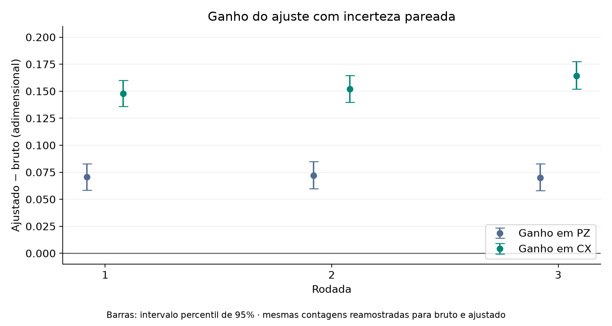

# Comparação das três rodadas de mitigação

Análise local de 1 de novembro de 2026. Os dados brutos permanecem intactos.

## Resultado principal

O ajuste aumenta PZ e CX nas três execuções disponíveis. Isso constitui evidência de repetibilidade do efeito do estimador neste conjunto de cinco qubits; não mede fidelidade completa nem demonstra eliminação dos erros de portas. A aproximação ao valor ideal não valida, por si só, o modelo de calibração.

## Proveniência e método

Cada rodada contém 32 circuitos de calibração e dois GHZ, com 1.000 shots cada: 34.000 por rodada e 102.000 no conjunto. Backend registrado: ibm_fez; qubits físicos 0–4. A numeração 1–2 identifica os dois arquivos históricos, sem inferir datas ausentes. Somente a rodada 3 registra data, versões e circuitos compilados. A equivalência exata das compilações históricas não pode ser auditada apenas com os JSONs.

As colunas de A são as frequências de leitura de cada estado de calibração. Resolvemos A q = p, sem recortar quasiprobabilidades negativas. PZ = p(00000) + p(11111); CX é a soma das probabilidades pares menos as ímpares em X. CX não é uma porcentagem de acertos.

Usamos 5,000 reamostragens multinomiais por rodada, com calibração e GHZ reamostrados. Bruto e ajustado usam o mesmo GHZ em cada réplica, preservando a covariância na diferença. As sementes e os hashes SHA-256 estão no JSON processado. As barras principais e os valores ± são um erro padrão, não intervalos de 95%. Os intervalos do ganho são percentis 2,5% e 97,5%, por comparação, sem ajuste para comparações múltiplas.

Essa análise substitui apenas a comparação derivada; os 300 bootstraps originalmente salvos na rodada 3 não foram alterados. Diferenças nos erros padrão decorrem da nova semente e do maior número de réplicas. O bootstrap representa incerteza de amostragem sob o modelo multinomial e não incorpora deriva, erros sistemáticos de preparação ou inadequação do modelo.

## Indicadores por rodada

| Rodada | PZ bruto ± EP | PZ ajustado ± EP | CX bruto ± EP | CX ajustado ± EP |
| --- | ---: | ---: | ---: | ---: |
| 1 | 0.8730 ± 0.0104 | 0.9436 ± 0.0130 | 0.7960 ± 0.0194 | 0.9440 ± 0.0235 |
| 2 | 0.8640 ± 0.0109 | 0.9360 ± 0.0136 | 0.7960 ± 0.0188 | 0.9481 ± 0.0228 |
| 3 | 0.8950 ± 0.0098 | 0.9648 ± 0.0125 | 0.8060 ± 0.0186 | 0.9702 ± 0.0229 |


## Ganho pareado

| Rodada | Indicador | Ganho | IC percentil 95% | Redução do desvio ao ideal |
| --- | --- | ---: | --- | ---: |
| 1 | populacao_z | 0.0706 | [0.0585; 0.0829] | 55.6% |
| 1 | correlacao_x | 0.1480 | [0.1359; 0.1600] | 72.5% |
| 2 | populacao_z | 0.0720 | [0.0599; 0.0849] | 52.9% |
| 2 | correlacao_x | 0.1521 | [0.1399; 0.1644] | 74.6% |
| 3 | populacao_z | 0.0698 | [0.0580; 0.0828] | 66.5% |
| 3 | correlacao_x | 0.1642 | [0.1519; 0.1775] | 84.7% |

A redução é 1 − |1 − ajustado| / |1 − bruto|, uma comparação descritiva de distância ao ideal; não é a fração de erros físicos eliminados. Todos os intervalos individuais do ganho ficam acima de zero nesta análise. Eles quantificam o efeito do ajuste sob o modelo, não um efeito causal isolado da leitura.



## Diagnósticos

| Rodada | Job | Condição de A (norma 2) | Menor quasi Z | Menor quasi X |
| --- | --- | ---: | ---: | ---: |
| 1 | `dbccq67i0auc73dumdk0` | 1.1992 | -0.00697 | -0.00215 |
| 2 | `dbccri9gv2cc73ea3630` | 1.2135 | -0.00491 | -0.00283 |
| 3 | `dbjnndgnceqs73akbkh0` | 1.2129 | -0.00787 | -0.00426 |

As matrizes não apresentam mau condicionamento numérico relevante nestas amostras. As quasiprobabilidades negativas são mantidas para não mudar o estimador. A incerteza dos valores ajustados é maior que a dos valores brutos: há um custo estatístico na inversão e na calibração finita.

## Alcance da conclusão

O ganho tem o mesmo sinal nas três rodadas. A terceira apresenta os maiores valores pontuais ajustados, mas três execuções não sustentam uma tendência temporal, e as duas primeiras não têm datas registradas. Não agregamos as contagens de diferentes calibrações nem usamos um erro combinado que pressuponha hardware estável.

Preparar os estados de calibração exige operações físicas; portanto A pode absorver erros de preparação. As portas de preparação do GHZ, as rotações para medir X e a perda de coerência continuam relevantes. PZ e CX são dois observáveis, não uma tomografia ou uma medida completa da fidelidade. Os resultados históricos de roteamento sem contagens salvas ficam fora desta comparação quantitativa.

## Reprodução e verificações

Da raiz do repositório:

```powershell
python -m venv .venv-analise
.venv-analise/Scripts/python -m pip install -r quantum-mitigation/requirements-analise.txt
.venv-analise/Scripts/python quantum-mitigation/scripts/comparar_rodadas.py
```

O script só lê JSONs locais e grava tabelas Markdown, JSON e figuras PNG/SVG. Valida nomes, bitstrings, totais e configuração; verifica normalização e resíduo da inversão; compara a rodada 3 com os indicadores salvos; confronta o erro padrão bruto com as fórmulas binomial e de paridade. Interrompe se houver matriz bootstrap instável; não descarta réplicas silenciosamente.

## Referência metodológica

O modelo de canal clássico de leitura e sua matriz de atribuição estão descritos no [tutorial oficial da IBM sobre mitigação de leitura](https://quantum.cloud.ibm.com/docs/en/tutorials/readout-error-mitigation-sampler). Aqui usamos inversão completa de 32 × 32, não o algoritmo M3 do tutorial.
