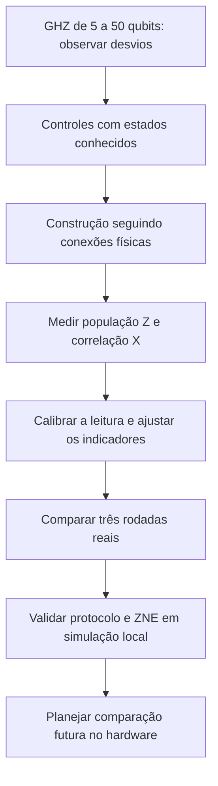

# 01. A pesquisa e o mapa do repositório

> Atualização de 2 de novembro de 2026: as contagens e os circuitos históricos das [etapas 2](../../../dados/brutos/02_controles/README.md) e [3](../../../dados/brutos/03_ghz_conectado/README.md) foram recuperados diretamente da IBM. Referências abaixo à ausência desses arquivos descrevem o estado anterior da importação.

[Índice do livro](../../../README.md) · [Próximo →](../02-fundamentos/README.md)

## O que estamos tentando descobrir

O projeto estuda circuitos GHZ, cujo comportamento ideal é conhecido. Eles funcionam como referência para observar desvios do hardware e avaliar duas intervenções: mudar a construção do circuito e ajustar estatisticamente a leitura. A pergunta é: **quanto dos desvios nos indicadores do GHZ diminui com essas intervenções, e com qual incerteza?**

O trabalho tem duas frentes. A mitigação compara construções e estimadores. A [modelagem](../../../../quantum-modeling/README.md) compara resultados reais com distribuições de simuladores ruidosos. Um modelo tenta reproduzir o equipamento; uma mitigação tenta melhorar uma estimativa. As duas atividades podem se ajudar, mas não são a mesma coisa.

## O percurso da pesquisa

O diagrama representa a sequência de perguntas. Não significa que todos os passos tenham o mesmo nível de documentação experimental.

## Como distinguir as evidências

| Tipo | O que significa neste projeto | Exemplo |
| --- | --- | --- |
| Medida real registrada | Há contagens e contexto de um job IBM | As três rodadas de mitigação |
| Resultado histórico com contexto parcial | Há contagens, mas faltam alguns metadados | Texto de GHZ de 5 a 50 qubits |
| Relato histórico | Um número foi registrado na conversa, sem seu arquivo bruto recuperado | Comparação anterior de 13 contra 4 portas |
| Código preservado | Existe um programa, sem todos os resultados correspondentes disponíveis | GHZ conectado de 50 qubits |
| Simulação local | As contagens foram geradas por um modelo no PC | Os 12 blocos de validação |
| Proposta | Há protocolo e orçamento, mas ainda não foi executado no hardware | Comparação futura de 120.000 medidas |

Essa classificação evita confundir um programa escrito com um experimento concluído. Também evita atribuir ao hardware o que aconteceu apenas no simulador.

## Mapa das pastas

| Local | Papel |
| --- | --- |
| [experimentos](../../../experimentos/README.md) | Scripts históricos de circuitos e de acesso à IBM |
| [scripts](../../../scripts/README.md) | Processamento, comparação, simulação e auditoria |
| [dados](../../../dados/README.md) | Brutos, derivados e simulados separados |
| [figuras](../../../figuras/README.md) | Gráficos da comparação das três rodadas |
| [tests](../../../tests/README.md) | Verificações automatizadas da implementação local |
| [docs](../../README.md) | Livro, relatórios, registros e planejamento |

## Situação em 2 de novembro de 2026

Temos três rodadas de mitigação reais concluídas, 102.000 shots nesse conjunto, análise comparativa e uma validação local de 486.000 shots simulados. O piloto de ZNE foi executado somente no PC. A branch de trabalho é `mitigation`; os seis commits até `8ff5086` foram publicados nela. A revisão documental deste livro é posterior a esses resultados.

As duas primeiras rodadas não possuem a mesma riqueza de metadados da terceira. A evidência de melhoria deve ser apresentada com esse limite. Nenhuma conclusão aqui transforma os modelos sintéticos em uma caracterização atual do IBM Fez.

**Ao terminar este capítulo:** identifique, em qualquer tabela, se a origem é hardware, simulação ou relato histórico antes de interpretar os números.

---

[Índice do livro](../../../README.md) · [Próximo →](../02-fundamentos/README.md)
