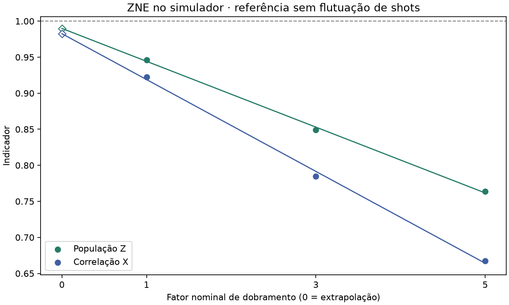

# Mitigação de ruído em circuitos quânticos: comparação de técnicas usando o estado GHZ como referência

> **Relatório em formato de artigo, rascunho de 2 de novembro de 2026.** Este relatório reúne a pesquisa em formato de artigo; o repositório ([visão geral](../README.md)) é a referência que o sustenta. Autoria, orientação e instituição: *a preencher.* Novas técnicas e circuitos entram como experimentos numerados (ver [seção 5](#5-conclusão-e-trabalhos-futuros)).
> A modelagem de ruído é uma frente separada, de João Paulo, em [quantum-modeling](../../quantum-modeling/README.md).

## Em uma tela

- **Pergunta.** Quanto cada técnica de mitigação aproxima os resultados de um circuito quântico do valor ideal, e a que custo?
- **Referência.** O estado GHZ de cinco qubits, porque conhecemos sua resposta ideal. Medimos dois indicadores, **PZ** e **CX**, que valem 1 no caso ideal.
- **Resultado principal.** No IBM Fez, a calibração de leitura aproximou PZ e CX do ideal nas três rodadas (PZ de 0,895 para 0,965 na rodada 3). Uma construção do circuito com menos portas também melhorou os indicadores brutos.
- **Limite principal.** O ajuste de leitura não desfaz o erro das portas, e a extrapolação a ruído zero só foi testada em simulação. As técnicas não podem ainda ser ordenadas entre si.

## Resumo

Computadores quânticos atuais devolvem resultados que se afastam dos ideais por causa do ruído. Técnicas de mitigação estimam o resultado correto sem corrigir o equipamento. Usamos o estado GHZ como referência, com dois indicadores: a população em Z (PZ) e a correlação em X (CX). Em hardware da IBM, PZ caiu de 0,922 para 0,109 quando o GHZ cresceu de 5 para 50 qubits. Em cinco qubits, uma construção que segue as conexões físicas reduziu as portas de dois qubits de 13 para 4 e elevou PZ de 0,833 para 0,888 e CX de 0,566 para 0,774. A calibração de leitura, em três rodadas, aproximou os indicadores do ideal em 0,070 a 0,072 (PZ) e 0,148 a 0,164 (CX). Em simulação com ruído conhecido, a calibração recuperou a distribuição anterior à leitura, mas não o erro das portas, e a extrapolação a ruído zero levou PZ de 0,9463 a 0,9899 no cálculo exato, com maior incerteza.

**Palavras-chave:** mitigação de erros quânticos; estado GHZ; erro de leitura; extrapolação a ruído zero; IBM Quantum.

## 1. Introdução

Um circuito executado em hardware real produz distribuições diferentes das previstas. A diferença vem de várias fontes de ruído ([fundamentos/ruido.md](../fundamentos/ruido.md)). Uma sequência como `00001`, quando esperávamos `00000`, não diz se o desvio surgiu na preparação, nas portas ou na leitura. Técnicas diferentes atacam fontes diferentes.

Começamos pelo GHZ porque ele permite medir o desvio, aplicar uma técnica e medir de novo com a mesma régua. Quando uma técnica estiver caracterizada, repetiremos a comparação em outros circuitos, definindo para cada um o resultado ideal e o indicador ([fundamentos/indicadores.md](../fundamentos/indicadores.md)).

| Técnica | Fonte que ataca | Situação |
| --- | --- | --- |
| Construção com menos portas | Portas, decoerência | Medida na IBM |
| Calibração de leitura | Leitura | Medida na IBM |
| Extrapolação a ruído zero (ZNE) | Portas | Simulada |
| Twirling, desacoplamento dinâmico, PEC | Ruído coerente, decoerência, portas | Planejadas |

Mitigação não é correção de erros: busca estimativas melhores de valores esperados, sem qubits adicionais. Descrição das técnicas e referências: [tecnicas.md](../fundamentos/tecnicas.md) e [referencias.md](../fundamentos/referencias.md).

## 2. Método

**Indicadores.** O GHZ ideal produz só `00000` ou `11111` em Z.

- **PZ** = (contagem de `00000` + contagem de `11111`) / total de shots.
- **CX** = fração de sequências com número par de bits 1 − fração com número ímpar, medida após girar a base para X. Uma mistura clássica de `00000` e `11111` daria CX = 0, então CX distingue o GHZ dessa mistura.

Os dois indicadores **não determinam a fidelidade** do estado. Exemplos com contas: [indicadores.md](../fundamentos/indicadores.md).

**Experimentos.** Cada um tem uma pasta com pergunta, método, conta, resultado e limites.

| # | Experimento | Onde | Backend e data |
| --- | --- | --- | --- |
| 1 | [Escala do GHZ, 5 a 50 qubits](../experimentos/01_ghz_escala/README.md) | IBM | não registrados |
| 2 | [Controles de estados conhecidos](../experimentos/02_controles/README.md) | IBM | Kingston e Fez, 20 e 21 out. 2026 |
| 3 | [Construção com menos portas](../experimentos/03_ghz_conectado/README.md) | IBM | Fez, 21 out. 2026 |
| 4 | [Calibração de leitura, 3 rodadas](../experimentos/04_mitigacao_leitura/README.md) | IBM | Fez, rodada 3 em 1º nov. 2026 |
| 5 | [Validação simulada](../experimentos/05_validacao_simulada/README.md) | PC | modelo sintético |
| 6 | [ZNE simulada](../experimentos/06_zne_simulado/README.md) | PC | modelo sintético |

**Intervenções.**

- *Construção.* O GHZ original liga o qubit 0 a todos os outros. A construção conectada usa uma árvore com raiz no qubit 2 (ligações 2→1, 2→3, 1→0, 3→4). O estado ideal é o mesmo.
- *Calibração de leitura.* Em cada rodada, preparamos as 32 sequências de cinco bits e medimos como cada uma foi registrada. As frequências formam uma matriz **A**. Com **p** as frequências observadas do GHZ, resolvemos **A q = p** e calculamos PZ e CX de **q**.
- *ZNE.* Em simulação, três versões do GHZ conectado com 4, 12 e 20 portas CX (fatores 1, 3 e 5). Ajustamos uma reta aos indicadores e lemos o valor no fator 0.

**Incerteza.** *Bootstrap* com 5.000 réplicas por rodada, refazendo todo o cálculo. Cobre só a variação de amostragem dentro de uma rodada. Entre dois circuitos simples usamos o erro padrão analítico.

**Simulação.** Qiskit Aer, com parâmetros **sintéticos** de ruído, e a referência exata do modelo, sem flutuação de shots. Parâmetros no [experimento 5](../experimentos/05_validacao_simulada/README.md#como-foi-feito).

**Reprodução.** As tabelas são geradas dos dados por `scripts/gerar_tabelas.py`. **Os programas das pastas de experimento 1 a 4 enviam jobs à IBM quando executados.** Comandos seguros: [scripts/README.md](../scripts/README.md).

## 3. Resultados

**3.1 Escala (exp. 1).** PZ caiu de 0,922 (5 qubits) para 0,109 (50 qubits). O experimento não separa o efeito do número de qubits do de portas e roteamento.

*Figura 1. Fração das 1.000 medidas que deram todos zeros ou todos uns.*

**3.2 Controles (exp. 2).** Em estados simples, os qubits 0 e 1 isolados acertaram 97,3% a 99,2% no Fez. No Kingston, o qubit 0 preparado em `0` devolveu `0` em só 24,9% das medidas, e o qubit 1 acertou todas. Os dados não permitem atribuir causa.

**3.3 Construção (exp. 3).** O original ficou com 13 portas de dois qubits e profundidade 35. O conectado, com 4 portas e profundidade 13. Valores brutos, sem correção de leitura.

**Tabela 1. Diferenças entre construções, em erros padrão de amostragem.**

<!-- TABELA:construcoes_testes -->
| Comparação | Indicador | Primeiro | Segundo | Diferença | EP da diferença | Diferença em EP |
| --- | --- | ---: | ---: | ---: | ---: | ---: |
| Mesmo circuito original em dois jobs | PZ | 0,834 | 0,833 | -0,001 | 0,017 | -0,1 |
| Conectado menos original, base Z | PZ | 0,833 | 0,888 | 0,055 | 0,015 | 3,6 |
| Conectado menos original, base X | CX | 0,566 | 0,774 | 0,208 | 0,033 | 6,3 |
<!-- /TABELA:construcoes_testes -->

A primeira linha é um controle: o mesmo circuito em dois jobs deu valores praticamente iguais. As duas diferenças entre construções ficam acima de 3 erros padrão.

**3.4 Calibração de leitura (exp. 4).** Cada rodada teve 34 circuitos de 1.000 shots (102.000 medidas no total). Na rodada 3, `00000` apareceu 454 vezes e `11111`, 441 vezes. Então PZ bruto = (454 + 441)/1.000 = 0,895. O valor ajustado, 0,9648, foi calculado a partir das mesmas contagens.

**Tabela 2. PZ e CX brutos e ajustados.**

<!-- TABELA:rodadas -->
| Rodada | PZ bruto → ajustado | CX bruta → ajustada |
| ---: | --- | --- |
| 1 | 0,8730 → 0,9436 | 0,7960 → 0,9440 |
| 2 | 0,8640 → 0,9360 | 0,7960 → 0,9481 |
| 3 | 0,8950 → 0,9648 | 0,8060 → 0,9702 |
<!-- /TABELA:rodadas -->

*Figura 2. Indicadores brutos e ajustados, com um erro padrão.*

Nas três rodadas os indicadores ficaram mais próximos de 1, e os seis intervalos de 95% do ganho ficam acima de zero. O ajuste aumenta o erro padrão.

**3.5 Validação simulada (exp. 5).** No simulador escolhemos o erro e calculamos a referência exata.

**Tabela 3. Indicadores do modelo antes e depois da leitura.**

<!-- TABELA:cenarios -->
| Cenário | Construção | PZ antes da leitura | PZ após a leitura | CX antes da leitura | CX após a leitura |
| --- | --- | ---: | ---: | ---: | ---: |
| Ideal | original | 1,0000 | 1,0000 | 1,0000 | 1,0000 |
| Ideal | conectado | 1,0000 | 1,0000 | 1,0000 | 1,0000 |
| Só leitura | original | 1,0000 | 0,8366 | 1,0000 | 0,6957 |
| Só leitura | conectado | 1,0000 | 0,8366 | 1,0000 | 0,6957 |
| Leitura e portas | original | 0,8409 | 0,7065 | 0,7690 | 0,5350 |
| Leitura e portas | conectado | 0,9463 | 0,7924 | 0,9224 | 0,6417 |
<!-- /TABELA:cenarios -->

Com erro só na leitura, a calibração recupera PZ = 1. Com erro também nas portas, o valor recuperável é o que chega à leitura: 0,8409 (original) ou 0,9463 (conectado).

**3.6 ZNE simulada (exp. 6).** A extrapolação aproximou PZ e CX de 1 sem chegar a 1: o ajuste linear tem viés. Com 1.000 shots, o erro padrão aumentou nos três blocos.

*Figura 3. Círculos: fatores 1, 3 e 5. Losangos: extrapolação ao fator 0. Tracejado: ideal.*

**3.7 Síntese.** As condições diferem, então **não é um ranking**.

<!-- TABELA:sintese -->
| Técnica | Onde | Variação nos indicadores | Custo |
| --- | --- | --- | --- |
| Construção com menos portas | IBM Fez, valores brutos | PZ +0,055; CX +0,208 | 9 portas CX a menos (13 → 4); nenhum shot extra |
| Calibração de leitura | IBM Fez, 3 rodadas | PZ +0,070 a +0,072; CX +0,148 a +0,164 | 32 circuitos de calibração por rodada; erro padrão maior |
| Extrapolação a ruído zero | Simulação, referência exata | PZ 0,9463 → 0,9899 (fator 1 → extrapolado) | 3 versões do circuito, até 20 CX; erro padrão maior; viés da reta |
<!-- /TABELA:sintese -->

## 4. Discussão

**Os dados sustentam** que, em cinco qubits no Fez, a calibração de leitura aproximou PZ e CX do ideal nas três rodadas, que a construção com menos portas teve indicadores brutos melhores (mais de 3 erros padrão), e que, no modelo simulado, a calibração compensa a leitura e o erro das portas permanece.

**Os dados não sustentam** a eliminação do erro das portas, a fidelidade do estado, o efeito isolado da leitura (a calibração também incorpora erros de preparação), uma ordem entre as técnicas, nem resultados para outros circuitos ou mais qubits (a matriz completa cresce como 2ⁿ × 2ⁿ).

**Limitações.**

1. **Backends e datas.** Os experimentos 2 a 4 usam equipamentos e dias diferentes. O GHZ conectado de 50 qubits (Fez) **não é comparável** à série de escala (código para Kingston).
2. **Poucas repetições.** Três rodadas, três blocos simulados, um job por comparação no experimento 3. O bootstrap não inclui deriva do equipamento entre dias.
3. **Quasiprobabilidades.** Estimativas ajustadas podem ter componentes negativas ou indicadores acima de 1. Não as recortamos.
4. **Modelo sintético.** As magnitudes da simulação não valem para o Fez. A auditoria registra um desvio de até 3,2 erros padrão em relação ao modelo exato, com critério amplo de sanidade, que não é teste de cobertura.
5. **ZNE.** A extrapolação linear tem viés e amplia a incerteza.

## 5. Conclusão e trabalhos futuros

O GHZ de cinco qubits serviu de referência para três técnicas. A calibração de leitura e a construção com menos portas melhoraram os indicadores medidos na IBM, e a simulação mostrou que elas atuam em fontes de ruído diferentes.

**Próximos passos propostos** (nada foi executado em hardware; detalhes em [planejamento.md](planejamento.md)):

1. O protocolo do experimento 5 na IBM: três blocos de 40 circuitos, cada um com sua calibração (120.000 medidas). Depende de decisão específica.
2. Piloto de ZNE na IBM (126.000 medidas).
3. Mais qubits, comparando um modelo de leitura escalável com a matriz completa em cinco qubits.
4. Twirling, desacoplamento dinâmico e PEC no GHZ.
5. Outros circuitos, depois de caracterizar as técnicas no GHZ.

**Como acrescentar uma etapa.** Copie o [molde de experimento](../experimentos/README.md#molde-de-um-experimento), defina pergunta, indicador, controle e critério de sucesso antes de executar, guarde as contagens em `dados/` e acrescente uma linha na tabela de experimentos da [seção 2](#2-método) e em [tecnicas.md](../fundamentos/tecnicas.md).

## Referências e mapa

Referências completas, com links verificados: [referencias.md](../fundamentos/referencias.md). Principais: Greenberger, Horne e Zeilinger (1989); Bravyi et al. (2021); Temme, Bravyi e Gambetta (2017); Giurgica-Tiron et al. (2020); Wallman e Emerson (2016); Viola, Knill e Lloyd (1999); van den Berg et al. (2023).

| Pasta | Conteúdo |
| --- | --- |
| [fundamentos](../fundamentos/README.md) | Ruído, técnicas, indicadores e referências. |
| [experimentos](../experimentos/README.md) | Um README por experimento e os programas históricos. |
| [dados](../dados/README.md) | Contagens da IBM, resultados processados e simulados. |
| [scripts](../scripts/README.md) · [tests](../tests/README.md) · [figuras](../figuras/README.md) | Análise, testes e gráficos. |
| [docs](README.md) | Este relatório, o planejamento e relatórios de apoio. |
