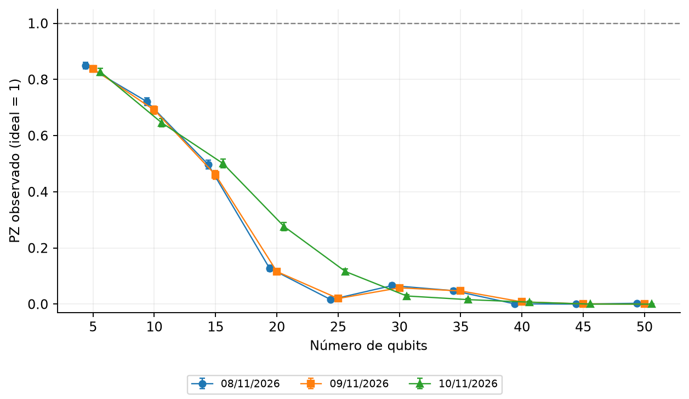

# Experimento 1 · Como o erro cresce de 5 a 50 qubits?

**Estado:** executado em 3 sessões, nos dias 8, 9 e 10 de novembro de 2026, no `ibm_fez`. Cada circuito foi medido 1.000 vezes por sessão. O job e a hora de cada sessão estão em `dados/*/ficha.json`.

## Resposta curta

O GHZ original **some entre 15 e 25 qubits**. Com 5 qubits, de 83% a 85% das medidas dão `00000` ou `11111`. Com 20, de 12% a 28%. De 40 qubits em diante, quase nenhuma. O padrão se repetiu nos três dias, mas **o tamanho do estrago muda de um dia para o outro**.

## Pergunta

Um GHZ ideal só produz `00…0` ou `11…1` ([GHZ](../../fundamentos/circuitos/ghz.md)). Que fração das medidas cai nesses dois resultados quando o número de qubits aumenta? É o ponto de partida: mede o erro **antes** de qualquer técnica de mitigação.

## Como foi feito

- **Circuito:** GHZ original (H e uma CX do qubit de menor número para todos os outros), medido em Z.
- **Tamanhos:** de 5 a 50 qubits, de 5 em 5 (10 circuitos). Com 5 qubits, os qubits físicos 0 a 4. Com mais, a busca parte do qubit 2 e junta qubits vizinhos.
- **Indicador:** **PZ**, a fração das medidas que deram todos zeros ou todos uns. Vale 1 no caso ideal ([indicadores](../../fundamentos/indicadores.md)). É um valor **observado**, sem nenhuma correção.
- **Erro padrão:** só o da amostragem, de 1.000 medidas por circuito.
- **Custo:** 10 circuitos × 1.000 = 10.000 medidas por sessão, 30.000 nas 3 sessões.
- **Critério (definido antes de rodar):** não há hipótese a testar. Mostramos o PZ de cada tamanho em cada sessão, lado a lado.

## Resultado

**PZ observado**, em cada tamanho e em cada sessão:

<!-- TABELA:sessoes -->
| Item | Indicador | 2026-11-08_ibm_fez | 2026-11-09_ibm_fez | 2026-11-10_ibm_fez |
| --- | --- | ---: | ---: | ---: |
| GHZ original, 5 qubits, base Z | PZ | 0,8500 | 0,8380 | 0,8270 |
| GHZ original, 10 qubits, base Z | PZ | 0,7210 | 0,6910 | 0,6460 |
| GHZ original, 15 qubits, base Z | PZ | 0,4970 | 0,4600 | 0,5010 |
| GHZ original, 20 qubits, base Z | PZ | 0,1280 | 0,1160 | 0,2760 |
| GHZ original, 25 qubits, base Z | PZ | 0,0160 | 0,0200 | 0,1160 |
| GHZ original, 30 qubits, base Z | PZ | 0,0660 | 0,0580 | 0,0290 |
| GHZ original, 35 qubits, base Z | PZ | 0,0480 | 0,0470 | 0,0160 |
| GHZ original, 40 qubits, base Z | PZ | 0,0010 | 0,0080 | 0,0070 |
| GHZ original, 45 qubits, base Z | PZ | 0,0000 | 0,0010 | 0,0000 |
| GHZ original, 50 qubits, base Z | PZ | 0,0030 | 0,0000 | 0,0000 |
<!-- /TABELA:sessoes -->

*Cada ponto é o PZ de um circuito em uma sessão, com um erro padrão. Cada cor e forma é um dia. Linha tracejada: o valor ideal, 1.*

O compilador entregou **o mesmo circuito nas três sessões**: mesmos qubits físicos, mesma profundidade e mesmo número de portas de dois qubits (13 em 5 qubits, 97 em 20 e 304 em 50, segundo as fichas). A diferença entre os dias não vem do circuito.

## Conclusão

1. **O PZ cai com o tamanho.** Em 5 qubits fica entre 0,827 e 0,850. Em 15, entre 0,460 e 0,501. Em 20, entre 0,116 e 0,276. De 40 qubits em diante, é no máximo 0,008.
2. **O GHZ de 50 qubits não aparece:** em 1.000 medidas, no máximo 3 deram todos zeros ou todos uns. Esse tamanho não serve de base para mitigação com este circuito.
3. **O estrago muda de um dia para o outro, mais do que o erro padrão indica.** Em 20 qubits, o PZ foi 0,128 e 0,116 nos dias 8 e 9, e 0,276 no dia 10; em 25 qubits, 0,016, 0,020 e 0,116. O erro padrão desses pontos é de cerca de 0,01. Não sabemos o motivo: os dados não mostram.
4. **A queda nem sempre é regular.** Nos dias 8 e 9, o PZ em 30 qubits (0,066 e 0,058) ficou **acima** do de 25 (0,016 e 0,020), diferença de vários erros padrão. No dia 10 a queda foi contínua. Também sem causa identificada.

**Limites.**
- É um único computador, e só três dias seguidos.
- O erro padrão cobre só a amostragem. A variação entre dias, vista acima, é maior.
- Com 25 qubits ou mais, a conferência do estado ideal não é feita (coluna `ideal` do ensaio). O indicador PZ continua valendo.

## Próximo passo

Montar o mesmo GHZ com menos portas ajuda? É o [experimento 3](../03_construcao/README.md), que compara a construção original com a conectada em 5, 10 e 20 qubits.

## Arquivos

| Arquivo | Para que serve |
| --- | --- |
| `experimento.py` | A receita: circuito, tamanhos, computador e número de sessões. |
| `dados/AAAA-MM-DD_ibm_fez/` | Uma pasta por sessão: ficha (job, hora, qubits, opções, versões), circuitos e contagens. **Não se edita.** |
| `resultados/` | `resultados.json` (todos os números), `tabelas.md` e `escala.png`. Refeitos com `python rodar.py 01 --analisar`. |

**Execução:** `python rodar.py 01 --enviar` **envia jobs à IBM**, depois de você digitar a confirmação.

[Experimentos](../README.md)
