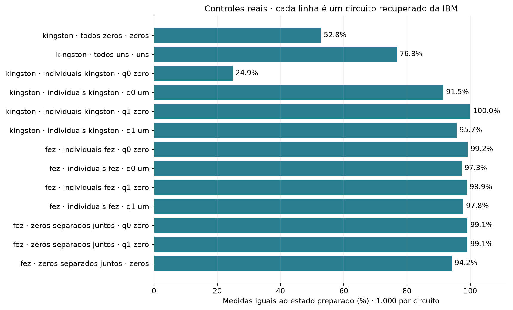

# Experimento 2 · O computador acerta o que é fácil?

**Onde e quando:** IBM, nos computadores `ibm_kingston` e `ibm_fez`, em 20 e 21 de outubro de 2026. Cada pedido foi repetido 1.000 vezes. As contagens foram recuperadas da conta IBM em 2 de novembro de 2026 ([registro de origem](../../dados/registro_origem.json)).

## Resposta curta

Mesmo nos testes mais fáceis, **o computador erra**, e o tamanho do erro **muda de um computador para outro e de um dia para o outro**. Isso mostra que parte do erro do experimento 1 não vem de o circuito ser complicado.

## Pergunta

Se eu peço ao computador um resultado que já conheço, ele devolve esse resultado? Por exemplo: "deixe os 5 qubits em 0 e me diga o que você vê". A resposta certa é `00000`, sempre. Um pedido desse tipo, em que sabemos a resposta, se chama **controle**. Aqui não tem GHZ: só pedir e ler.

No experimento 1 o erro crescia com o tamanho do circuito, mas não dava para saber se a causa era a complicação do circuito. Se o computador já erra no simples, existe uma parte do erro que é mais básica. Este teste mistura dois passos, **preparar** o qubit e **ler** o resultado, e não diz qual dos dois falhou.

## Como foi feito

Quatro pedidos. Em todos, contamos quantas vezes, em 1.000, o computador respondeu o que pedimos.

| Pedido | O que foi feito | Programa |
| --- | --- | --- |
| Cinco qubits em 0 | Não faz nada nos 5 qubits e lê. Resposta certa: `00000`. | `todos_zeros.py` |
| Cinco qubits em 1 | Inverte os 5 qubits (porta X) e lê. Resposta certa: `11111`. | `todos_uns.py` |
| Um qubit por vez | Os qubits 0 e 1, cada um pedido em 0 e em 1, um de cada vez. | `qubits_individuais.py` |
| Sozinhos e juntos | Qubit 0 sozinho, qubit 1 sozinho e os cinco juntos, no mesmo envio. | `comparar_zeros.py` |

## Resultado

### Teste 1: cinco qubits parados

<!-- TABELA:cinco_parados -->
| Computador | Dia | O que pedi | Quantas vezes acertou |
| --- | --- | --- | ---: |
| ibm_kingston | 20/10/2026 | `00000` | 528 de 1.000 |
| ibm_kingston | 20/10/2026 | `11111` | 768 de 1.000 |
| ibm_fez | 21/10/2026 | `00000` | 942 de 1.000 |
<!-- /TABELA:cinco_parados -->

Quanto mais perto de 1.000, melhor. O Kingston acertou pouco, em especial pedindo `00000`; o Fez acertou quase tudo.

### Teste 2: um qubit por vez

<!-- TABELA:um_qubit -->
| Computador | Dia | Qubit | O que pedi | Quantas vezes acertou |
| --- | --- | ---: | --- | ---: |
| ibm_kingston | 21/10/2026 | 0 | `0` | 249 de 1.000 |
| ibm_kingston | 21/10/2026 | 0 | `1` | 915 de 1.000 |
| ibm_kingston | 21/10/2026 | 1 | `0` | 1.000 de 1.000 |
| ibm_kingston | 21/10/2026 | 1 | `1` | 957 de 1.000 |
| ibm_fez | 21/10/2026 | 0 | `0` | 992 de 1.000 |
| ibm_fez | 21/10/2026 | 0 | `1` | 973 de 1.000 |
| ibm_fez | 21/10/2026 | 1 | `0` | 989 de 1.000 |
| ibm_fez | 21/10/2026 | 1 | `1` | 978 de 1.000 |
<!-- /TABELA:um_qubit -->

No Fez, todos os pedidos ficam entre 97% e 99% de acerto. No Kingston, o **qubit 0 pedido em 0 acertou menos de 1 vez em cada 4**, enquanto o qubit 1 acertou todas.

*Cada barra é um teste (computador, qubits e o que foi pedido), e mostra a porcentagem de acertos. Quanto mais longa, melhor.*

### O mesmo computador, em dois dias

No Kingston, olhamos só os qubits 0 e 1 pedidos em 0, e quantas vezes cada um respondeu `1`, o que está errado:

<!-- TABELA:kingston_dias -->
| Dia | Teste | Qubit 0 respondeu 1 | Qubit 1 respondeu 1 |
| --- | --- | ---: | ---: |
| 20/10/2026 | cinco qubits juntos | 318 de 1.000 | 211 de 1.000 |
| 21/10/2026 | cada qubit sozinho | 751 de 1.000 | 0 de 1.000 |
<!-- /TABELA:kingston_dias -->

São os mesmos qubits e o comportamento mudou. O qubit 1 passou de errar cerca de 1 vez em cada 5 para não errar nenhuma. Nos testes dos cinco qubits do dia 20, os qubits 2, 3 e 4 quase não erraram; o problema estava concentrado nos dois primeiros.

### Medir cinco qubits juntos piora a leitura? (Fez)

Se medir juntos não atrapalhasse, os cinco juntos deveriam acertar tanto quanto cada qubit sozinho, elevado à quinta potência. Comparamos com o que foi medido:

<!-- TABELA:cinco_conta -->
| Fez, 21/10/2026 | Quantas vezes acertou |
| --- | ---: |
| Qubit 0 medido sozinho | 991 de 1.000 |
| Qubit 1 medido sozinho | 991 de 1.000 |
| Esperado para os cinco juntos, se cada qubit acertasse com essa chance sem influenciar os outros | 956 de 1.000 |
| Medido, cinco juntos | 942 de 1.000 |
| Diferença | 14 medidas (1,9 erros padrão) |
<!-- /TABELA:cinco_conta -->

*Erro padrão* é quanto um número oscila só por sorte da amostra ([explicação](../../fundamentos/indicadores.md)). Uma diferença de menos de 2 erros padrão pode ser só sorte.

## Conclusão

1. **O computador erra até no teste mais simples**, sem GHZ e sem portas.
2. **O erro depende do computador e do dia.** O Fez acertou 97% a 99% nos qubits sozinhos. No Kingston, o qubit 0 e o qubit 1 mudaram de comportamento de um dia para o outro.
3. **Medir cinco juntos não mostrou piora clara** no Fez: a diferença ficou abaixo de 2 erros padrão.
4. **Não sabemos a causa.** Pode ser a preparação, a leitura, o estado do equipamento naquele dia, ou outra. Os dados não permitem escolher.
5. **Não compare os testes entre si.** Cada um foi feito uma vez só, em jobs, dias e computadores diferentes. Por exemplo, o resultado dos cinco qubits do Kingston não se compara com o do qubit 0 sozinho.

## Próximo passo

O erro existe mesmo no simples, e circuitos com mais passos têm mais chances de erro. Dá para montar o mesmo GHZ com menos passos? [Experimento 3](../03_ghz_conectado/README.md).

## Arquivos

| Arquivo | Para que serve |
| --- | --- |
| `todos_zeros.py`, `todos_uns.py`, `qubits_individuais.py`, `comparar_zeros.py` | Os quatro programas descritos acima. |
| [Contagens e circuitos](../../dados/README.md#02--controles-de-estados-conhecidos) | Cinco jobs (JSON e QPY). |
| [resultados_recuperados.json](../../dados/processados/02_controles/resultados_recuperados.json) | Uma linha por circuito, com job, computador e acertos. |

**Execução:** os quatro programas **enviam jobs à IBM**. Para estudar os resultados, abra os dados.

[Experimentos](../README.md)
