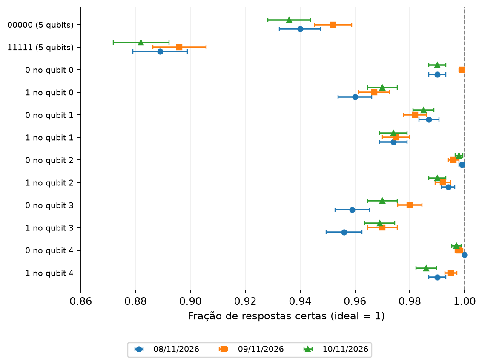

# Experimento 2 · O computador acerta o que é fácil?

**Estado:** executado em 3 sessões, nos dias 8, 9 e 10 de novembro de 2026, no `ibm_fez`. Cada circuito foi medido 1.000 vezes por sessão. O job e a hora de cada sessão estão em `dados/*/ficha.json`.

## Resposta curta

**Quase sempre.** Um qubit sozinho responde certo de 95,6% a 100% das vezes. Os cinco juntos acertam `00000` de 93,6% a 95,2% e `11111` de 88,2% a 89,6%. Pedir "1" erra mais do que pedir "0", e o qubit 3 (em 0) e o qubit 0 (em 1) são os que mais erram. Isso se repete nos três dias.

## Pergunta

Se eu peço ao computador um resultado que já conheço, ele devolve esse resultado? Por exemplo: "deixe os 5 qubits em 0 e me diga o que você vê". A resposta certa é `00000`, sempre. Um pedido assim, com resposta conhecida, é um **controle**. Aqui não há GHZ: só pedir e ler.

O teste mistura dois passos, **preparar** o qubit e **ler** o resultado, e não diz qual dos dois falhou.

## Como foi feito

12 circuitos:

| Pedido | Circuitos |
| --- | --- |
| Cinco qubits em 0 | `00000`, nos qubits 0 a 4. |
| Cinco qubits em 1 | `11111` (porta X nos cinco), nos qubits 0 a 4. |
| Um qubit por vez | Cada qubit de 0 a 4, sozinho, pedido em 0 e em 1 (10 circuitos). |

- **Indicador:** a fração das 1.000 medidas em que o computador respondeu o que pedimos. É um valor **observado**, sem correção.
- **Erro padrão:** só o da amostragem.
- **Custo:** 12 circuitos × 1.000 = 12.000 medidas por sessão, 36.000 nas 3 sessões.
- **Critério (definido antes de rodar):** não há hipótese a testar. Mostramos cada sessão separada, para ver se um qubit muda de um dia para o outro. Não atribuímos causa que os dados não mostram.

## Resultado

**Fração de respostas certas**, em cada pedido e em cada sessão:

<!-- TABELA:sessoes -->
| Item | Indicador | 2026-11-08_ibm_fez | 2026-11-09_ibm_fez | 2026-11-10_ibm_fez |
| --- | --- | ---: | ---: | ---: |
| estado `00000`, 5 qubits | sucesso | 0,9400 | 0,9520 | 0,9360 |
| estado `11111`, 5 qubits | sucesso | 0,8890 | 0,8960 | 0,8820 |
| estado `0`, qubit 0 | sucesso | 0,9900 | 0,9990 | 0,9900 |
| estado `1`, qubit 0 | sucesso | 0,9600 | 0,9670 | 0,9700 |
| estado `0`, qubit 1 | sucesso | 0,9870 | 0,9820 | 0,9850 |
| estado `1`, qubit 1 | sucesso | 0,9740 | 0,9750 | 0,9740 |
| estado `0`, qubit 2 | sucesso | 0,9990 | 0,9960 | 0,9980 |
| estado `1`, qubit 2 | sucesso | 0,9940 | 0,9920 | 0,9900 |
| estado `0`, qubit 3 | sucesso | 0,9590 | 0,9800 | 0,9700 |
| estado `1`, qubit 3 | sucesso | 0,9560 | 0,9700 | 0,9690 |
| estado `0`, qubit 4 | sucesso | 1,0000 | 0,9980 | 0,9970 |
| estado `1`, qubit 4 | sucesso | 0,9900 | 0,9950 | 0,9860 |
<!-- /TABELA:sessoes -->

*Cada ponto é um pedido em uma sessão, com um erro padrão. Cada cor e forma é um dia. Linha tracejada: o ideal, 1.*

**Os cinco juntos contra os cinco separados.** Multiplicando as frações dos cinco qubits pedidos sozinhos, obtemos, para `11111`, 0,880, 0,903 e 0,894 nos três dias. O valor medido com os cinco juntos foi 0,889, 0,896 e 0,882. Para `00000`, o produto é 0,936, 0,956 e 0,941, e o medido, 0,940, 0,952 e 0,936. A diferença é de no máximo 1,1 erro padrão em todos os seis casos.

## Conclusão

1. **O que é fácil o computador faz bem:** os dez pedidos de um qubit ficam entre 0,956 e 1,000.
2. **Pedir 1 erra mais que pedir 0.** Em `11111`, o sucesso fica entre 0,882 e 0,896; em `00000`, entre 0,936 e 0,952. Nos 15 pares (5 qubits × 3 dias), o "1" teve sucesso menor que o "0" em todos.
3. **Os menores sucessos de um qubit** são os do qubit 3 (0,956 a 0,980) e os do qubit 0 pedido em 1 (0,960 a 0,970). O qubit 2 acerta 0,990 ou mais em todos os pedidos.
4. **O resultado dos cinco juntos é compatível com o dos cinco separados**, dentro de cerca de 1 erro padrão. Não há, neste teste, sinal de que rodar os cinco ao mesmo tempo piore cada um.
5. **Os dias são parecidos.** Nenhum pedido mudou mais do que 0,021 entre sessões, e a maior variação foi no qubit 3, pedido em 0.

**Limites.**
- O erro vem da preparação mais a leitura, misturados. Este experimento não separa os dois.
- Só os qubits 0 a 4, um computador, três dias seguidos.
- Perto de 1, poucas medidas erradas bastam para mudar o valor. Por isso a comparação entre qubits com sucesso de 0,99 ou mais não é firme.

## Próximo passo

Esse erro de leitura pode ser medido e usado para corrigir o resultado? É o [experimento 4](../04_calibracao_leitura/README.md), que monta a matriz de calibração e a aplica ao GHZ conectado.

## Arquivos

| Arquivo | Para que serve |
| --- | --- |
| `experimento.py` | A receita. |
| `dados/AAAA-MM-DD_ibm_fez/` | Uma pasta por sessão: ficha (job, hora, qubits, opções, versões), circuitos e contagens. **Não se edita.** |
| `resultados/` | `resultados.json`, `tabelas.md` e `controles.png`. Refeitos com `python rodar.py 02 --analisar`. |

**Execução:** `python rodar.py 02 --enviar` **envia jobs à IBM**, depois de você digitar a confirmação.

[Experimentos](../README.md)
