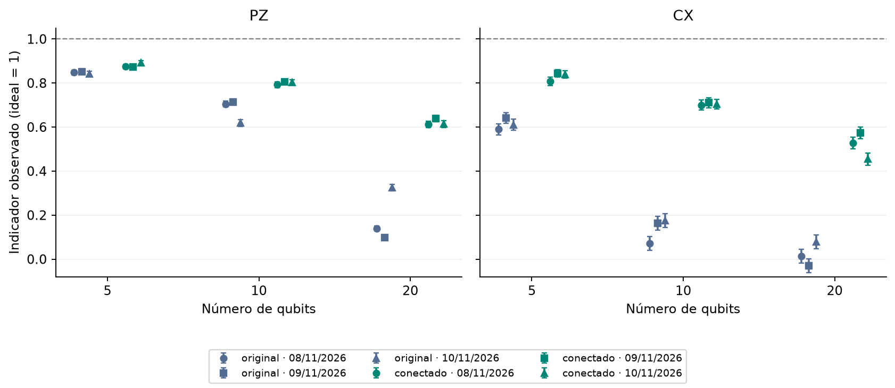

# Experimento 3 · Montar o GHZ com menos passos melhora o resultado?

**Estado:** executado em 3 sessões, nos dias 8, 9 e 10 de novembro de 2026, no `ibm_fez`. Cada circuito foi medido 1.000 vezes por sessão. O job e a hora de cada sessão estão em `dados/*/ficha.json`.

## Resposta curta

**Sim, nos 6 casos e nas 3 sessões.** O GHZ conectado, com menos portas de dois qubits, ficou acima do original em PZ e em CX, em 5, 10 e 20 qubits, em todos os dias. Pelo critério definido antes de rodar (mesmo sinal nas 3 sessões), a conectada conta como melhor. A diferença é pequena em PZ com 5 qubits e grande nos demais casos.

## Pergunta

O computador só liga diretamente alguns pares de qubits. Quando o circuito pede uma porta entre dois qubits que não são vizinhos, o compilador acrescenta trocas de lugar (SWAP) e portas extras, e cada porta de dois qubits tem chance de erro ([ruído](../../fundamentos/ruido.md)). Dá para montar o mesmo GHZ seguindo as ligações do computador, sem passos extras, e isso melhora o resultado? ([construção](../../fundamentos/tecnicas/construcao.md))

## Como foi feito

- **Circuitos:** o GHZ **original** (o qubit de menor número liga a todos) e o **conectado** (árvore que segue as ligações, a partir do qubit 2), na mesma região do chip, no mesmo job.
- **Tamanhos:** 5, 10 e 20 qubits. Com 5, os qubits 0 a 4.
- **Medidas:** em Z (indicador PZ) e em X (indicador CX), **observadas, sem correção de leitura** ([indicadores](../../fundamentos/circuitos/ghz.md)).
- **Compilação:** a conectada é compilada **sem trocas de qubits**. Se o compilador precisar trocar algum, o envio é recusado.
- **Erro padrão:** só o da amostragem. Na diferença entre conectado e original, os dois erros se combinam.
- **Custo:** 3 tamanhos × 2 construções × 2 bases = 12 circuitos × 1.000 = 12.000 medidas por sessão, 36.000 nas 3 sessões.
- **Critério (definido antes de rodar):** a conectada só conta como melhor se a diferença tiver o **mesmo sinal nas 3 sessões**, em cada tamanho. Caso contrário, o resultado é "inconclusivo". Cada sessão aparece separada.

## Resultado

**O custo em portas.** Segundo as fichas, o compilador gerou o mesmo circuito nas 3 sessões:

<!-- TABELA:portas -->
| Qubits | Portas de 2 qubits, original | Portas de 2 qubits, conectado |
| ---: | ---: | ---: |
| 5 | 13 | 4 |
| 10 | 33 | 9 |
| 20 | 97 | 19 |
<!-- /TABELA:portas -->

O conectado usa uma porta de dois qubits a menos que o número de qubits (n − 1), o mínimo para ligar todos.

**Indicadores observados**, por circuito e por sessão:

<!-- TABELA:sessoes -->
| Item | Indicador | 2026-11-08_ibm_fez | 2026-11-09_ibm_fez | 2026-11-10_ibm_fez |
| --- | --- | ---: | ---: | ---: |
| GHZ original, 5 qubits, base Z | PZ | 0,8480 | 0,8510 | 0,8420 |
| GHZ original, 5 qubits, base X | CX | 0,5900 | 0,6420 | 0,6100 |
| GHZ conectado, 5 qubits, base Z | PZ | 0,8750 | 0,8730 | 0,8930 |
| GHZ conectado, 5 qubits, base X | CX | 0,8080 | 0,8440 | 0,8400 |
| GHZ original, 10 qubits, base Z | PZ | 0,7050 | 0,7140 | 0,6190 |
| GHZ original, 10 qubits, base X | CX | 0,0720 | 0,1640 | 0,1760 |
| GHZ conectado, 10 qubits, base Z | PZ | 0,7920 | 0,8060 | 0,8030 |
| GHZ conectado, 10 qubits, base X | CX | 0,7000 | 0,7100 | 0,7040 |
| GHZ original, 20 qubits, base Z | PZ | 0,1390 | 0,0970 | 0,3250 |
| GHZ original, 20 qubits, base X | CX | 0,0140 | -0,0300 | 0,0780 |
| GHZ conectado, 20 qubits, base Z | PZ | 0,6120 | 0,6390 | 0,6140 |
| GHZ conectado, 20 qubits, base X | CX | 0,5280 | 0,5740 | 0,4540 |
<!-- /TABELA:sessoes -->

*Cada ponto é um circuito em uma sessão, com um erro padrão. Azul: original. Verde: conectado. A forma do marcador é o dia. Linha tracejada: o ideal, 1.*

**Conectado menos original** (diferença dos valores observados, com erro padrão):

<!-- TABELA:contrastes -->
| Conectado menos original | 2026-11-08_ibm_fez | 2026-11-09_ibm_fez | 2026-11-10_ibm_fez | Sinal |
| --- | ---: | ---: | ---: | --- |
| PZ, 5 qubits | 0,027 ± 0,015 | 0,022 ± 0,015 | 0,051 ± 0,015 | positivo em todas |
| CX, 5 qubits | 0,218 ± 0,032 | 0,202 ± 0,030 | 0,230 ± 0,030 | positivo em todas |
| PZ, 10 qubits | 0,087 ± 0,019 | 0,092 ± 0,019 | 0,184 ± 0,020 | positivo em todas |
| CX, 10 qubits | 0,628 ± 0,039 | 0,546 ± 0,038 | 0,528 ± 0,038 | positivo em todas |
| PZ, 20 qubits | 0,473 ± 0,019 | 0,542 ± 0,018 | 0,289 ± 0,021 | positivo em todas |
| CX, 20 qubits | 0,514 ± 0,041 | 0,604 ± 0,041 | 0,376 ± 0,042 | positivo em todas |
<!-- /TABELA:contrastes -->

## Conclusão

1. **A diferença é positiva nos 6 casos e nas 3 sessões**, então pelo critério combinado a conectada é melhor.
2. **Em CX, a diferença é grande em todos os tamanhos.** Fica entre 0,20 e 0,23 em 5 qubits, entre 0,53 e 0,63 em 10 e entre 0,38 e 0,60 em 20, sempre a muitos erros padrão de zero. No original, o CX em 20 qubits é praticamente zero (de −0,030 a 0,078): a correlação do GHZ não é detectada.
3. **Em PZ, a diferença cresce com o tamanho e é pequena em 5 qubits**: de 0,022 a 0,051, cerca de 1,5 a 3,4 erros padrão. Nos dias 8 e 9 ela ficou abaixo de 2 erros padrão. O sinal se repetiu, mas o tamanho dessa diferença em 5 qubits é pouco firme.
4. **Em 20 qubits o conectado mantém PZ de 0,61 a 0,64 e CX de 0,45 a 0,57**, enquanto o original fica em PZ de 0,10 a 0,33 e CX de −0,03 a 0,08.
5. **A diferença varia entre os dias, mais que o erro padrão.** Em 20 qubits, PZ passou de +0,473 e +0,542 (dias 8 e 9) para +0,289 (dia 10), porque o PZ do original foi mais alto no dia 10 (0,325 contra 0,139 e 0,097). Em 10 qubits o PZ do original foi mais **baixo** no dia 10 (0,619 contra 0,705 e 0,714). O sinal não mudou. Não sabemos o motivo.

**Limites.**
- Os valores são observados, sem correção de leitura. Parte do erro vem da leitura e se soma ao das portas.
- Um computador, três dias seguidos, só 5, 10 e 20 qubits.
- O experimento mostra que menos portas coincide com melhor resultado. Ele não separa quanto vem das portas e quanto de outras diferenças entre os dois circuitos, como a profundidade.
- Para tamanhos maiores, a comparação com o [experimento 1](../01_escala/README.md) ainda não foi feita.

## Próximo passo

Dá para melhorar mais o GHZ conectado usando os dados de calibração da leitura? É o [experimento 4](../04_calibracao_leitura/README.md), que ajusta PZ e CX do GHZ conectado de 5 qubits com uma matriz de calibração medida no mesmo job.

## Arquivos

| Arquivo | Para que serve |
| --- | --- |
| `experimento.py` | A receita. |
| `dados/AAAA-MM-DD_ibm_fez/` | Uma pasta por sessão: ficha (job, hora, qubits, portas, opções, versões), circuitos e contagens. **Não se edita.** |
| `resultados/` | `resultados.json`, `tabelas.md` e `construcao.png`. Refeitos com `python rodar.py 03 --analisar`. |

**Execução:** `python rodar.py 03 --enviar` **envia jobs à IBM**, depois de você digitar a confirmação.

[Experimentos](../README.md)
