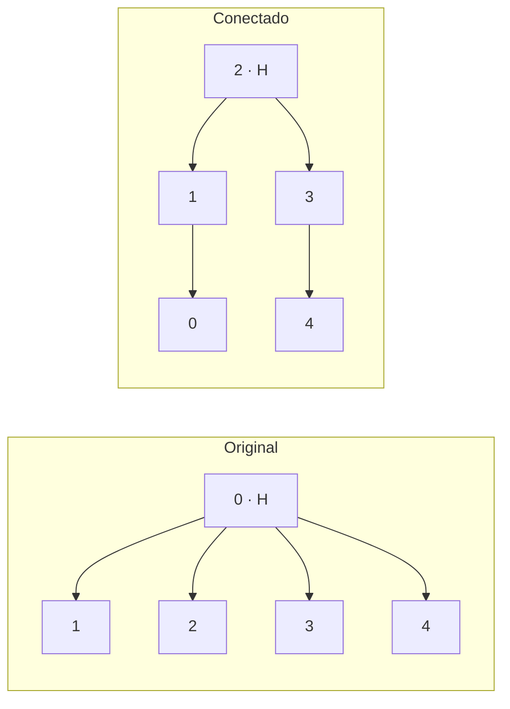

# 03 — Construção conectada

[Experimentos](../README.md) · [Compilação e roteamento](../../docs/livro/03-circuitos-medidas/README.md)

## Objetivo

Preparar o mesmo GHZ usando interações que acompanham conexões físicas, evitando operações adicionais de roteamento quando possível. O número de portas e a profundidade são registrados para comparar o custo compilado.

| Script | Papel |
| --- | --- |
| [ghz_05_original_fez.py](ghz_05_original_fez.py) | Referência original de cinco qubits no Fez, layout 0–4 |
| [comparar_construcoes.py](comparar_construcoes.py) | Compara a construção original com árvores conectadas; testa raízes no compilador e escolhe menor número de portas de dois qubits, depois menor profundidade |
| [comparar_base_x.py](comparar_base_x.py) | Compara as construções com medidas na base X |
| [ghz_50_conectado.py](ghz_50_conectado.py) | Seleciona 50 qubits conectados por busca em largura a partir da raiz física 2 e prepara GHZ |

Todos usam 1.000 shots por circuito e selecionam `ibm_fez` no código histórico. O programa de 50 qubits não aplica calibração completa de leitura; ele mede a população em Z. Seu destino de saída foi organizado para `dados/brutos/03_ghz_conectado`, pasta criada pelo programa se uma execução gerar resultados.

## O que foi recuperado

O [guia histórico](../../docs/experimentos.md) registra a comparação relatada de 13 para 4 portas de dois qubits, profundidade de 35 para 13 e melhora em indicadores. Os arquivos brutos dessas comparações não foram encontrados na importação. Também não foi recuperado resultado do GHZ conectado de cinquenta qubits.

O protocolo novo local usa uma árvore fixa de cinco qubits e dados próprios de simulação; não transforma os relatos históricos em medidas rastreáveis. Veja a [validação local](../../docs/livro/07-simulacao-local/README.md).

**Execução:** estes arquivos consultam o backend e submetem jobs; não são comandos necessários para ler os resultados existentes.

## Duas maneiras de espalhar a mesma correlação

Cada seta abaixo representa uma porta controlada, da origem para o alvo. H prepara a superposição na raiz. Leia as setas da esquerda para a direita na ordem indicada.

| Construção original | Construção conectada de cinco qubits |
| --- | --- |
| H em 0 | H em 2 |
| 0 → 1 | 2 → 1 |
| 0 → 2 | 2 → 3 |
| 0 → 3 | 1 → 0 |
| 0 → 4 | 3 → 4 |

Ambas usam quatro portas controladas no desenho lógico. A diferença aparece **após compilar**: quando o par pedido não é vizinho, operações adicionais podem ser necessárias para aproximá-lo. No registro histórico, o original passou a ter 13 portas de dois qubits e o conectado ficou com 4. Isso corresponde a nove operações a menos. Essa redução pode diminuir a exposição a erros nas portas. O número veio do [relato histórico](../../docs/experimentos.md); as contagens simuladas preservadas estão em um [experimento separado](../../dados/simulados/README.md).

Cada seta mostra a direção controle → alvo. O desenho representa as interações lógicas; a tabela acima dá a ordem de aplicação.
