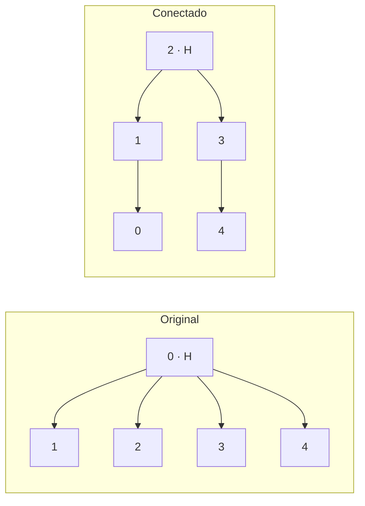

# 3. Menos portas reduzem o desvio?

**Situação:** medido na IBM. **Backend:** `ibm_fez`. **Data:** 21 de outubro de 2026. **Shots por circuito:** 1.000. As contagens e os circuitos foram recuperados diretamente da conta IBM em 2 de novembro de 2026 ([recuperação](../../docs/recuperacao_etapas_02_03.json)).

## Pergunta

O mesmo GHZ, preparado por um caminho que segue as conexões físicas do equipamento, tem indicadores melhores que o preparado com a construção original?

## Por que esta pergunta

Porta de dois qubits costuma ter taxa de erro maior que a de um qubit ([ruído](../../fundamentos/ruido.md)). Se o compilador precisa inserir operações extras para ligar qubits que não são vizinhos, o circuito executado tem mais portas que o desenhado.

## Método

As duas construções produzem o mesmo estado ideal. Cada seta é uma porta CX, da origem (controle) para o destino (alvo). H prepara a superposição na raiz.

| Original | Conectada (5 qubits) |
| --- | --- |
| H em 0 | H em 2 |
| 0 → 1 | 2 → 1 |
| 0 → 2 | 2 → 3 |
| 0 → 3 | 1 → 0 |
| 0 → 4 | 3 → 4 |

No desenho lógico, ambas têm quatro CX. A diferença aparece **depois de compilar**: no original, o qubit 0 precisa interagir com qubits que não são seus vizinhos, e o compilador acrescenta operações. O custo é lido do circuito compilado.

**Indicadores:** PZ na base Z e CX na base X ([definições](../../fundamentos/indicadores.md)). Não há correção de leitura: os valores são brutos. A técnica avaliada é só a construção.

## Resultado

<!-- TABELA:construcoes -->
| Experimento | Circuito | Qubits | Portas de 2 qubits | Profundidade | Indicador | Data do job | Job |
| --- | --- | ---: | ---: | ---: | --- | --- | --- |
| original_fez | original_Z | 5 | 13 | 35 | PZ = 0,834 | 2026-10-21 | `dbccaqpgv2cc73ea21fg` |
| comparar_construcoes | original_Z | 5 | 13 | 35 | PZ = 0,833 | 2026-10-21 | `dbcccpc24mrc73cjb6bg` |
| comparar_construcoes | conectado_Z | 5 | 4 | 13 | PZ = 0,888 | 2026-10-21 | `dbcccpc24mrc73cjb6bg` |
| comparar_base_x | original_X | 5 | 13 | 38 | CX = 0,566 | 2026-10-21 | `dbcco2fi0auc73dum8i0` |
| comparar_base_x | conectado_X | 5 | 4 | 16 | CX = 0,774 | 2026-10-21 | `dbcco2fi0auc73dum8i0` |
| conectado_50 | conectado50_Z | 50 | 49 | 56 | PZ = 0,155 | 2026-10-21 | `dbch2kpgv2cc73eabim0` |
<!-- /TABELA:construcoes -->

*Figura. À esquerda, PZ; à direita, CX. Cada barra é um circuito real. A linha em 1 marca o ideal.*

**Custo compilado, cinco qubits:** o original ficou com 13 portas de dois qubits, profundidade 35 em Z e 38 em X. O conectado ficou com 4 portas, profundidade 13 em Z e 16 em X. São 9 portas a menos.

### A diferença é maior que a flutuação de amostragem?

Cada diferença é comparada ao seu erro padrão analítico, que só considera a amostragem de 1.000 shots (PZ: √(p(1−p)/n); CX: √((1−CX²)/n)).

<!-- TABELA:construcoes_testes -->
| Comparação | Indicador | Primeiro | Segundo | Diferença | EP da diferença | Diferença em EP |
| --- | --- | ---: | ---: | ---: | ---: | ---: |
| Mesmo circuito original em dois jobs | PZ | 0,834 | 0,833 | -0,001 | 0,017 | -0,1 |
| Conectado menos original, base Z | PZ | 0,833 | 0,888 | 0,055 | 0,015 | 3,6 |
| Conectado menos original, base X | CX | 0,566 | 0,774 | 0,208 | 0,033 | 6,3 |
<!-- /TABELA:construcoes_testes -->

A primeira linha é um controle: o **mesmo circuito original**, em dois jobs diferentes no mesmo dia, deu valores praticamente iguais (0,834 e 0,833). Isso indica que, nesse intervalo, a repetição foi estável. As duas diferenças entre construções ficam acima de 3 erros padrão.

## Limites

- Os valores são **brutos**, sem correção de leitura.
- Cada comparação entre construções foi feita em um único job por base. Não houve repetição em outros dias.
- Essa melhora nos indicadores acompanha a redução de portas, mas o experimento não separa a contribuição das portas, da profundidade e da decoerência.
- **GHZ conectado de 50 qubits:** PZ = 0,155, com 49 CX e profundidade 56, no Fez, em 21 de outubro. A série do experimento 1 usa outro backend (provavelmente `ibm_kingston`) e outra data. **Não é uma comparação válida** entre construções. O GHZ original de 50 qubits não foi executado no Fez.

## Arquivos

| Arquivo | Para que serve |
| --- | --- |
| [ghz_05_original_fez.py](ghz_05_original_fez.py) | Referência original de cinco qubits no Fez. |
| [comparar_construcoes.py](comparar_construcoes.py) | Compara a original com árvores conectadas e escolhe a de menos portas de dois qubits. |
| [comparar_base_x.py](comparar_base_x.py) | Mesma comparação, medindo na base X. |
| [ghz_50_conectado.py](ghz_50_conectado.py) | GHZ de 50 qubits por busca em largura a partir da raiz física 2. |
| [brutos/03_ghz_conectado](../../dados/brutos/03_ghz_conectado/README.md) | Contagens e circuitos (JSON e QPY) dos quatro jobs. |
| [resultados_recuperados.json](../../dados/processados/03_ghz_conectado/resultados_recuperados.json) | Uma linha por circuito. |

**Execução:** os quatro programas **enviam jobs à IBM**. Não são necessários para ler os resultados.

**Próxima pergunta:** além de reduzir portas, como corrigir a leitura? [Experimento 4](../04_mitigacao_leitura/README.md).

[Experimentos](../README.md)
