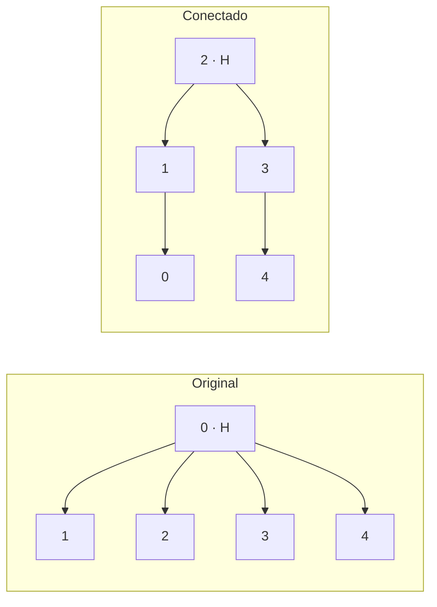

# Experimento 3 · Menos portas reduzem o desvio?

**Onde e quando:** IBM, `ibm_fez`, 21 de outubro de 2026. **Shots por circuito:** 1.000. As contagens e os circuitos foram recuperados da conta IBM em 2 de novembro de 2026 ([registro](../../docs/recuperacao_etapas_02_03.json)).

## Pergunta

O mesmo GHZ, preparado por um caminho que segue as conexões físicas do equipamento, tem indicadores melhores que o da construção original? Porta de dois qubits costuma ter mais erro que a de um qubit ([ruído](../../fundamentos/ruido.md)). Se o compilador precisa inserir operações extras para ligar qubits que não são vizinhos, o circuito executado tem mais portas que o desenhado.

## Como foi feito

As duas construções produzem o mesmo estado ideal. Cada seta é uma CX, do controle para o alvo, e H cria a superposição no qubit de origem.

| Original | Conectada (5 qubits) |
| --- | --- |
| H em 0 | H em 2 |
| 0 → 1 | 2 → 1 |
| 0 → 2 | 2 → 3 |
| 0 → 3 | 1 → 0 |
| 0 → 4 | 3 → 4 |

No desenho, ambas têm quatro CX. A diferença aparece **depois de compilar**: no original, o qubit 0 precisa interagir com qubits que não são seus vizinhos, e o compilador acrescenta operações. O custo é lido do circuito compilado.

**Indicadores:** PZ na base Z e CX na base X ([definições](../../fundamentos/indicadores.md)). Os valores são **brutos**, sem correção de leitura: a única técnica avaliada é a construção.

## Resultado

<!-- TABELA:construcoes -->
| Experimento | Circuito | Qubits | Portas de 2 qubits | Profundidade | Indicador | Data do job | Job |
| --- | --- | ---: | ---: | ---: | --- | --- | --- |
| original_fez | original_Z | 5 | 13 | 35 | PZ = 0,834 | 2026-10-21 | `dbccaqpgv2cc73ea21fg` |
| comparar_construcoes | original_Z | 5 | 13 | 35 | PZ = 0,833 | 2026-10-21 | `dbcccpc24mrc73cjb6bg` |
| comparar_construcoes | conectado_Z | 5 | 4 | 13 | PZ = 0,888 | 2026-10-21 | `dbcccpc24mrc73cjb6bg` |
| comparar_base_x | original_X | 5 | 13 | 38 | CX = 0,566 | 2026-10-21 | `dbcco2fi0auc73dum8i0` |
| comparar_base_x | conectado_X | 5 | 4 | 16 | CX = 0,774 | 2026-10-21 | `dbcco2fi0auc73dum8i0` |
| conectado_50 | conectado50_Z | 50 | 49 | 56 | PZ = 0,155 | 2026-10-21 | `dbch2kpgv2cc73eabim0` |
<!-- /TABELA:construcoes -->

*À esquerda, PZ; à direita, CX. Cada barra é um circuito real. A linha em 1 marca o ideal.*

**Custo compilado, cinco qubits:** o original ficou com 13 portas de dois qubits (profundidade 35 em Z e 38 em X) e o conectado com 4 (profundidade 13 em Z e 16 em X): 9 portas a menos.

**A diferença é maior que a flutuação de amostragem?** Comparamos cada diferença ao seu erro padrão (PZ: √(p(1−p)/n); CX: √((1−CX²)/n), ver [indicadores](../../fundamentos/indicadores.md)).

<!-- TABELA:construcoes_testes -->
| Comparação | Indicador | Primeiro | Segundo | Diferença | EP da diferença | Diferença em EP |
| --- | --- | ---: | ---: | ---: | ---: | ---: |
| Mesmo circuito original em dois jobs | PZ | 0,834 | 0,833 | -0,001 | 0,017 | -0,1 |
| Conectado menos original, base Z | PZ | 0,833 | 0,888 | 0,055 | 0,015 | 3,6 |
| Conectado menos original, base X | CX | 0,566 | 0,774 | 0,208 | 0,033 | 6,3 |
<!-- /TABELA:construcoes_testes -->

A primeira linha é um controle: o **mesmo circuito original**, em dois jobs no mesmo dia, deu valores praticamente iguais, o que indica repetição estável nesse intervalo.

## Conclusão

A construção conectada teve indicadores brutos melhores que a original: PZ +0,055 (3,6 erros padrão) e CX +0,208 (6,3 erros padrão), com 9 portas de dois qubits a menos. Isso mostra que reduzir portas ajuda, mas o experimento **não separa** a contribuição das portas, da profundidade e da decoerência, e cada comparação tem um único job, sem repetição em outros dias.

O **GHZ conectado de 50 qubits** (PZ = 0,155, com 49 CX e profundidade 56) foi no Fez, em 21 de outubro; a série do experimento 1 usa outro backend e outra data. **Não é uma comparação válida** entre construções, e o GHZ original de 50 qubits não foi executado no Fez.

## Próximo passo

Além de reduzir as portas, dá para corrigir o erro de leitura? [Experimento 4](../04_mitigacao_leitura/README.md).

## Arquivos

| Arquivo | Para que serve |
| --- | --- |
| `ghz_05_original_fez.py` | Referência original de cinco qubits no Fez. |
| `comparar_construcoes.py` | Compara a original com árvores conectadas e escolhe a de menos portas de dois qubits. |
| `comparar_base_x.py` | Mesma comparação, medindo na base X. |
| `ghz_50_conectado.py` | GHZ de 50 qubits por busca em largura a partir da raiz física 2. |
| [Contagens e circuitos](../../dados/brutos/README.md#03--construções-do-ghz) | Quatro jobs (JSON e QPY). |
| [resultados_recuperados.json](../../dados/processados/03_ghz_conectado/resultados_recuperados.json) | Uma linha por circuito. |

**Execução:** os quatro programas **enviam jobs à IBM**.

[Experimentos](../README.md)
