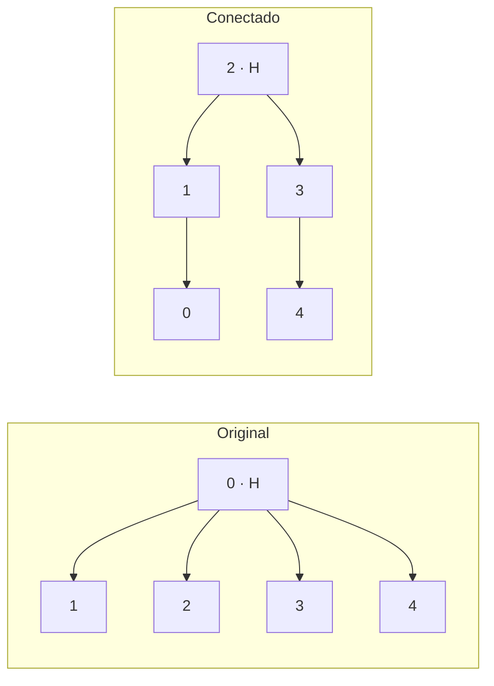
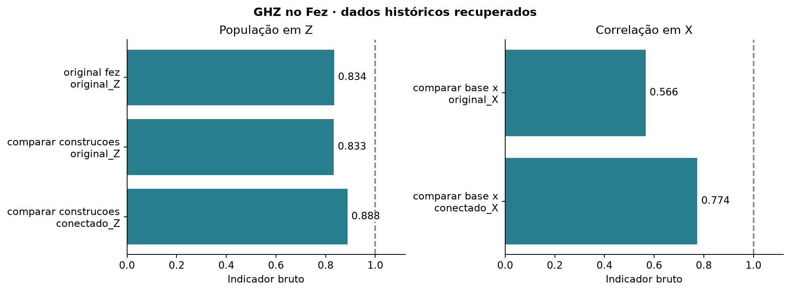

# Experimento 3 · Montar o GHZ com menos passos melhora o resultado?

**Onde e quando:** IBM, `ibm_fez`, 21 de outubro de 2026. GHZ de 5 qubits, cada circuito repetido 1.000 vezes. As contagens foram recuperadas da conta IBM em 2 de novembro de 2026 ([registro de origem](../../dados/registro_origem.json)).

## Resposta curta

**Sim.** A construção que segue as ligações do computador usa 4 portas de dois qubits em vez de 13 e tirou notas melhores nas duas medidas (PZ e CX), com diferença bem maior que a oscilação por sorte.

## Pergunta

O computador só liga diretamente alguns pares de qubits. Quando o circuito pede uma porta entre dois qubits que não são vizinhos, o **compilador** (o programa que adapta o circuito ao computador) acrescenta passos extras. Cada porta de dois qubits tem uma chance de erro maior que as de um qubit ([ruído](../../fundamentos/ruido.md)), então mais passos significam mais chances de erro.

A pergunta é: dá para montar o mesmo GHZ seguindo as ligações do computador, sem passos extras, e isso melhora o resultado?

## Como foi feito

Duas maneiras de montar o GHZ de 5 qubits. As duas têm o mesmo resultado ideal. Cada seta é uma porta CX (que liga dois qubits, do primeiro para o segundo), e o H cria a superposição no qubit de origem.

| Original | Conectada |
| --- | --- |
| H em 0 | H em 2 |
| 0 → 1 | 2 → 1 |
| 0 → 2 | 2 → 3 |
| 0 → 3 | 1 → 0 |
| 0 → 4 | 3 → 4 |

No desenho, as duas têm 4 CX. A diferença aparece **depois de compilar**: no original, o qubit 0 precisa falar com todos, e o compilador acrescenta trocas de lugar entre qubits (SWAP) para chegar neles. Na conectada, cada qubit só fala com um vizinho, e nada é acrescentado.

Medimos de duas formas, a mesma que usamos no resto do projeto ([definições](../../fundamentos/indicadores.md)): **PZ**, medindo em Z, e **CX**, medindo em X. Nos dois, 1 é o resultado ideal. Os valores são **brutos**, sem correção de leitura: a única coisa que muda entre os dois circuitos é a construção.

## Resultado

<!-- TABELA:construcao_cinco -->
| Construção | Portas de 2 qubits | Profundidade (medindo em Z) | PZ | Profundidade (medindo em X) | CX |
| --- | ---: | ---: | ---: | ---: | ---: |
| Original | 13 | 35 | 0,833 | 38 | 0,566 |
| Conectada | 4 | 13 | 0,888 | 16 | 0,774 |
<!-- /TABELA:construcao_cinco -->

A conectada tem 9 portas de dois qubits a menos, o que equivale a 3 trocas de lugar (cada troca usa 3 portas), e uma profundidade bem menor. A profundidade é o número de camadas de portas, uma medida aproximada do tempo que o circuito leva.

*À esquerda, PZ; à direita, CX. Cada barra é um circuito real, e a linha em 1 marca o ideal.*

**A diferença é maior que a sorte?** Comparamos cada diferença com o seu erro padrão (quanto o número oscila só pela amostra, ver [indicadores](../../fundamentos/indicadores.md)):

<!-- TABELA:construcoes_testes -->
| Comparação | Indicador | Primeiro | Segundo | Diferença | EP da diferença | Diferença em EP |
| --- | --- | ---: | ---: | ---: | ---: | ---: |
| Mesmo circuito original em dois jobs | PZ | 0,834 | 0,833 | -0,001 | 0,017 | -0,1 |
| Conectado menos original, base Z | PZ | 0,833 | 0,888 | 0,055 | 0,015 | 3,6 |
| Conectado menos original, base X | CX | 0,566 | 0,774 | 0,208 | 0,033 | 6,3 |
<!-- /TABELA:construcoes_testes -->

A primeira linha é uma checagem: o **mesmo circuito original**, em dois jobs no mesmo dia, deu valores quase iguais. Isso indica que a repetição é estável nesse intervalo. As duas diferenças entre construções ficam acima de 3 erros padrão.

## Conclusão

1. **Menos portas deram notas melhores**, no PZ e no CX, com diferenças acima de 3 erros padrão.
2. **Não sabemos o que explica a melhora.** As portas, a profundidade e o tempo em que os qubits esperam mudam todos juntos. O experimento não separa um do outro.
3. **Cada comparação foi feita uma vez, em um dia só.** Não repetimos em outros dias.
4. **Só testamos 5 qubits.** Para saber se a vantagem se mantém em circuitos maiores, seria preciso rodar o original e o conectado em outros tamanhos, no mesmo computador e no mesmo dia. Isso ainda não foi feito.

## Próximo passo

Reduzir os passos ajuda. Dá para também corrigir o erro de leitura? [Experimento 4](../04_mitigacao_leitura/README.md).

## Arquivos

| Arquivo | Para que serve |
| --- | --- |
| `ghz_05_original_fez.py` | O GHZ original de 5 qubits no Fez. |
| `comparar_construcoes.py` | Compara a original com as conectadas (medindo em Z) e escolhe a de menos portas de dois qubits. |
| `comparar_base_x.py` | A mesma comparação, medindo em X. |
| [Contagens e circuitos](../../dados/README.md#03--construções-do-ghz) | Os jobs de 5 qubits (JSON e QPY). |
| [resultados_recuperados.json](../../dados/processados/03_ghz_conectado/resultados_recuperados.json) | Uma linha por circuito. |

**Execução:** os três programas **enviam jobs à IBM**.

[Experimentos](../README.md)
