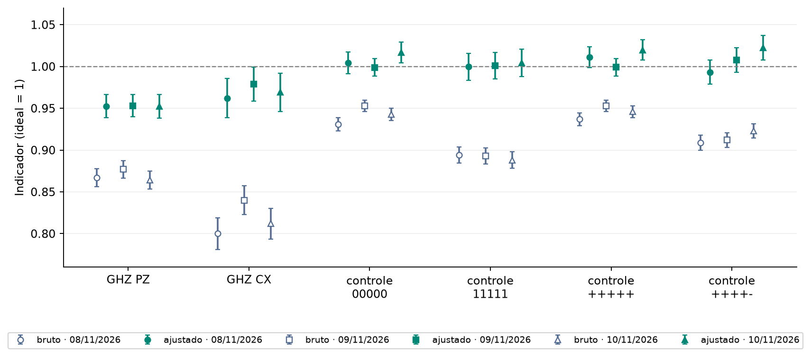

# Experimento 4 · A calibração de leitura aproxima os indicadores do ideal?

**Estado:** executado em 3 sessões, nos dias 8, 9 e 10 de novembro de 2026, no `ibm_fez`, qubits 0 a 4. Cada circuito foi medido 1.000 vezes por sessão. O job e a hora de cada sessão estão em `dados/*/ficha.json`.

## Resposta curta

**Sim, mas não até 1.** Nas 3 sessões, o valor ajustado ficou mais perto de 1 que o observado, em PZ e em CX, com o intervalo de 95% do ganho acima de zero. O PZ do GHZ foi de cerca de 0,87 para 0,953, e o CX, de 0,80 a 0,84 para 0,96 a 0,98. Os quatro controles independentes, que a calibração não viu, ficaram em torno de 1. **O PZ do GHZ continua abaixo de 1**, e a calibração não explica essa parte.

## Pergunta

Se medirmos como o equipamento registra estados conhecidos, podemos usar isso para estimar melhor PZ e CX do GHZ? A técnica está explicada, com um exemplo de um qubit, em [leitura](../../fundamentos/tecnicas/leitura.md).

## Como foi feito

Cada sessão tem 38 circuitos de cinco qubits, enviados no mesmo job:

| Circuitos | O que são | Para quê |
| ---: | --- | --- |
| 32 | Cada sequência de `00000` a `11111`. | Montar a matriz de calibração A. |
| 2 | GHZ conectado, medido em Z e em X. | Calcular PZ e CX. |
| 4 | **Controles independentes** (amostras novas, não reaproveitam a calibração): `00000` e `11111` em Z, e os estados `+++++` e `++++-` em X, com resposta `00000` e `00001`. | Conferir se a correção acerta o que ela não viu. |

- **Observado e ajustado:** o **observado** é a contagem direta. O **ajustado** é uma estimativa: aplica a inversa da matriz A às probabilidades observadas. Cada sessão usa a própria calibração.
- **Incerteza:** o erro padrão e o intervalo de 95% do ajustado vêm de 5.000 réplicas (bootstrap) que repetem a calibração e o circuito juntos. O ajustado pode passar de 1 (quasiprobabilidades), e não o recortamos.
- **Custo:** 38 circuitos × 1.000 = 38.000 medidas por sessão, 114.000 nas 3 sessões.
- **Critério (definido antes de rodar):** a calibração só conta como "ajudou" se o valor **ajustado ficar mais perto de 1 que o observado nas 3 sessões**, tanto em PZ quanto em CX, com o intervalo de 95% do ganho acima de zero. Os controles independentes decidem se a melhora vem mesmo da leitura: desvios persistentes, do mesmo sinal, em sessões diferentes, pedem investigação antes de atribuir a melhora à leitura.

## Resultado

**Observado → ajustado**, em cada indicador e em cada sessão:

<!-- TABELA:sessoes -->
| Item | Indicador | 2026-11-08_ibm_fez | 2026-11-09_ibm_fez | 2026-11-10_ibm_fez |
| --- | --- | ---: | ---: | ---: |
| GHZ conectado, 5 qubits, base Z | PZ | 0,8670 → 0,9526 | 0,8770 → 0,9531 | 0,8640 → 0,9526 |
| GHZ conectado, 5 qubits, base X | CX | 0,8000 → 0,9621 | 0,8400 → 0,9789 | 0,8120 → 0,9691 |
| estado `00000`, 5 qubits (controle) | sucesso | 0,9310 → 1,0044 | 0,9530 → 0,9989 | 0,9430 → 1,0166 |
| estado `11111`, 5 qubits (controle) | sucesso | 0,8940 → 0,9996 | 0,8930 → 1,0010 | 0,8880 → 1,0046 |
| estado `+++++`, 5 qubits, base X (controle) | sucesso | 0,9370 → 1,0111 | 0,9530 → 0,9990 | 0,9460 → 1,0199 |
| estado `++++-`, 5 qubits, base X (controle) | sucesso | 0,9090 → 0,9933 | 0,9120 → 1,0079 | 0,9230 → 1,0224 |
<!-- /TABELA:sessoes -->

*Cada ponto é um circuito em uma sessão, com um erro padrão. Cada forma é um dia. Vazado e azul: observado. Cheio e verde: ajustado. Linha tracejada: o ideal, 1.*

**O ganho** (ajustado menos observado) do GHZ, com o intervalo de 95%:

<!-- TABELA:ganhos -->
| Indicador | 2026-11-08_ibm_fez | 2026-11-09_ibm_fez | 2026-11-10_ibm_fez |
| --- | ---: | ---: | ---: |
| PZ | 0,086 [0,072; 0,100] | 0,076 [0,063; 0,090] | 0,089 [0,075; 0,103] |
| CX | 0,162 [0,149; 0,175] | 0,139 [0,128; 0,150] | 0,157 [0,145; 0,170] |
<!-- /TABELA:ganhos -->

**Os controles independentes**, valor ajustado menos o ideal (1):

<!-- TABELA:controles -->
| Sessão | 00000 em Z | 11111 em Z | +++++ em X | ++++- em X |
| --- | ---: | ---: | ---: | ---: |
| 2026-11-08_ibm_fez | 0,004 | -0,000 | 0,011 | -0,007 |
| 2026-11-09_ibm_fez | -0,001 | 0,001 | -0,001 | 0,008 |
| 2026-11-10_ibm_fez | 0,017 | 0,005 | 0,020 | 0,022 |
<!-- /TABELA:controles -->

## Conclusão

1. **A calibração ajudou, pelo critério combinado.** Nas 3 sessões o ajustado ficou mais perto de 1 que o observado, em PZ e em CX, e o intervalo de 95% do ganho ficou acima de zero.
2. **Os controles confirmam que a melhora vem da leitura.** Nos quatro controles, que não entraram na calibração, o observado ficou entre 0,89 e 0,95 e o ajustado entre 0,99 e 1,02. Nenhum desvio passa de 2 erros padrão.
3. **Há um padrão na sessão 3 que vale acompanhar.** Os quatro controles ficaram acima de 1 (de +0,005 a +0,022; três deles entre 1,3 e 1,6 erros padrão). Nas sessões 1 e 2 os sinais se misturam. O critério pede investigar desvios do mesmo sinal **em sessões diferentes**, e isso não aconteceu. A sessão 3 não pede ação, e o padrão fica registrado.
4. **O PZ do GHZ ajustado ficou em 0,953 nas três sessões** (0,953 ± 0,014), e o intervalo de 95% de cada sessão não inclui 1. O que sobra não é erro de leitura. Os dados deste experimento não dizem de onde vem. No [experimento 5](../05_validacao_simulada/README.md), no simulador, o erro das portas fica depois da calibração do mesmo jeito, mas aqui não medimos o erro das portas separadamente.
5. **O CX do GHZ ajustado ficou entre 0,962 e 0,979**, com erro padrão de 0,02 a 0,024: nas três sessões o intervalo de 95% inclui 1.

**Limites.**
- O ajustado é uma estimativa. O que o computador entregou é o observado.
- A calibração não corrige o erro das portas e também absorve parte do erro de preparação.
- A matriz é de 32 × 32, medida no mesmo job que o GHZ. Em outros dias ou em outros qubits, ela precisa ser refeita.
- Os quatro controles são só um conjunto de estados fáceis. Com o GHZ, não há uma conferência independente do mesmo tipo.
- Um computador e três dias seguidos. Com três sessões não estimamos a cobertura dos intervalos.

## Próximo passo

O que sobra depois da calibração vem das portas? No simulador, o [experimento 5](../05_validacao_simulada/README.md) já separa as fontes de erro, e o [experimento 6](../06_zne_simulado/README.md) testa a extrapolação a ruído zero. Testar a extrapolação na IBM seria um experimento novo.

## Arquivos

| Arquivo | Para que serve |
| --- | --- |
| `experimento.py` | A receita. |
| `dados/AAAA-MM-DD_ibm_fez/` | Uma pasta por sessão: ficha (job, hora, qubits, opções, versões), circuitos e contagens. **Não se edita.** |
| `resultados/` | `resultados.json` (todos os números, inclusive o condicionamento da matriz), `tabelas.md` e `calibracao.png`. Refeitos com `python rodar.py 04 --analisar`. |

**Execução:** `python rodar.py 04 --enviar` **envia jobs à IBM**, depois de você digitar a confirmação.

[Experimentos](../README.md)
