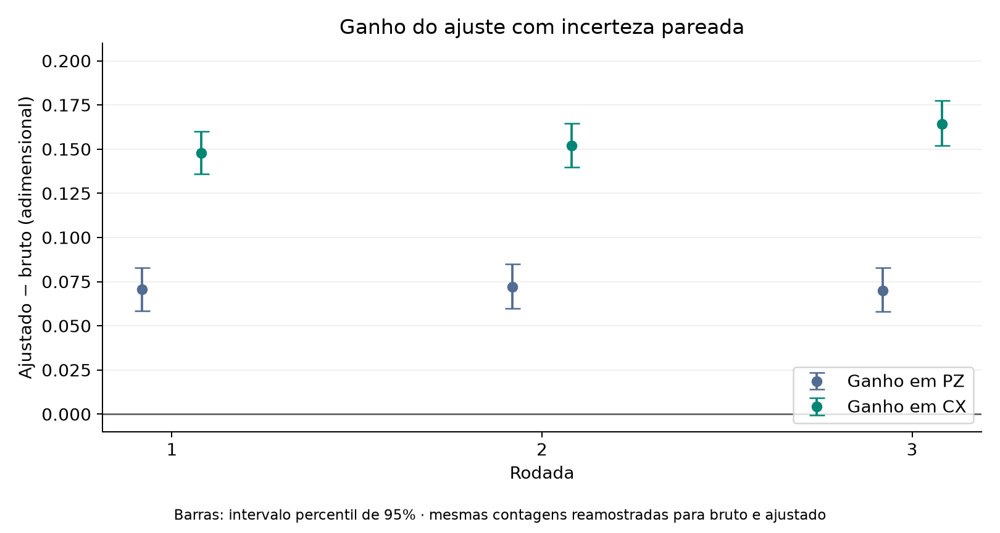

# Experimento 4 · Quanto a calibração de leitura aproxima os indicadores do ideal?

**Onde e quando:** IBM, `ibm_fez`, qubits 0 a 4, três rodadas. A rodada 3 foi enviada em 1º de novembro de 2026; as rodadas 1 e 2 não registram a data. **Shots por circuito:** 1.000.

## Pergunta

Se medirmos como o equipamento registra estados conhecidos, podemos usar essa informação para estimar melhor PZ e CX do GHZ? A técnica está explicada, com um exemplo de um qubit, em [fundamentos/tecnicas.md](../../fundamentos/tecnicas.md#2-calibração-de-leitura).

## Como foi feito

Cada rodada executou 34 circuitos de cinco qubits, 1.000 vezes cada. Total: **102.000 medidas nas três rodadas.**

| Circuitos | O que preparamos | Para quê |
| ---: | --- | --- |
| 32 | Cada sequência de `00000` a `11111` (2⁵ = 32) | Medir como cada preparação é registrada |
| 1 | GHZ medido em Z | Calcular PZ |
| 1 | GHZ medido em X | Calcular CX |

As 32 calibrações formam uma matriz **A** de 32 × 32: cada coluna tem as frequências registradas para uma preparação. Com **p** as frequências observadas do GHZ, resolvemos **A q = p**, e **q** é a estimativa ajustada.

<!-- TABELA:rodadas_jobs -->
| Rodada | Job IBM | Backend | Data de envio | Circuitos | Shots por circuito | Medidas |
| ---: | --- | --- | --- | ---: | ---: | ---: |
| 1 | `dbccq67i0auc73dumdk0` | ibm_fez | não registrada | 34 | 1000 | 34.000 |
| 2 | `dbccri9gv2cc73ea3630` | ibm_fez | não registrada | 34 | 1000 | 34.000 |
| 3 | `dbjnndgnceqs73akbkh0` | ibm_fez | 2026-11-01 | 34 | 1000 | 34.000 |
| **Total** |  |  |  |  |  | **102.000** |
<!-- /TABELA:rodadas_jobs -->

## Resultado

**Conta, rodada 3.** No [JSON da rodada 3](../../dados/brutos/04_mitigacao_leitura/rodada_03/rodada_03.json), em `contagens` e `GHZ_Z`: `00000` apareceu 454 vezes, `11111` apareceu 441 e outras sequências, 105.

1. **PZ observado** = (454 + 441) / 1.000 = **0,895**.
2. Resolvendo **A q = p** e somando as componentes de `00000` e `11111` de **q**: **0,9648**.
3. Em `GHZ_X`: 903 sequências com número par de 1 e 97 ímpares. **CX observada** = (903 − 97) / 1.000 = **0,806**. Ajustada: **0,9702**.

O 0,895 foi observado; o 0,9648 foi calculado a partir das mesmas contagens. Não houve uma segunda execução com 965 acertos.

<!-- TABELA:rodadas -->
| Rodada | PZ bruto → ajustado | CX bruta → ajustada |
| ---: | --- | --- |
| 1 | 0,8730 → 0,9436 | 0,7960 → 0,9440 |
| 2 | 0,8640 → 0,9360 | 0,7960 → 0,9481 |
| 3 | 0,8950 → 0,9648 | 0,8060 → 0,9702 |
<!-- /TABELA:rodadas -->

*Indicadores brutos e ajustados em cada rodada, com um erro padrão. O eixo vertical não começa em zero.*

**Ganho e incerteza.** O ganho é o valor ajustado menos o bruto. O erro padrão (EP) e o intervalo de 95% vêm do *bootstrap* com 5.000 réplicas por rodada ([método](../../fundamentos/indicadores.md)). Relatório completo: [comparacao_rodadas.md](../../docs/comparacao_rodadas.md).

<!-- TABELA:rodadas_ganho -->
| Rodada | Indicador | Bruto | EP bruto | Ajustado | EP ajustado | Ganho | IC 95% do ganho |
| ---: | ---: | ---: | ---: | ---: | ---: | ---: | ---: |
| 1 | PZ | 0,8730 | 0,0104 | 0,9436 | 0,0130 | 0,0706 | 0,0585 a 0,0829 |
| 1 | CX | 0,7960 | 0,0194 | 0,9440 | 0,0235 | 0,1480 | 0,1359 a 0,1600 |
| 2 | PZ | 0,8640 | 0,0109 | 0,9360 | 0,0136 | 0,0720 | 0,0599 a 0,0849 |
| 2 | CX | 0,7960 | 0,0188 | 0,9481 | 0,0228 | 0,1521 | 0,1399 a 0,1644 |
| 3 | PZ | 0,8950 | 0,0098 | 0,9648 | 0,0125 | 0,0698 | 0,0580 a 0,0828 |
| 3 | CX | 0,8060 | 0,0186 | 0,9702 | 0,0229 | 0,1642 | 0,1519 a 0,1775 |
<!-- /TABELA:rodadas_ganho -->

*Ganho (ajustado menos bruto) e intervalo bootstrap de 95%.*

## Conclusão

Nas três rodadas, PZ e CX ficaram mais próximos de 1 depois do ajuste de leitura, e os seis intervalos de 95% do ganho ficam acima de zero. O ajuste também **aumenta o erro padrão** do indicador: é o custo de inverter a matriz.

O que o experimento **não mostra**:
- que o erro das portas desapareceu: um qubit que já saiu errado do circuito e foi lido corretamente não é corrigido;
- a separação entre erro de leitura e de preparação, porque os estados de calibração também são preparados por portas;
- fidelidade: PZ e CX não determinam o estado completo;
- a deriva do equipamento entre dias: o bootstrap só contém a variação de amostragem dentro de cada rodada.

Os valores ajustados são estimativas e podem conter quasiprobabilidades negativas.

## Próximo passo

Na IBM só vemos as contagens finais, sem saber quanto do desvio veio da leitura e quanto das portas. E se nós escolhermos o erro? [Experimento 5](../05_validacao_simulada/README.md).

## Arquivos

| Arquivo | Para que serve |
| --- | --- |
| `mitigacao_leitura.py` | Salva `GHZ_leitura_<job>.json`, o formato das rodadas 1 e 2. **Envia um job.** |
| `repetir_mitigacao.py` | Rodada 3, com `--verificar` (local), `--enviar` e `--coletar`. Sem `--enviar`, nada é enviado, e uma rodada já registrada não é reenviada. |
| [comparar_rodadas.py](../../scripts/comparar_rodadas.py) | Ajustes e bootstrap das três rodadas, sem acessar a IBM. |
| [Contagens das rodadas](../../dados/brutos/README.md#04--calibração-de-leitura) | JSON das rodadas 1 e 2; JSON e QPY da rodada 3. |
| [comparacao_rodadas.json](../../dados/processados/comparacao_rodadas.json) | Resultado processado das três rodadas. |

**Execução:** `mitigacao_leitura.py` envia um job à IBM. O job `dbjnndgnceqs73akbkh0` (rodada 3) já foi concluído e não deve ser reenviado.

[Experimentos](../README.md)
