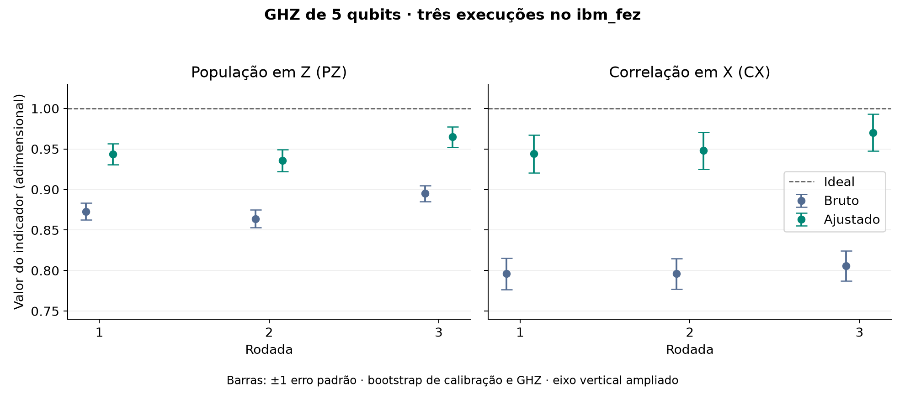

# 4. Quanto a correção da leitura aproxima os indicadores do ideal?

**Situação:** medido na IBM, três rodadas. **Backend:** `ibm_fez`, qubits 0 a 4. **Shots por circuito:** 1.000. A rodada 3 foi enviada em 1º de novembro de 2026. As rodadas 1 e 2 não registram a data.

## Pergunta

Se medirmos como o equipamento registra estados conhecidos, podemos usar essa informação para estimar melhor PZ e CX do GHZ?

## Método

Cada rodada executou 34 circuitos de cinco qubits, 1.000 vezes cada. Total: **102.000 medidas nas três rodadas.**

| Circuitos | O que preparamos | Para quê |
| ---: | --- | --- |
| 32 | Cada sequência de `00000` a `11111` (2⁵ = 32) | Medir como cada preparação é registrada |
| 1 | GHZ medido em Z | Calcular PZ |
| 1 | GHZ medido em X | Calcular CX |

As 32 calibrações formam uma matriz **A**. Com **p** as frequências observadas do GHZ, resolvemos **A q = p**, e **q** é a estimativa ajustada. [Exemplo com um bit e detalhes](detalhes.md).

## Conta passo a passo: rodada 3

No [JSON da rodada 3](../../dados/brutos/04_mitigacao_leitura/rodada_03/rodada_03.json), em `contagens` e `GHZ_Z`:

1. `00000` apareceu 454 vezes e `11111`, 441. Outras sequências: 105.
2. **PZ observado** = (454 + 441) / 1.000 = **0,895**.
3. Resolvendo **A q = p** e somando as componentes de `00000` e `11111` de **q**: **0,9648**.

O 0,895 foi observado. O 0,9648 foi calculado a partir das mesmas contagens, e não houve uma segunda execução com 965 acertos.

Em `GHZ_X`: 903 sequências com número par de 1 e 97 ímpares. **CX observada** = (903 − 97) / 1.000 = **0,806**. Ajustada: **0,9702**.

## Resultado

<!-- TABELA:rodadas -->
| Rodada | PZ bruto → ajustado | CX bruta → ajustada |
| ---: | --- | --- |
| 1 | 0,8730 → 0,9436 | 0,7960 → 0,9440 |
| 2 | 0,8640 → 0,9360 | 0,7960 → 0,9481 |
| 3 | 0,8950 → 0,9648 | 0,8060 → 0,9702 |
<!-- /TABELA:rodadas -->

*Figura. Indicadores brutos e ajustados em cada rodada, com um erro padrão.*

Nas três rodadas, PZ e CX ficaram mais próximos de 1, e os seis intervalos de 95% do ganho ficam acima de zero ([ganhos e intervalos](detalhes.md#ganho-e-incerteza)).

## Limites

- **Não mostra** que o erro das portas desapareceu: o ajuste só atua na leitura.
- **Não separa** leitura de preparação, pois os estados de calibração também são preparados por portas.
- O bootstrap cobre só a amostragem dentro de cada rodada, não a deriva entre dias. A lista completa está em [detalhes.md](detalhes.md#o-que-o-experimento-mostra-e-o-que-não-mostra).

## Arquivos

| Arquivo | Para que serve |
| --- | --- |
| [mitigacao_leitura.py](mitigacao_leitura.py) | Salva `GHZ_leitura_<job>.json`, o formato das rodadas 1 e 2. **Envia um job.** |
| [repetir_mitigacao.py](repetir_mitigacao.py) | Rodada 3, com `--verificar` (local), `--enviar` e `--coletar`. Sem `--enviar`, nada é enviado, e uma rodada já registrada não é reenviada. |
| [comparar_rodadas.py](../../scripts/comparar_rodadas.py) | Ajustes e bootstrap das três rodadas, sem acessar a IBM. |

**Execução:** `mitigacao_leitura.py` envia um job à IBM. O job `dbjnndgnceqs73akbkh0` (rodada 3) já está concluído e não deve ser reenviado.

**Próxima pergunta:** e o erro que ocorreu dentro do circuito? [Experimento 5](../05_validacao_simulada/README.md).

[Experimentos](../README.md)
