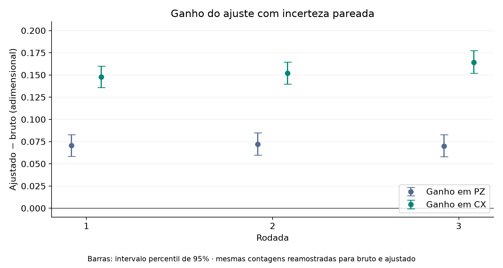

# 4. Calibração de leitura · detalhes

Complemento do [experimento 4](README.md). Aqui ficam o exemplo com um bit, os dados de cada rodada, os ganhos com intervalos e a lista completa do que o experimento mostra e não mostra.

## Exemplo com um bit (ilustrativo, não é dado real)

Suponha que o leitor registra 0 em 90% das vezes quando preparamos 0, e registra 0 em 20% das vezes quando preparamos 1. Se a fração verdadeira de zeros for x, observamos 0,90 x + 0,20 (1 − x). Observando 0,55, resolvemos 0,55 = 0,90 x + 0,20 (1 − x) e obtemos x = 0,50.

No experimento real, são 32 sequências. Cada preparação conhecida fornece uma coluna da matriz **A** (32 × 32), dividindo suas contagens por 1.000. Resolvemos **A q = p**, em que **p** são as frequências observadas do GHZ e **q** a estimativa ajustada.

## Dados de cada rodada

<!-- TABELA:rodadas_jobs -->
| Rodada | Job IBM | Backend | Data de envio | Circuitos | Shots por circuito | Medidas |
| ---: | --- | --- | --- | ---: | ---: | ---: |
| 1 | `dbccq67i0auc73dumdk0` | ibm_fez | não registrada | 34 | 1000 | 34.000 |
| 2 | `dbccri9gv2cc73ea3630` | ibm_fez | não registrada | 34 | 1000 | 34.000 |
| 3 | `dbjnndgnceqs73akbkh0` | ibm_fez | 2026-11-01 | 34 | 1000 | 34.000 |
| **Total** |  |  |  |  |  | **102.000** |
<!-- /TABELA:rodadas_jobs -->

As rodadas 1 e 2 estão em arquivos nomeados com o ID do job. A rodada 3 está na pasta [rodada_03](../../dados/brutos/04_mitigacao_leitura/rodada_03/README.md), que guarda também os circuitos compilados (QPY). A pasta se chamava `repeticoes` e foi renomeada. As três rodadas são o mesmo experimento. [Mapa dos arquivos](../../dados/brutos/04_mitigacao_leitura/README.md).

## Ganho e incerteza

O ganho é o valor ajustado menos o bruto. O erro padrão (EP) e o intervalo de 95% vêm do bootstrap com 5.000 réplicas por rodada ([método](../../fundamentos/indicadores.md)).

<!-- TABELA:rodadas_ganho -->
| Rodada | Indicador | Bruto | EP bruto | Ajustado | EP ajustado | Ganho | IC 95% do ganho |
| ---: | ---: | ---: | ---: | ---: | ---: | ---: | ---: |
| 1 | PZ | 0,8730 | 0,0104 | 0,9436 | 0,0130 | 0,0706 | 0,0585 a 0,0829 |
| 1 | CX | 0,7960 | 0,0194 | 0,9440 | 0,0235 | 0,1480 | 0,1359 a 0,1600 |
| 2 | PZ | 0,8640 | 0,0109 | 0,9360 | 0,0136 | 0,0720 | 0,0599 a 0,0849 |
| 2 | CX | 0,7960 | 0,0188 | 0,9481 | 0,0228 | 0,1521 | 0,1399 a 0,1644 |
| 3 | PZ | 0,8950 | 0,0098 | 0,9648 | 0,0125 | 0,0698 | 0,0580 a 0,0828 |
| 3 | CX | 0,8060 | 0,0186 | 0,9702 | 0,0229 | 0,1642 | 0,1519 a 0,1775 |
<!-- /TABELA:rodadas_ganho -->

*Figura. Ganho (ajustado menos bruto) e intervalo bootstrap de 95%.*

Os seis intervalos ficam acima de zero. O ajuste também **aumenta o erro padrão** do indicador, o custo de inverter a matriz. Relatório completo: [comparacao_rodadas.md](../../docs/comparacao_rodadas.md).

## O que o experimento mostra e o que não mostra

- **Mostra** que, nas três rodadas, os dois indicadores ficaram mais próximos de 1 depois do ajuste de leitura.
- **Não mostra** que erros das portas desapareceram. Um qubit que já saiu errado do circuito e foi lido corretamente não é corrigido.
- **Não separa** erro de leitura de erro de preparação: os estados de calibração também são preparados por portas.
- **Não é fidelidade:** PZ e CX não determinam o estado completo.
- O bootstrap contém só a variação de amostragem dentro de cada rodada, não a deriva entre dias.
- Os valores ajustados são estimativas e podem conter quasiprobabilidades negativas.

[Voltar ao experimento 4](README.md)
