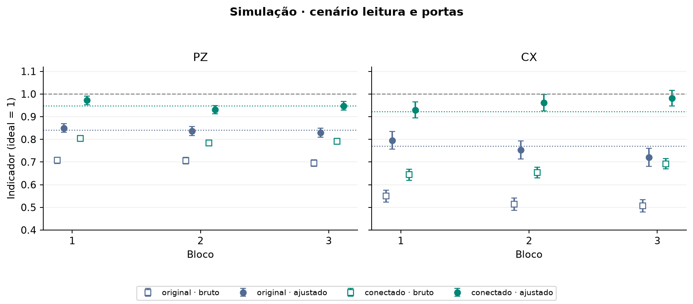

# Experimento 5 · O que a calibração recupera quando o erro é conhecido?

**Estado:** executado em 8 de novembro de 2026, no simulador (Qiskit Aer, CPU), sem acesso à IBM. Nove sessões, cada circuito simulado 1.000 vezes.

## Resposta curta

A calibração de leitura recupera o que a leitura estragou, **e só isso**. Com erro apenas de leitura, o valor ajustado volta para perto de 1. Com erro também nas portas, o ajustado para no valor que **chegava à leitura** (a coluna "antes da leitura" da primeira tabela), que fica abaixo de 1. A construção conectada, com menos portas, chega melhor à leitura que a original.

## Pergunta

Na IBM só vemos as contagens finais, não o estado antes da leitura. No simulador **nós escolhemos o erro**, então sabemos a resposta certa. A calibração de leitura ([leitura](../../fundamentos/tecnicas/leitura.md)) recupera o estado anterior à leitura, e o que ela deixa para trás? O [experimento 4](../04_calibracao_leitura/README.md) mede na IBM; este separa as fontes de erro, uma de cada vez, e serve para **provar que a análise está certa** antes de ela ver dados da IBM.

## Como foi feito

- **Três cenários**, com três blocos cada (uma sessão por bloco, com calibração e semente próprias): **ideal** (sem ruído), **só leitura** e **leitura e portas** (erro de leitura mais ruído depois de cada CX).
- **Cada bloco tem 40 circuitos** de cinco qubits: 32 de calibração, 4 de GHZ (original e conectado, em Z e em X) e 4 controles independentes (amostras novas, sem reaproveitar a calibração).
- **Parâmetros do modelo:** valores **sintéticos**, escolhidos por nós, em `mitigacao/execucao/ruido.py`. **Não** são de um computador real: as magnitudes valem para este modelo e não para o Fez.
- **Referência exata:** para cada circuito que rodou, a distribuição exata do modelo, sem flutuação de shots, antes e depois do erro de leitura.
- **Custo:** 9 blocos × 40 circuitos × 1.000 = 360.000 medidas simuladas.
- **Critério (definido antes de rodar):** sanidade, não cobertura. Nenhum valor ajustado pode ficar a mais de 6 erros padrão da referência exata, e a inversão exata deve recuperar a distribuição anterior à leitura.

## Resultado

**A referência exata do modelo**, o que cada circuito entrega à leitura e o que o equipamento registraria:

<!-- TABELA:cenarios -->
| Cenário | Construção | PZ antes da leitura | PZ após a leitura | CX antes da leitura | CX após a leitura |
| --- | --- | ---: | ---: | ---: | ---: |
| ideal | original | 1,0000 | 1,0000 | 1,0000 | 1,0000 |
| ideal | conectado | 1,0000 | 1,0000 | 1,0000 | 1,0000 |
| leitura | original | 1,0000 | 0,8366 | 1,0000 | 0,6957 |
| leitura | conectado | 1,0000 | 0,8366 | 1,0000 | 0,6957 |
| leitura_e_portas | original | 0,8409 | 0,7065 | 0,7690 | 0,5350 |
| leitura_e_portas | conectado | 0,9463 | 0,7924 | 0,9224 | 0,6417 |
<!-- /TABELA:cenarios -->

Com erro só de leitura, o estado chega perfeito (1,0000), e a leitura derruba os indicadores. Com erro também nas portas, o estado já chega abaixo de 1, e a calibração **não** pode recuperar o que as portas estragaram.

**Cenário leitura e portas, nos três blocos.** Cada célula é *bruto → ajustado*. O ajustado deve cair perto do "antes da leitura" da tabela acima, e não em 1.

<!-- TABELA:sessoes_leitura_e_portas -->
| Item | Indicador | bloco_01 | bloco_02 | bloco_03 |
| --- | --- | ---: | ---: | ---: |
| GHZ original, 5 qubits, base Z | PZ | 0,7070 → 0,8501 | 0,7060 → 0,8367 | 0,6950 → 0,8295 |
| GHZ original, 5 qubits, base X | CX | 0,5500 → 0,7950 | 0,5140 → 0,7533 | 0,5060 → 0,7209 |
| GHZ conectado, 5 qubits, base Z | PZ | 0,8040 → 0,9717 | 0,7840 → 0,9314 | 0,7920 → 0,9479 |
| GHZ conectado, 5 qubits, base X | CX | 0,6440 → 0,9295 | 0,6540 → 0,9617 | 0,6920 → 0,9813 |
| estado `00000`, 5 qubits (controle) | sucesso | 0,8520 → 0,9830 | 0,8420 → 0,9838 | 0,8470 → 0,9972 |
| estado `11111`, 5 qubits (controle) | sucesso | 0,8130 → 1,0261 | 0,8410 → 1,0208 | 0,8010 → 0,9770 |
| estado `+++++`, 5 qubits, base X (controle) | sucesso | 0,8540 → 0,9854 | 0,8500 → 0,9938 | 0,8750 → 1,0312 |
| estado `++++-`, 5 qubits, base X (controle) | sucesso | 0,8190 → 1,0237 | 0,8040 → 1,0119 | 0,8230 → 1,0065 |
<!-- /TABELA:sessoes_leitura_e_portas -->

*Quadrados vazios: bruto. Círculos cheios: ajustado, com um erro padrão. Linhas pontilhadas: o valor exato antes da leitura, de cada construção. Linha tracejada em 1: o ideal.*

**Conectado menos original** (diferença do valor ajustado, com erro padrão):

<!-- TABELA:contrastes_leitura_e_portas -->
| Conectado menos original | bloco_01 | bloco_02 | bloco_03 | Sinal |
| --- | ---: | ---: | ---: | --- |
| PZ, 5 qubits | 0,122 ± 0,024 | 0,095 ± 0,024 | 0,118 ± 0,024 | positivo em todas |
| CX, 5 qubits | 0,134 ± 0,052 | 0,208 ± 0,052 | 0,260 ± 0,051 | positivo em todas |
<!-- /TABELA:contrastes_leitura_e_portas -->

**Só erro de leitura:** [figura](resultados/comparacao_leitura.png) e as tabelas completas, de todos os cenários e dos controles, estão em [resultados/tabelas.md](resultados/tabelas.md). **Cenário ideal:** [figura](resultados/comparacao_ideal.png).

**A análise bate com a referência exata?** O maior desvio entre cada valor e a sua referência, em erros padrão:

<!-- TABELA:validacao -->
| Sessão | Cenário | Maior desvio do bruto (EP) | Maior desvio do ajustado (EP) | Dentro do limite |
| --- | --- | ---: | ---: | --- |
| ideal_bloco_01 | ideal | 0,00 | 0,00 | sim |
| ideal_bloco_02 | ideal | 0,00 | 0,00 | sim |
| ideal_bloco_03 | ideal | 0,00 | 0,00 | sim |
| leitura_bloco_01 | leitura | 1,78 | 2,27 | sim |
| leitura_bloco_02 | leitura | 1,68 | 1,69 | sim |
| leitura_bloco_03 | leitura | 1,91 | 1,76 | sim |
| leitura_e_portas_bloco_01 | leitura_e_portas | 0,92 | 1,36 | sim |
| leitura_e_portas_bloco_02 | leitura_e_portas | 2,25 | 1,10 | sim |
| leitura_e_portas_bloco_03 | leitura_e_portas | 2,20 | 1,74 | sim |
<!-- /TABELA:validacao -->

## Conclusão

1. **No cenário ideal a análise não inventa melhora:** bruto e ajustado valem exatamente 1.
2. **Só com erro de leitura, o ajustado fica em volta de 1**, com oscilação de poucos erros padrão (no máximo cerca de 2, pela tabela de validação). A calibração desfez a leitura.
3. **Com erro de leitura e de portas, o ajustado concorda com o "antes da leitura" e fica abaixo de 1.** O erro das portas permanece, e a calibração não o corrige.
4. **A construção conectada chega melhor à leitura:** a diferença conectado menos original é positiva nos três blocos, em PZ e em CX, e maior que 2 erros padrão em todos. Com erro só de leitura, a diferença fica dentro de 2 erros padrão, como se espera: a leitura é a mesma nos dois circuitos.
5. **Os nove blocos ficaram dentro do limite de sanidade** da tabela de validação. Além disso, um teste automático confirma que, com as probabilidades exatas (sem shots), a correção devolve o estado anterior à leitura com erro menor que 10⁻¹⁰, inclusive no circuito original, em que o compilador trocou qubits de lugar.

**Limites.**
- Os erros são sintéticos. Nada daqui vale para o Fez.
- O modelo tem leitura **independente por qubit**; a calibração, porém, é uma matriz completa, que aceitaria correlações.
- O critério é de sanidade: não é um teste de cobertura dos intervalos.
- São só três blocos por cenário.
- O ajustado pode passar de 1 (quasiprobabilidades), e não o recortamos ([indicadores](../../fundamentos/indicadores.md)).

## Próximo passo

Sobra o erro das portas. Existe uma técnica que o reduza? A extrapolação a ruído zero: [experimento 6](../06_zne_simulado/README.md).

## Arquivos

| Arquivo | Para que serve |
| --- | --- |
| `experimento.py` | A receita, com as 9 sessões. Rode com `python rodar.py 05 --enviar --todas`. |
| `dados/<cenário>_bloco_NN/` | Uma pasta por sessão: ficha, circuitos, contagens. **Não se edita.** |
| `resultados/` | `resultados.json` (todos os números), `tabelas.md` e as figuras. Refeitos com `python rodar.py 05 --analisar`. |
| [analise.py](../../mitigacao/analise.py), [validacao.py](../../mitigacao/validacao.py) | A análise e a conferência com a referência exata. |

**Execução:** tudo local, não acessa a IBM.

[Experimentos](../README.md)
