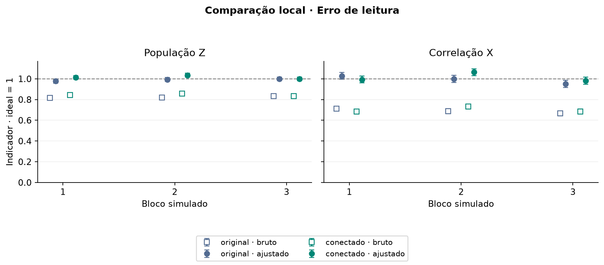

# Experimento 5 · O que a calibração recupera quando conhecemos a causa do erro?

**Onde e quando:** simulado no PC (CPU, Qiskit Aer), em 1º de novembro de 2026. **Shots por circuito:** 1.000. **Total:** 9 blocos × 40 circuitos × 1.000 = **360.000 shots simulados**. Nada foi enviado à IBM.

## Pergunta

Na IBM só vemos as contagens finais, não o estado imediatamente antes da leitura. No simulador **nós escolhemos o erro**, então sabemos a resposta certa. A calibração de leitura recupera o estado anterior à leitura, e o que ela deixa para trás? O [experimento 4](../04_mitigacao_leitura/README.md) aproximou os indicadores do ideal, mas não distingue o que veio da leitura. Aqui separamos as fontes de erro, uma de cada vez.

## Como foi feito

**Três cenários**, três blocos cada (sementes diferentes):

1. **Ideal:** sem ruído.
2. **Só leitura:** erro de leitura em cada qubit.
3. **Leitura e portas:** o mesmo erro de leitura, mais ruído depolarizante após cada CX (um ruído que, com certa probabilidade, troca o estado dos qubits da porta por um estado aleatório).

**Cada bloco tem 40 circuitos:**

| Circuitos | O que são |
| ---: | --- |
| 32 | Calibração (todas as sequências de cinco bits). |
| 4 | GHZ original e GHZ conectado, em Z e em X ([experimento 3](../03_ghz_conectado/README.md)). |
| 4 | Controles independentes com resposta conhecida: todos zeros, todos uns, paridade positiva e paridade negativa. Usam amostras novas, sem reaproveitar as contagens da calibração. |

**Parâmetros do modelo.** São **valores sintéticos** escolhidos por nós, **não** uma calibração atual do Fez.

<!-- TABELA:parametros -->
| Qubit | Erro 0→1 na leitura | Erro 1→0 na leitura |
| ---: | ---: | ---: |
| 0 | 0,01 | 0,06 |
| 1 | 0,02 | 0,05 |
| 2 | 0,03 | 0,04 |
| 3 | 0,04 | 0,03 |
| 4 | 0,05 | 0,02 |

Ruído depolarizante após cada CX: 0,02. Conexões usadas: 2→1, 2→3, 1→0, 3→4.
<!-- /TABELA:parametros -->

**Referência exata.** Para cada circuito, calculamos a distribuição exata do modelo antes e depois da leitura, sem flutuação de shots. Com ela medimos o que a análise deveria recuperar.

## Resultado

<!-- TABELA:cenarios -->
| Cenário | Construção | PZ antes da leitura | PZ após a leitura | CX antes da leitura | CX após a leitura |
| --- | --- | ---: | ---: | ---: | ---: |
| Ideal | original | 1,0000 | 1,0000 | 1,0000 | 1,0000 |
| Ideal | conectado | 1,0000 | 1,0000 | 1,0000 | 1,0000 |
| Só leitura | original | 1,0000 | 0,8366 | 1,0000 | 0,6957 |
| Só leitura | conectado | 1,0000 | 0,8366 | 1,0000 | 0,6957 |
| Leitura e portas | original | 0,8409 | 0,7065 | 0,7690 | 0,5350 |
| Leitura e portas | conectado | 0,9463 | 0,7924 | 0,9224 | 0,6417 |
<!-- /TABELA:cenarios -->

Como ler a tabela:
- **Só leitura.** Antes da leitura, PZ = 1. Depois dela, o modelo dá 0,8366. Corrigir a leitura **com a matriz exata** recuperou a distribuição anterior à leitura, com erro menor que 10⁻¹² no cálculo exato.
- **Leitura e portas.** O original chega à leitura com PZ = 0,8409 e o conectado com 0,9463. Mesmo com a leitura perfeitamente corrigida, o valor recuperável é 0,8409 ou 0,9463, porque o dano das portas já ocorreu.

*Os três blocos do cenário só com leitura. Quadrados vazios: indicadores brutos. Círculos: ajustados. Azul: original. Verde: conectado. Barras: um erro padrão. Linha em 1: ideal.*

*O mesmo gráfico para o cenário com leitura e portas.*

Os gráficos do cenário [ideal](../../figuras/05_simulacao_ideal.png) e dos [controles](../../figuras/05_controles_simulados.png) estão em [figuras](../../figuras/README.md).

## Conclusão

No modelo simulado, a calibração compensa o erro de leitura e **não** o erro das portas. A construção conectada, com menos portas, chega melhor à leitura (PZ 0,9463 contra 0,8409). As duas técnicas atuam em fontes de ruído diferentes.

Limites:
- **Os erros são sintéticos.** As magnitudes valem para este modelo, não para o Fez.
- O modelo usa leitura **independente por qubit**; a calibração, porém, é uma matriz completa, que aceitaria correlações.
- A auditoria compara o resultado amostrado com o modelo exato. O maior desvio do valor **ajustado** foi 3,2 erros padrão, com um critério de sanidade amplo (até 6). Isso **não é um teste de cobertura dos intervalos**; ver [verificacao.json](../../dados/simulados/validacao_2026_11_01/verificacao.json).
- Apenas três blocos por cenário.

## Próximo passo

Sobra o erro das portas. Existe uma técnica que o reduza? A extrapolação a ruído zero: [experimento 6](../06_zne_simulado/README.md).

## Arquivos

| Arquivo | Para que serve |
| --- | --- |
| [protocolo_local.py](../../scripts/protocolo_local.py) | Define circuitos, ruído e cálculos. |
| [validar_protocolo_local.py](../../scripts/validar_protocolo_local.py) | Executa os blocos e salva contagens e análises. |
| [verificar_registro_local.py](../../scripts/verificar_registro_local.py) | Audita hashes, totais de shots e coerência com o modelo exato. |
| [test_protocolo_local.py](../../tests/test_protocolo_local.py) | Testes automatizados (roteamento, ordem dos bits, controles, inversão assimétrica). |
| [Dados simulados](../../dados/README.md#dados-simulados) | Contagens, análises, circuitos, manifesto e relatório. |

**Execução:** todos os programas desta etapa são **locais**. Não acessam a IBM.

[Experimentos](../README.md)
