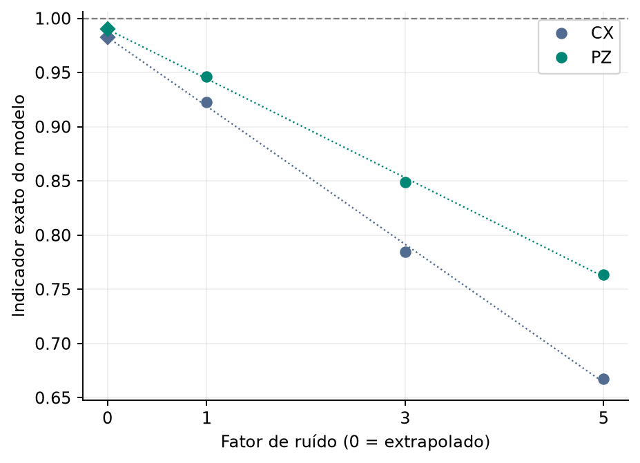
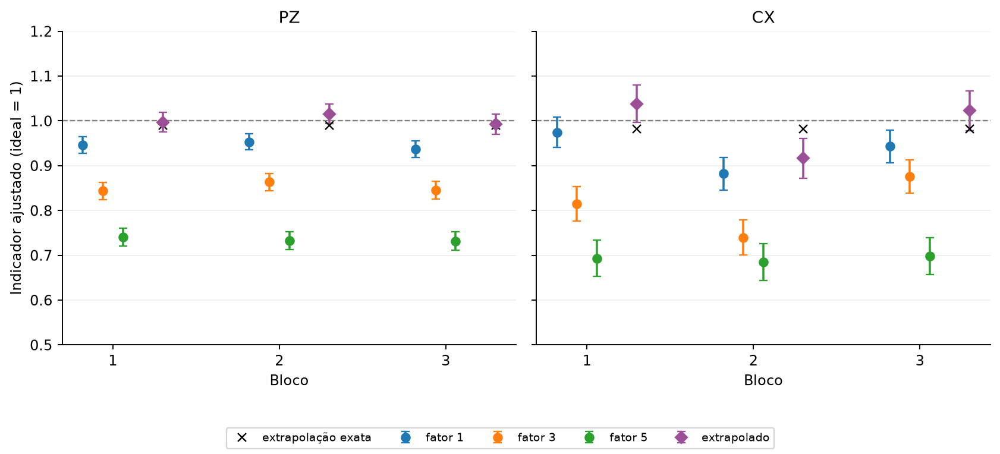

# Experimento 6 · A extrapolação a ruído zero reduz o erro das portas?

**Estado:** executado em 8 de novembro de 2026, no simulador (Qiskit Aer, CPU), sem acesso à IBM. Três sessões (blocos), cada circuito simulado 1.000 vezes.

## Resposta curta

Em simulação, a ZNE **aproxima o indicador de 1, mas não chega a 1** (a reta deixa um viés), e **aumenta a incerteza em todos os blocos**. O valor extrapolado fica perto da extrapolação exata do modelo, e às vezes passa de 1.

## Pergunta

A calibração de leitura não desfaz o erro das portas ([experimento 5](../05_validacao_simulada/README.md)). Se executarmos o circuito com ruído de portas crescente e extrapolarmos o indicador até ruído zero, chegamos mais perto do valor ideal? A técnica (ZNE) está explicada, com a conta, em [zne](../../fundamentos/tecnicas/zne.md).

## Como foi feito

- **Versões com mais ruído:** o GHZ conectado de 5 qubits em três versões com o mesmo resultado ideal, repetindo o bloco de preparação como U · U⁻¹ · U. Os **fatores de ruído** são 1, 3 e 5, com 4, 12 e 20 portas CX.
- **Correção de leitura:** cada versão é ajustada pela calibração do bloco. Depois ajustamos uma reta aos três valores e lemos o valor no fator 0.
- **Cenário:** leitura e portas, com os parâmetros sintéticos de `mitigacao/execucao/ruido.py`.
- **Cada bloco tem 42 circuitos:** 6 de GHZ (3 fatores × Z e X), 32 de calibração e 4 controles independentes. Três blocos, uma sessão cada.
- **Custo:** 3 blocos × 42 circuitos × 1.000 = 126.000 medidas simuladas.
- **Critério (definido antes de rodar):** relatar, em cada bloco, o valor no fator 1, o valor extrapolado e a referência exata do modelo, com o erro padrão. Sem recortar valores fora do intervalo físico e sem escolher o ajuste que chega mais perto de 1.

## Resultado

**O que o modelo prevê, sem flutuação de shots.** A cada fator de ruído o indicador cai, e a reta lida no fator 0 sobe de novo:

<!-- TABELA:zne_exato -->
| Fator de ruído | Portas de 2 qubits | PZ (referência exata) | CX (referência exata) |
| --- | ---: | ---: | ---: |
| 1 | 4 | 0,9463 | 0,9224 |
| 3 | 12 | 0,8490 | 0,7847 |
| 5 | 20 | 0,7637 | 0,6676 |
| 0 (extrapolado) | — | **0,9899** | **0,9826** |
<!-- /TABELA:zne_exato -->

*Círculos: valores exatos do modelo nos fatores 1, 3 e 5. Losangos: extrapolação ao fator 0. Linha tracejada: o ideal.*

A extrapolação exata chega perto de 1, **sem chegar**: a queda do indicador com o número de portas não é perfeitamente linear, e esse resíduo é o viés da reta.

**Com contagens finitas, nos três blocos** (valor ajustado com um erro padrão):

<!-- TABELA:zne_blocos -->
| Sessão | Indicador | Ajustado, fator 1 | Após ZNE | Exato, fator 1 | Exato após ZNE |
| --- | --- | ---: | ---: | ---: | ---: |
| bloco_01 | CX | 0,9743 ± 0,0340 | 1,0381 ± 0,0421 | 0,9224 | 0,9826 |
| bloco_01 | PZ | 0,9460 ± 0,0184 | 0,9972 ± 0,0220 | 0,9463 | 0,9899 |
| bloco_02 | CX | 0,8820 ± 0,0364 | 0,9165 ± 0,0441 | 0,9224 | 0,9826 |
| bloco_02 | PZ | 0,9534 ± 0,0182 | 1,0154 ± 0,0218 | 0,9463 | 0,9899 |
| bloco_03 | CX | 0,9429 ± 0,0360 | 1,0227 ± 0,0442 | 0,9224 | 0,9826 |
| bloco_03 | PZ | 0,9374 ± 0,0185 | 0,9925 ± 0,0223 | 0,9463 | 0,9899 |
<!-- /TABELA:zne_blocos -->

*Círculos: ajustado nos fatores 1, 3 e 5, com um erro padrão. Losango: valor extrapolado. X: extrapolação exata do modelo. Linha tracejada: o ideal.*

**A análise bate com a referência exata?** O maior desvio de cada sessão, em erros padrão:

<!-- TABELA:validacao -->
| Sessão | Cenário | Maior desvio do bruto (EP) | Maior desvio do ajustado (EP) | Dentro do limite |
| --- | --- | ---: | ---: | --- |
| bloco_01 | leitura_e_portas | 1,83 | 1,63 | sim |
| bloco_02 | leitura_e_portas | 1,39 | 1,52 | sim |
| bloco_03 | leitura_e_portas | 2,30 | 2,44 | sim |
<!-- /TABELA:validacao -->

## Conclusão

1. **A extrapolação aproxima o indicador de 1:** em todos os blocos, o valor após a ZNE fica acima do valor no fator 1, em PZ e em CX, e perto da extrapolação exata.
2. **Não chega a 1 no modelo exato** (viés da reta), e com contagens finitas o valor pode **passar de 1**, porque a correção de leitura e a extrapolação não ficam restritas ao espaço físico.
3. **A incerteza aumenta:** o erro padrão após a ZNE é maior que o do fator 1 nos seis casos da tabela.
4. **Os valores variam entre blocos** do tamanho do erro padrão. Três blocos não permitem estimar a cobertura dos intervalos.

**Limites.**
- Só simulação, com ruído sintético depolarizante nas portas. No hardware, a ZNE depende de como o ruído real cresce com as portas, e isso não foi testado.
- A reta é uma escolha; outras curvas dariam outro resultado e outro viés.
- Só um circuito: o GHZ de 5 qubits na construção conectada.
- A ZNE usou 3 versões do circuito, com até 5 vezes mais portas. O custo não foi comparado com o de outras técnicas.

## Próximo passo

A ZNE funciona no hardware? Ainda não foi testado. Seria um experimento novo na IBM, depois de os experimentos 1 a 4 terem caracterizado o computador.

## Arquivos

| Arquivo | Para que serve |
| --- | --- |
| `experimento.py` | A receita, com as 3 sessões. Rode com `python rodar.py 06 --enviar --todas`. |
| `dados/bloco_NN/` | Uma pasta por sessão: ficha, circuitos, contagens. **Não se edita.** |
| `resultados/` | `resultados.json`, `tabelas.md` e as figuras. Refeitos com `python rodar.py 06 --analisar`. |
| [analise.py](../../mitigacao/analise.py), [tecnicas/zne.py](../../mitigacao/tecnicas/zne.py) | A análise e a extrapolação. |

**Execução:** tudo local, não acessa a IBM.

[Experimentos](../README.md)
