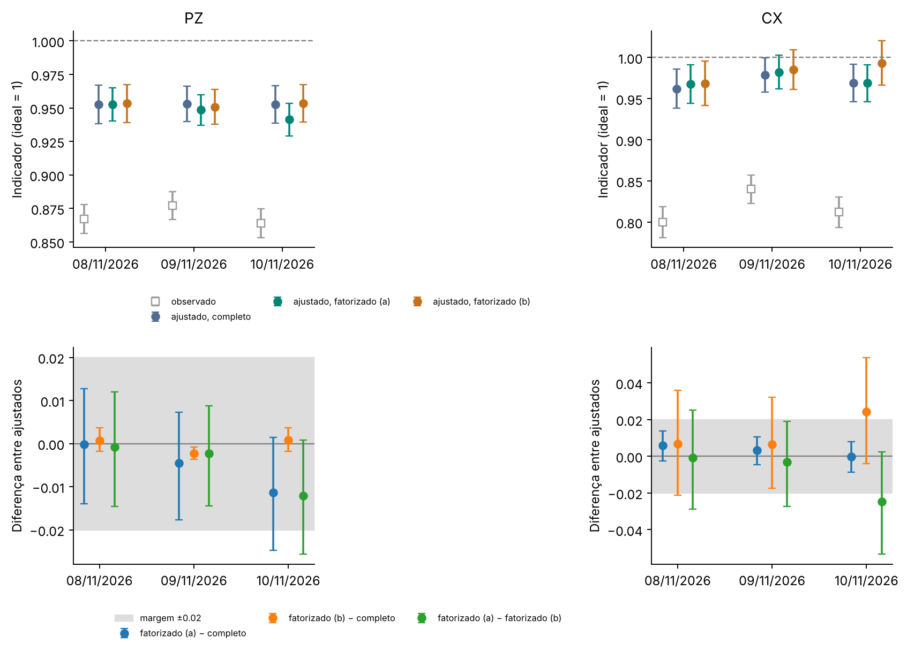

# Experimento 7 · Uma tabela por qubit substitui a matriz completa de leitura?

**Estado:** critérios definidos em 22 de novembro de 2026, **antes** de qualquer cálculo (o código foi commitado antes de rodar). A análise já foi rodada e os números estão na seção Resultado; **Resposta curta e Conclusão ainda não foram escritas**, para serem feitas depois de o autor olhar os números. Quem decidiu: o autor, aceitando as propostas abaixo. A justificativa científica da margem ainda será escrita com os orientadores (ver a seção do critério).

**Onde e quando:** análise local, sem acesso à IBM. Usa as contagens já gravadas no [experimento 4](../04_calibracao_leitura/README.md) (`ibm_fez`, sessões de 8, 9 e 10 de novembro de 2026, 1.000 medidas por circuito). Não há dados novos.

## Resposta curta

*A escrever depois da análise.*

## Pergunta

No experimento 4, a calibração de leitura usou uma matriz de 32 × 32, medida com os 32 estados de `00000` a `11111` ([leitura](../../fundamentos/tecnicas/leitura.md)). Essa matriz não serve para muitos qubits: com 20 qubits seriam mais de um milhão de calibrações.

Um modelo mais simples usa uma tabela de 2 × 2 **por qubit** e supõe que um qubit não atrapalha a leitura do vizinho. **Quanto a simplificação do modelo e o custo da calibração alteram os valores ajustados de PZ e CX do GHZ?**

Esta pergunta não explica por que o PZ ajustado ficou em 0,953. Os três métodos usam preparações de calibração em comum e podem ter o mesmo viés. A origem desse resto continua sendo uma investigação separada.

## Como será feito

**Três métodos**, todos aplicados às mesmas contagens do GHZ conectado de 5 qubits (Z e X) de cada sessão:

| Método | Tabelas | Calibrações usadas | O que testa |
| --- | --- | --- | --- |
| Completo | 1 de 32 × 32 | as 32 | A referência (o que o experimento 4 já fez) |
| Fatorizado (a) | 5 de 2 × 2, com as marginais das 32 calibrações | as 32 | Só a simplificação do modelo |
| Fatorizado (b) | 5 de 2 × 2, com só `00000` e `11111` | 2 | A simplificação mais o corte de custo |

**Comparações.** Principais: (a) contra o completo, que isola o efeito da simplificação do modelo (mesmos dados de calibração), e (b) contra o completo, que avalia o pacote "modelo simplificado + calibração barata". Secundária: (a) contra (b), que mostra a sensibilidade à quantidade de dados: em (a), cada condição de um qubit reúne 16.000 medidas (16 estados × 1.000), e em (b), 1.000. Em (b), o contexto dos outros qubits é sempre "todos em 0" ou "todos em 1", e isso pode não representar bem o GHZ se a resposta de um qubit depender dos vizinhos. Por isso (b) é apresentado como teste de redução de custo, com a diferença de precisão informada junto (a largura do intervalo em cada método).

- **Indicadores:** PZ (base Z) e CX (base X) do GHZ conectado, cada sessão separada ([indicadores](../../fundamentos/indicadores.md)).
- **Incerteza:** bootstrap com 5.000 réplicas e semente 2026, como no experimento 4, compartilhado. Em cada réplica, a calibração e o GHZ são reamostrados **uma vez** e a mesma réplica entra nos três ajustes. Assim a diferença entre métodos tem a incerteza certa, e não a soma das incertezas separadas.
- **Valores negativos:** os ajustados podem passar de 1 ou ficar abaixo de 0 em alguma probabilidade (quasiprobabilidades). Não recortamos nem renormalizamos, como no experimento 4. Registramos a menor quasiprobabilidade e o condicionamento de cada matriz. Réplicas que falharem são contadas e informadas, nunca descartadas em silêncio.
- **Ordem dos bits:** a conversão entre qubit físico e bit da resposta usa `leitura.permutacao`, como no experimento 4. Em 5 qubits, aplicar as 5 tabelas uma a uma deve dar o mesmo que o produto explícito das 5 (teste automático).
- **Custo:** nenhuma medida nova na IBM.

### Verificações além do PZ e do CX

PZ e CX resumem muita coisa em dois números, e dois modelos podem coincidir neles sem serem equivalentes.

1. **Previsão da calibração.** As 1.000 medidas de cada circuito de calibração são divididas ao acaso em duas metades (semente fixa: **20261122**, escolhida antes de calcular). Cada método é montado com a primeira metade e avaliado na segunda: compara-se a distribuição que ele prevê, para cada um dos 32 estados, com a medida. A métrica é a distância de variação total média, fixada agora.
2. **Controles independentes.** Os 4 controles do experimento 4 (`00000` e `11111` em Z; `+++++` e `++++-` em X) seguem como avaliação separada.

### Critério de equivalência, definido antes de calcular

Para cada sessão e cada indicador, olhamos a diferença **fatorizado menos completo**, com o intervalo de 95% do bootstrap compartilhado.

| Resultado | Quando |
| --- | --- |
| **Equivalente** | O intervalo de 95% inteiro está dentro da margem. |
| **Diferente** | O intervalo de 95% inteiro está fora da margem, de um lado só. |
| **Inconclusivo** | O intervalo cruza a margem. |

- **Margem adotada: ±0,02** para PZ e para CX, por decisão do autor em 22/11/2026. A justificativa científica de por que 0,02 preserva as conclusões do projeto **ainda não foi escrita**; ela será discutida com os orientadores antes de o resultado ser divulgado. Para comparação, o resíduo do PZ ajustado é de cerca de 0,047 (1 − 0,953), então 0,02 é cerca de 43% dele. Se os orientadores pedirem outra margem, a análise é refeita e o novo valor é registrado aqui, com a data e o motivo.
- Este critério (intervalo de 95% dentro da margem) é mais exigente que o TOST de 90%, e não deve ser chamado de TOST sem especificar o procedimento.
- Cada sessão aparece separada. A conclusão geral só vale se o resultado for o mesmo nas 3.

## Resultado

Computador `ibm_fez`; sessões de 8, 9 e 10 de novembro de 2026 (dados do experimento 4). **Observado** é a contagem direta; **ajustado** é a estimativa depois da calibração, com o método indicado. As tabelas saem dos dados por `analisar.py`.

Figura [comparacao_leitura.png](resultados/comparacao_leitura.png): em cima, PZ e CX de cada método em cada sessão (marca vazada: observado; marcas cheias: ajustados, com erro padrão do bootstrap); embaixo, a diferença entre ajustados com o intervalo de 95%, e a faixa cinza é a margem de ±0,02.

**GHZ conectado de 5 qubits: observado e ajustado pelos três métodos.**

<!-- TABELA:metodos -->
| Sessão | Indicador | Observado | completo | fatorizado (a) | fatorizado (b) |
| --- | --- | ---: | ---: | ---: | ---: |
| 2026-11-08_ibm_fez | PZ | 0,8670 ± 0,0107 | 0,9526 ± 0,0142 | 0,9525 ± 0,0124 | 0,9533 ± 0,0143 |
| 2026-11-08_ibm_fez | CX | 0,8000 ± 0,0190 | 0,9621 ± 0,0237 | 0,9678 ± 0,0233 | 0,9687 ± 0,0268 |
| 2026-11-09_ibm_fez | PZ | 0,8770 ± 0,0104 | 0,9531 ± 0,0132 | 0,9485 ± 0,0114 | 0,9508 ± 0,0130 |
| 2026-11-09_ibm_fez | CX | 0,8400 ± 0,0172 | 0,9789 ± 0,0210 | 0,9822 ± 0,0205 | 0,9853 ± 0,0238 |
| 2026-11-10_ibm_fez | PZ | 0,8640 ± 0,0108 | 0,9526 ± 0,0139 | 0,9413 ± 0,0120 | 0,9534 ± 0,0139 |
| 2026-11-10_ibm_fez | CX | 0,8120 ± 0,0185 | 0,9691 ± 0,0227 | 0,9687 ± 0,0222 | 0,9933 ± 0,0268 |
<!-- /TABELA:metodos -->

**Diferença entre ajustados, com o intervalo de 95% e a decisão pelo critério acima.**

<!-- TABELA:diferencas -->
| Sessão | Indicador | Diferença | Valor | Intervalo de 95% | Decisão |
| --- | --- | --- | ---: | --- | --- |
| 2026-11-08_ibm_fez | PZ | fatorizado (a) − completo | -0,000 | [-0,014; 0,013] | equivalente |
| 2026-11-08_ibm_fez | PZ | fatorizado (b) − completo | 0,001 | [-0,002; 0,004] | equivalente |
| 2026-11-08_ibm_fez | PZ | fatorizado (a) − fatorizado (b) | -0,001 | [-0,015; 0,012] | equivalente |
| 2026-11-08_ibm_fez | CX | fatorizado (a) − completo | 0,006 | [-0,003; 0,014] | equivalente |
| 2026-11-08_ibm_fez | CX | fatorizado (b) − completo | 0,007 | [-0,021; 0,036] | inconclusivo |
| 2026-11-08_ibm_fez | CX | fatorizado (a) − fatorizado (b) | -0,001 | [-0,029; 0,025] | inconclusivo |
| 2026-11-09_ibm_fez | PZ | fatorizado (a) − completo | -0,005 | [-0,018; 0,007] | equivalente |
| 2026-11-09_ibm_fez | PZ | fatorizado (b) − completo | -0,002 | [-0,004; -0,001] | equivalente |
| 2026-11-09_ibm_fez | PZ | fatorizado (a) − fatorizado (b) | -0,002 | [-0,014; 0,009] | equivalente |
| 2026-11-09_ibm_fez | CX | fatorizado (a) − completo | 0,003 | [-0,005; 0,011] | equivalente |
| 2026-11-09_ibm_fez | CX | fatorizado (b) − completo | 0,006 | [-0,017; 0,032] | inconclusivo |
| 2026-11-09_ibm_fez | CX | fatorizado (a) − fatorizado (b) | -0,003 | [-0,027; 0,019] | inconclusivo |
| 2026-11-10_ibm_fez | PZ | fatorizado (a) − completo | -0,011 | [-0,025; 0,001] | inconclusivo |
| 2026-11-10_ibm_fez | PZ | fatorizado (b) − completo | 0,001 | [-0,002; 0,004] | equivalente |
| 2026-11-10_ibm_fez | PZ | fatorizado (a) − fatorizado (b) | -0,012 | [-0,026; 0,001] | inconclusivo |
| 2026-11-10_ibm_fez | CX | fatorizado (a) − completo | -0,000 | [-0,009; 0,008] | equivalente |
| 2026-11-10_ibm_fez | CX | fatorizado (b) − completo | 0,024 | [-0,004; 0,054] | inconclusivo |
| 2026-11-10_ibm_fez | CX | fatorizado (a) − fatorizado (b) | -0,025 | [-0,053; 0,002] | inconclusivo |
<!-- /TABELA:diferencas -->

**Controles independentes (ajustado menos o ideal, que é 1).** Colunas: `00000` e `11111` em Z; `+++++` e `++++-` em X.

<!-- TABELA:controles -->
| Sessão | Método | 00000 em Z | 11111 em Z | +++++ em X | ++++- em X |
| --- | --- | ---: | ---: | ---: | ---: |
| 2026-11-08_ibm_fez | completo | 0,004 | -0,000 | 0,011 | -0,007 |
| 2026-11-08_ibm_fez | fatorizado (a) | 0,002 | 0,002 | 0,009 | 0,002 |
| 2026-11-08_ibm_fez | fatorizado (b) | 0,004 | 0,002 | 0,011 | 0,012 |
| 2026-11-09_ibm_fez | completo | -0,001 | 0,001 | -0,001 | 0,008 |
| 2026-11-09_ibm_fez | fatorizado (a) | 0,007 | -0,014 | 0,007 | -0,008 |
| 2026-11-09_ibm_fez | fatorizado (b) | -0,002 | -0,003 | -0,002 | -0,007 |
| 2026-11-10_ibm_fez | completo | 0,017 | 0,005 | 0,020 | 0,022 |
| 2026-11-10_ibm_fez | fatorizado (a) | 0,002 | -0,005 | 0,006 | 0,007 |
| 2026-11-10_ibm_fez | fatorizado (b) | 0,017 | 0,005 | 0,021 | 0,018 |
<!-- /TABELA:controles -->

**Previsão da calibração.** Distância média (e máxima) entre a distribuição prevista por cada método, montado com metade das medidas, e a medida na outra metade, nos 32 estados. A distância é a metade da soma de |previsto − medido|; 0 seria uma previsão perfeita.

<!-- TABELA:previsao -->
| Sessão | completo | fatorizado (a) | fatorizado (b) |
| --- | ---: | ---: | ---: |
| 2026-11-08_ibm_fez | 0,0232 (0,0380) | 0,0165 (0,0355) | 0,0248 (0,0357) |
| 2026-11-09_ibm_fez | 0,0224 (0,0460) | 0,0161 (0,0290) | 0,0220 (0,0347) |
| 2026-11-10_ibm_fez | 0,0234 (0,0640) | 0,0192 (0,0456) | 0,0268 (0,0673) |
<!-- /TABELA:previsao -->

**Diagnóstico numérico.** Condicionamento da matriz e menor quasiprobabilidade do GHZ, na ordem completo / fatorizado (a) / fatorizado (b); réplicas do bootstrap com calibração instável (descartadas e contadas).

<!-- TABELA:diagnostico -->
| Sessão | Condicionamento | Menor quasiprobabilidade do GHZ | Réplicas com falha |
| --- | ---: | ---: | ---: |
| 2026-11-08_ibm_fez | 1,22 / 1,22 / 1,23 | -0,0050 / -0,0080 / -0,0069 | 0 |
| 2026-11-09_ibm_fez | 1,19 / 1,18 / 1,19 | -0,0055 / -0,0060 / -0,0049 | 0 |
| 2026-11-10_ibm_fez | 1,21 / 1,21 / 1,24 | -0,0117 / -0,0090 / -0,0121 | 0 |
<!-- /TABELA:diagnostico -->

## Conclusão

*A escrever depois da análise. O que cada resultado permitirá dizer:*

- **Equivalente:** "Nestas 3 sessões e dentro da margem, trocar a matriz completa pelo modelo fatorizado não alterou materialmente PZ e CX ajustados."
- **Diferente:** "Os indicadores são sensíveis ao modelo ou ao protocolo de calibração." Dizer que a causa é correlação de leitura entre qubits exigiria examinar os padrões conjuntos das contagens.
- **Inconclusivo:** dizer que estes dados não permitem decidir.

**Limites já conhecidos.**
- Um computador e três dias seguidos.
- O modelo fatorizado supõe independência entre qubits. Concordar com o completo em 5 qubits não prova que vale em tamanhos maiores.
- Os métodos compartilham as preparações de calibração. Concordância entre eles não elimina um viés comum, por exemplo de erros de preparação absorvidos na calibração.
- Os quatro controles cobrem poucos estados e não validam todas as distribuições.

## Próximo passo

*Depende do resultado. Se os modelos forem equivalentes, a análise com um modelo por qubit abre caminho para tamanhos maiores. A investigação da origem do resíduo de 0,953 é uma pergunta separada.*

## Arquivos

| Arquivo | Para que serve |
| --- | --- |
| `analisar.py` | Lê as sessões do experimento 4, compara os três métodos e grava `resultados/` e as tabelas deste relatório. |
| `resultados/resultados.json` | Todos os números, por sessão e por item. Gerado dos dados. |
| `resultados/tabelas.md` | As tabelas deste relatório em um arquivo só. |
| `resultados/comparacao_leitura.png` | A figura do resultado. |

Este experimento **não tem pasta `dados/` própria** e não envia nada à IBM: lê `../04_calibracao_leitura/dados/`, que não se edita. O código da conta está em `mitigacao/leitura_comparacao.py` e o das tabelas e da figura, em `mitigacao/leitura_saida.py`.

[Experimentos](../README.md)
