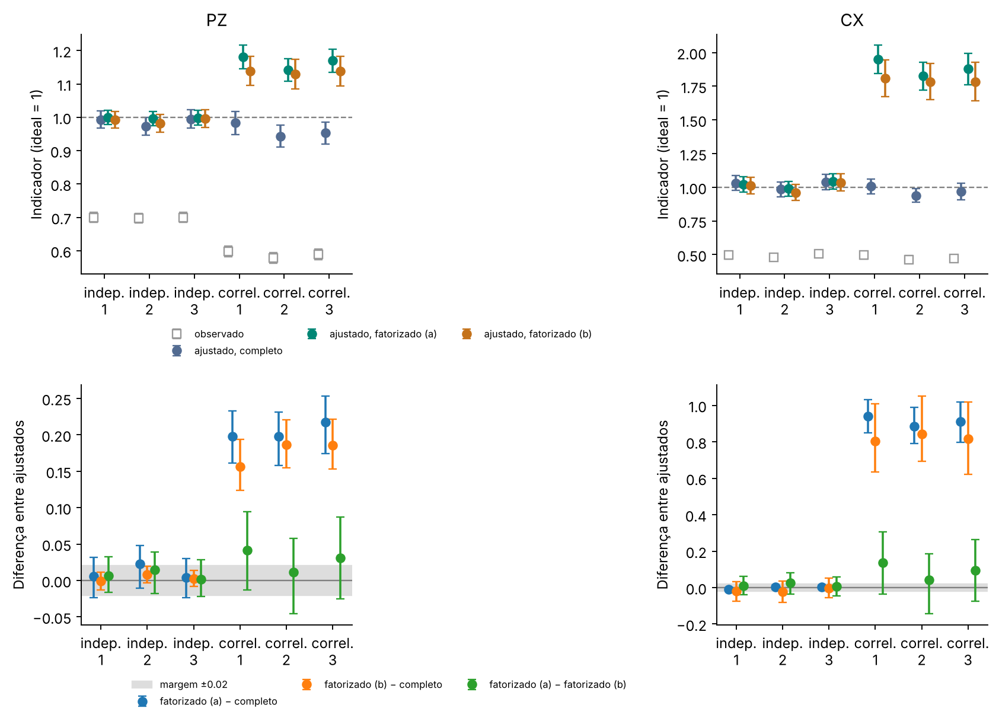

# Experimento 8, parte A · Em 10 qubits, a tabela por qubit reproduz a matriz completa?

**Estado:** critérios definidos em 22 de novembro de 2026, **antes** de rodar (commit anterior aos dados). Sessões simuladas e analisadas no mesmo dia; os critérios não foram mudados depois.

**Onde e quando:** simulador local (Qiskit Aer, matriz densidade), 10 qubits em linha, 1.000 medidas por circuito. Nenhum acesso à IBM.

## Resposta curta

**Sim quando cada qubit erra sozinho; não quando os qubits de um par erram juntos.** Com erro independente, as três formas de calibrar ficam a até 0,042 do valor verdadeiro (1) e nenhuma das 12 comparações principais deu "diferente", mas 7 ficaram "inconclusivo" (os intervalos, de cerca de ±0,02 a ±0,03, têm o tamanho da margem). Com o erro conjunto nos pares, a matriz completa segue perto de 1 (erro de −0,06 a 0,01), enquanto as tabelas por qubit passam do ideal: PZ de 0,13 a 0,18 acima e CX de 0,78 a 0,95 acima, e as 12 comparações principais deram "diferente". É um resultado de simulador, com erro escolhido por nós.

## Pergunta

O [experimento 7](../../07_leitura_fatorizada/README.md) comparou em 5 qubits, com dados reais, a matriz completa e as tabelas por qubit. Aqui o erro de leitura é **escolhido por nós**, então sabemos o valor verdadeiro dos indicadores (1, porque não há erro de portas). Dois cenários:

- **`leitura`:** cada qubit erra sozinho (as chances de 0 virar 1 e de 1 virar 0 são as do [simulador](../../../mitigacao/execucao/ruido.py), as mesmas do experimento 5). É o caso em que o modelo por qubit está certo.
- **`leitura_correlacionada`:** o mesmo erro por qubit e, além disso, com chance 0,03 os dois qubits de cada par (0,1), (2,3), …, (8,9) leem errado **ao mesmo tempo**. É o caso em que o modelo por qubit está errado. O valor 0,03 foi escolhido antes de rodar, do tamanho dos erros por qubit (0,01 a 0,06). Os pares vizinhos são só uma escolha simples; o simulador não representa nenhum computador real.

## Como será feito

- **Circuitos por sessão:** GHZ conectado de 10 qubits em Z e em X, as 1.024 calibrações (`0000000000` a `1111111111`) e 4 controles independentes (zeros e uns em Z; todos em `+` e todos em `+` com o qubit 0 em `−`, em X). 1.030 circuitos × 1.000 = 1.030.000 medidas por sessão.
- **Sessões:** 3 blocos por cenário, cada um com a sua calibração e a sua semente (sementes 8001 a 8003 e 8101 a 8103; ver `experimento.py`). 6 sessões.
- **Métodos**, como no experimento 7: completo (1.024 × 1.024), fatorizado (a) (10 tabelas 2 × 2 com as 1.024 calibrações) e fatorizado (b) (só `0000000000` e `1111111111`).
- **Indicadores:** PZ e CX do GHZ ([indicadores](../../../fundamentos/indicadores.md)). Verdadeiro = 1.
- **Incerteza:** bootstrap compartilhado entre os métodos, como no experimento 7, com semente 2026 e **250 réplicas** (e não 5.000): a verificação do condicionamento de uma matriz 1.024 × 1.024 leva cerca de 0,4 s e o bootstrap completo levaria horas. Os intervalos de 95% ficam mais grosseiros que no experimento 7.
- **Verificações:** previsão da calibração com metade das medidas (semente 20261122, como no 7) e os 4 controles.
- **Valores negativos e condicionamento:** como no experimento 7 (nada é recortado; registramos a menor quasiprobabilidade, o condicionamento e as réplicas descartadas).

## Critérios, definidos antes de rodar

Mesma regra do experimento 7, sobre **fatorizado menos completo**, com intervalo de 95% e **margem ±0,02**: *equivalente* (intervalo dentro da margem), *diferente* (inteiro fora, de um lado) ou *inconclusivo*. A justificativa científica da margem continua pendente (ver o experimento 7). Cada bloco aparece separado.

Também medimos o **erro contra o valor verdadeiro** (ajustado − 1), porque aqui o 1 é conhecido.

O que cada cenário **deve** mostrar:

| Cenário | Esperado | Se não acontecer |
| --- | --- | --- |
| `leitura` | O fatorizado (a) e o completo estimam a mesma coisa, então a diferença deve ficar dentro da margem. | Não é falha do modelo: o completo estima 1.024 × 1.024 números com 1.000 medidas por coluna e pode ser mais ruidoso que o fatorizado. Reportamos o erro de cada método contra o 1 para ver quem erra mais. |
| `leitura_correlacionada` | Sem previsão de tamanho. Se o fatorizado ficar "diferente" do completo, o experimento detecta a correlação. Se continuar "equivalente", essa correlação (0,03 por par) não é detectada pelos indicadores. | Os dois resultados são informativos e entram no relatório. |

O que este experimento **não** diz: nada sobre o computador real. Só mostra o que a análise detecta quando o erro de leitura é conhecido.

## Resultado

Simulador, 10 qubits, erro de leitura conhecido (verdadeiro = 1). **Observado** é a contagem direta; **ajustado** é a estimativa depois da calibração, com o método indicado. As tabelas saem dos dados por `analisar.py`. Nomes das sessões: `leitura_bloco_NN` (cada qubit erra sozinho) e `leitura_correlacionada_bloco_NN` (com erro conjunto nos pares).

Figura [comparacao_leitura_10q.png](resultados/comparacao_leitura_10q.png): em cima, PZ e CX de cada método em cada sessão (marca vazada: observado; marcas cheias: ajustados, com erro padrão do bootstrap; a linha tracejada é o valor verdadeiro, 1); embaixo, a diferença entre ajustados com o intervalo de 95% e a margem de ±0,02 em cinza. `indep.` e `correl.` são os dois cenários.

**GHZ conectado de 10 qubits: observado e ajustado pelos três métodos.**

<!-- TABELA:metodos -->
| Sessão | Indicador | Observado | completo | fatorizado (a) | fatorizado (b) |
| --- | --- | ---: | ---: | ---: | ---: |
| leitura_bloco_01 | PZ | 0,7000 ± 0,0145 | 0,9932 ± 0,0257 | 0,9990 ± 0,0216 | 0,9922 ± 0,0252 |
| leitura_bloco_01 | CX | 0,4960 ± 0,0275 | 1,0323 ± 0,0569 | 1,0225 ± 0,0565 | 1,0121 ± 0,0613 |
| leitura_bloco_02 | PZ | 0,6980 ± 0,0145 | 0,9735 ± 0,0266 | 0,9961 ± 0,0219 | 0,9817 ± 0,0261 |
| leitura_bloco_02 | CX | 0,4800 ± 0,0277 | 0,9844 ± 0,0543 | 0,9888 ± 0,0546 | 0,9620 ± 0,0587 |
| leitura_bloco_03 | PZ | 0,7000 ± 0,0145 | 0,9948 ± 0,0272 | 0,9985 ± 0,0228 | 0,9968 ± 0,0266 |
| leitura_bloco_03 | CX | 0,5060 ± 0,0273 | 1,0383 ± 0,0581 | 1,0419 ± 0,0578 | 1,0363 ± 0,0634 |
| leitura_correlacionada_bloco_01 | PZ | 0,5980 ± 0,0155 | 0,9828 ± 0,0350 | 1,1804 ± 0,0353 | 1,1388 ± 0,0434 |
| leitura_correlacionada_bloco_01 | CX | 0,4960 ± 0,0275 | 1,0069 ± 0,0545 | 1,9482 ± 0,1058 | 1,8100 ± 0,1350 |
| leitura_correlacionada_bloco_02 | PZ | 0,5780 ± 0,0156 | 0,9432 ± 0,0327 | 1,1412 ± 0,0338 | 1,1294 ± 0,0437 |
| leitura_correlacionada_bloco_02 | CX | 0,4640 ± 0,0280 | 0,9399 ± 0,0527 | 1,8263 ± 0,1030 | 1,7832 ± 0,1341 |
| leitura_correlacionada_bloco_03 | PZ | 0,5890 ± 0,0156 | 0,9526 ± 0,0333 | 1,1697 ± 0,0348 | 1,1384 ± 0,0443 |
| leitura_correlacionada_bloco_03 | CX | 0,4720 ± 0,0279 | 0,9680 ± 0,0602 | 1,8787 ± 0,1169 | 1,7845 ± 0,1416 |
<!-- /TABELA:metodos -->

**Erro contra o valor verdadeiro (indicador − 1).**

<!-- TABELA:erro -->
| Sessão | Indicador | Observado − 1 | completo − 1 | fatorizado (a) − 1 | fatorizado (b) − 1 |
| --- | --- | ---: | ---: | ---: | ---: |
| leitura_bloco_01 | PZ | -0,300 | -0,007 | -0,001 | -0,008 |
| leitura_bloco_01 | CX | -0,504 | 0,032 | 0,023 | 0,012 |
| leitura_bloco_02 | PZ | -0,302 | -0,026 | -0,004 | -0,018 |
| leitura_bloco_02 | CX | -0,520 | -0,016 | -0,011 | -0,038 |
| leitura_bloco_03 | PZ | -0,300 | -0,005 | -0,002 | -0,003 |
| leitura_bloco_03 | CX | -0,494 | 0,038 | 0,042 | 0,036 |
| leitura_correlacionada_bloco_01 | PZ | -0,402 | -0,017 | 0,180 | 0,139 |
| leitura_correlacionada_bloco_01 | CX | -0,504 | 0,007 | 0,948 | 0,810 |
| leitura_correlacionada_bloco_02 | PZ | -0,422 | -0,057 | 0,141 | 0,129 |
| leitura_correlacionada_bloco_02 | CX | -0,536 | -0,060 | 0,826 | 0,783 |
| leitura_correlacionada_bloco_03 | PZ | -0,411 | -0,047 | 0,170 | 0,138 |
| leitura_correlacionada_bloco_03 | CX | -0,528 | -0,032 | 0,879 | 0,785 |
<!-- /TABELA:erro -->

**Diferença entre ajustados, com o intervalo de 95% e a decisão pelo critério acima.**

<!-- TABELA:diferencas -->
| Sessão | Indicador | Diferença | Valor | Intervalo de 95% | Decisão |
| --- | --- | --- | ---: | --- | --- |
| leitura_bloco_01 | PZ | fatorizado (a) − completo | 0,006 | [-0,023; 0,032] | inconclusivo |
| leitura_bloco_01 | PZ | fatorizado (b) − completo | -0,001 | [-0,013; 0,011] | equivalente |
| leitura_bloco_01 | PZ | fatorizado (a) − fatorizado (b) | 0,007 | [-0,017; 0,033] | inconclusivo |
| leitura_bloco_01 | CX | fatorizado (a) − completo | -0,010 | [-0,021; -0,001] | inconclusivo |
| leitura_bloco_01 | CX | fatorizado (b) − completo | -0,020 | [-0,075; 0,032] | inconclusivo |
| leitura_bloco_01 | CX | fatorizado (a) − fatorizado (b) | 0,010 | [-0,040; 0,063] | inconclusivo |
| leitura_bloco_02 | PZ | fatorizado (a) − completo | 0,023 | [-0,011; 0,048] | inconclusivo |
| leitura_bloco_02 | PZ | fatorizado (b) − completo | 0,008 | [-0,004; 0,020] | equivalente |
| leitura_bloco_02 | PZ | fatorizado (a) − fatorizado (b) | 0,014 | [-0,018; 0,039] | inconclusivo |
| leitura_bloco_02 | CX | fatorizado (a) − completo | 0,004 | [-0,008; 0,013] | equivalente |
| leitura_bloco_02 | CX | fatorizado (b) − completo | -0,022 | [-0,082; 0,037] | inconclusivo |
| leitura_bloco_02 | CX | fatorizado (a) − fatorizado (b) | 0,027 | [-0,035; 0,081] | inconclusivo |
| leitura_bloco_03 | PZ | fatorizado (a) − completo | 0,004 | [-0,023; 0,030] | inconclusivo |
| leitura_bloco_03 | PZ | fatorizado (b) − completo | 0,002 | [-0,008; 0,014] | equivalente |
| leitura_bloco_03 | PZ | fatorizado (a) − fatorizado (b) | 0,002 | [-0,022; 0,028] | inconclusivo |
| leitura_bloco_03 | CX | fatorizado (a) − completo | 0,004 | [-0,007; 0,012] | equivalente |
| leitura_bloco_03 | CX | fatorizado (b) − completo | -0,002 | [-0,055; 0,051] | inconclusivo |
| leitura_bloco_03 | CX | fatorizado (a) − fatorizado (b) | 0,006 | [-0,044; 0,059] | inconclusivo |
| leitura_correlacionada_bloco_01 | PZ | fatorizado (a) − completo | 0,198 | [0,162; 0,233] | diferente |
| leitura_correlacionada_bloco_01 | PZ | fatorizado (b) − completo | 0,156 | [0,124; 0,194] | diferente |
| leitura_correlacionada_bloco_01 | PZ | fatorizado (a) − fatorizado (b) | 0,042 | [-0,013; 0,094] | inconclusivo |
| leitura_correlacionada_bloco_01 | CX | fatorizado (a) − completo | 0,941 | [0,848; 1,033] | diferente |
| leitura_correlacionada_bloco_01 | CX | fatorizado (b) − completo | 0,803 | [0,633; 1,010] | diferente |
| leitura_correlacionada_bloco_01 | CX | fatorizado (a) − fatorizado (b) | 0,138 | [-0,035; 0,306] | inconclusivo |
| leitura_correlacionada_bloco_02 | PZ | fatorizado (a) − completo | 0,198 | [0,158; 0,231] | diferente |
| leitura_correlacionada_bloco_02 | PZ | fatorizado (b) − completo | 0,186 | [0,155; 0,221] | diferente |
| leitura_correlacionada_bloco_02 | PZ | fatorizado (a) − fatorizado (b) | 0,012 | [-0,046; 0,058] | inconclusivo |
| leitura_correlacionada_bloco_02 | CX | fatorizado (a) − completo | 0,886 | [0,789; 0,991] | diferente |
| leitura_correlacionada_bloco_02 | CX | fatorizado (b) − completo | 0,843 | [0,692; 1,052] | diferente |
| leitura_correlacionada_bloco_02 | CX | fatorizado (a) − fatorizado (b) | 0,043 | [-0,144; 0,184] | inconclusivo |
| leitura_correlacionada_bloco_03 | PZ | fatorizado (a) − completo | 0,217 | [0,174; 0,254] | diferente |
| leitura_correlacionada_bloco_03 | PZ | fatorizado (b) − completo | 0,186 | [0,153; 0,222] | diferente |
| leitura_correlacionada_bloco_03 | PZ | fatorizado (a) − fatorizado (b) | 0,031 | [-0,025; 0,087] | inconclusivo |
| leitura_correlacionada_bloco_03 | CX | fatorizado (a) − completo | 0,911 | [0,798; 1,018] | diferente |
| leitura_correlacionada_bloco_03 | CX | fatorizado (b) − completo | 0,816 | [0,621; 1,018] | diferente |
| leitura_correlacionada_bloco_03 | CX | fatorizado (a) − fatorizado (b) | 0,094 | [-0,076; 0,263] | inconclusivo |
<!-- /TABELA:diferencas -->

**Controles independentes (ajustado menos o ideal, que é 1).** Colunas: zeros e uns em Z; todos em `+` e todos em `+` com o qubit 0 em `−`, em X.

<!-- TABELA:controles -->
| Sessão | Método | zeros em Z | uns em Z | todos + em X | todos +, qubit 0 em −, em X |
| --- | --- | ---: | ---: | ---: | ---: |
| leitura_bloco_01 | completo | 0,021 | 0,021 | -0,061 | -0,029 |
| leitura_bloco_01 | fatorizado (a) | 0,035 | 0,018 | -0,047 | -0,011 |
| leitura_bloco_01 | fatorizado (b) | 0,027 | 0,013 | -0,055 | -0,019 |
| leitura_bloco_02 | completo | -0,024 | -0,042 | -0,004 | -0,040 |
| leitura_bloco_02 | fatorizado (a) | -0,006 | -0,016 | 0,014 | -0,024 |
| leitura_bloco_02 | fatorizado (b) | -0,010 | -0,040 | 0,010 | -0,035 |
| leitura_bloco_03 | completo | -0,037 | 0,004 | -0,007 | 0,030 |
| leitura_bloco_03 | fatorizado (a) | -0,032 | 0,007 | -0,002 | 0,007 |
| leitura_bloco_03 | fatorizado (b) | -0,028 | -0,001 | 0,002 | 0,016 |
| leitura_correlacionada_bloco_01 | completo | -0,062 | -0,034 | 0,001 | -0,053 |
| leitura_correlacionada_bloco_01 | fatorizado (a) | 0,122 | 0,164 | 0,197 | 0,164 |
| leitura_correlacionada_bloco_01 | fatorizado (b) | 0,103 | 0,101 | 0,175 | 0,150 |
| leitura_correlacionada_bloco_02 | completo | 0,012 | -0,012 | 0,005 | -0,011 |
| leitura_correlacionada_bloco_02 | fatorizado (a) | 0,212 | 0,213 | 0,202 | 0,146 |
| leitura_correlacionada_bloco_02 | fatorizado (b) | 0,206 | 0,194 | 0,196 | 0,137 |
| leitura_correlacionada_bloco_03 | completo | -0,018 | -0,064 | -0,053 | -0,012 |
| leitura_correlacionada_bloco_03 | fatorizado (a) | 0,193 | 0,161 | 0,153 | 0,184 |
| leitura_correlacionada_bloco_03 | fatorizado (b) | 0,177 | 0,116 | 0,138 | 0,177 |
<!-- /TABELA:controles -->

**Previsão da calibração.** Distância média (e máxima) entre a distribuição prevista por cada método, montado com metade das medidas, e a medida na outra metade, nas 1.024 sequências.

<!-- TABELA:previsao -->
| Sessão | completo | fatorizado (a) | fatorizado (b) |
| --- | ---: | ---: | ---: |
| leitura_bloco_01 | 0,0815 (0,1680) | 0,0628 (0,1103) | 0,0725 (0,1398) |
| leitura_bloco_02 | 0,0809 (0,1520) | 0,0626 (0,1119) | 0,0783 (0,1458) |
| leitura_bloco_03 | 0,0812 (0,1400) | 0,0629 (0,1058) | 0,0708 (0,1273) |
| leitura_correlacionada_bloco_01 | 0,1206 (0,1820) | 0,2244 (0,2782) | 0,2058 (0,2701) |
| leitura_correlacionada_bloco_02 | 0,1215 (0,1920) | 0,2245 (0,2749) | 0,2184 (0,2907) |
| leitura_correlacionada_bloco_03 | 0,1217 (0,1960) | 0,2255 (0,2770) | 0,2105 (0,2870) |
<!-- /TABELA:previsao -->

**Diagnóstico numérico.** Condicionamento da matriz e menor quasiprobabilidade do GHZ, na ordem completo / fatorizado (a) / fatorizado (b); réplicas do bootstrap com calibração instável (descartadas e contadas).

<!-- TABELA:diagnostico -->
| Sessão | Condicionamento | Menor quasiprobabilidade do GHZ | Réplicas com falha |
| --- | ---: | ---: | ---: |
| leitura_bloco_01 | 2,22 / 2,20 / 2,18 | -0,0085 / -0,0066 / -0,0063 | 0 |
| leitura_bloco_02 | 2,21 / 2,20 / 2,13 | -0,0108 / -0,0076 / -0,0138 | 0 |
| leitura_bloco_03 | 2,21 / 2,20 / 2,20 | -0,0110 / -0,0093 / -0,0130 | 0 |
| leitura_correlacionada_bloco_01 | 2,35 / 4,06 / 3,80 | -0,0232 / -0,0317 / -0,0398 | 0 |
| leitura_correlacionada_bloco_02 | 2,40 / 4,06 / 3,95 | -0,0068 / -0,0263 / -0,0314 | 0 |
| leitura_correlacionada_bloco_03 | 2,32 / 4,07 / 3,90 | -0,0115 / -0,0283 / -0,0271 | 0 |
<!-- /TABELA:diagnostico -->

## Conclusão

1. **Erro independente (`leitura`).** Observado: PZ 0,70 e CX 0,48 a 0,51. Ajustado pelos três métodos: PZ de 0,973 a 0,999 e CX de 0,962 a 1,042. Nenhuma diferença "diferente". Das 12 comparações principais, 5 deram "equivalente" e 7 "inconclusivo". O intervalo de (a) menos completo no PZ passa da margem nos 3 blocos, então não dá para declarar equivalência pelo critério, embora as diferenças pontuais sejam pequenas (de 0,004 a 0,023).
2. **O erro padrão do fatorizado (a) é menor que o do completo** (PZ 0,022 contra 0,026 a 0,027): cada coluna da matriz completa vem de só 1.000 medidas. Isso aparece também na previsão com metade das medidas (distância média 0,063 do (a) contra 0,081 do completo). Isso não mostra que o (a) seja mais correto. Mostra que ele estima menos números com as mesmas medidas.
3. **Erro conjunto nos pares (`leitura_correlacionada`).** O completo recupera o valor verdadeiro (PZ de 0,943 a 0,983; CX de 0,940 a 1,007). O fatorizado (a) dá PZ de 1,141 a 1,180 e CX de 1,826 a 1,948; o (b) dá PZ de 1,129 a 1,139 e CX de 1,783 a 1,810. Indicadores acima de 1 não existem fisicamente: a calibração por qubit corrige demais quando ignora a correlação. As 12 comparações principais deram "diferente", nos 3 blocos.
4. **Os controles e a previsão também separam os cenários.** Com correlação, os controles ajustados pelo (a) e pelo (b) ficam de 0,10 a 0,21 acima de 1, e os do completo, a no máximo 0,064. A previsão com metade das medidas erra 0,21 a 0,23 nos dois métodos por qubit e 0,12 no completo. Sem correlação, nada disso separa os métodos.
5. **(a) contra (b)** (todas as calibrações contra só zeros e uns) ficou "inconclusivo" em todos os casos dos dois cenários: aqui os dados não separam os dois.
6. **Diagnóstico.** Condicionamento de 2,1 a 4,1, sem réplicas descartadas. Menor quasiprobabilidade do GHZ entre −0,006 e −0,040.

**Limites.**
- É simulação: o erro de leitura é escolhido por nós (as chances por qubit do [experimento 5](../../05_validacao_simulada/README.md) e uma correlação de 0,03 em pares vizinhos). Não diz quanto um computador real tem de correlação.
- Sem erro de portas, e só 10 qubits. Três blocos por cenário e 250 réplicas de bootstrap (intervalos mais grosseiros que no experimento 7).
- A tabela mostra que o critério **detecta** uma correlação desse tamanho. Uma correlação bem menor não foi testada.

## Próximo passo

A [parte B](../b_ibm/README.md) leva o modelo por qubit para a IBM em 10 e 20 qubits. A conta acima serve de referência: se lá aparecer indicador acima de 1 ou controles acima de 1, isso é sinal de correlação entre qubits. Antes de gastar tempo da IBM, dá para **testar no simulador a verificação de independência planejada para a parte B** (calibrações `0101…` e `1010…` contra `00…0` e `11…1`), com os dois cenários deste experimento. Isso ainda não foi feito.

## Próximo passo

*Depende do resultado. A [parte B](../b_ibm/README.md) leva o modelo por qubit para a IBM.*

## Arquivos

| Arquivo | Para que serve |
| --- | --- |
| `experimento.py` | A receita: circuitos, cenários e sementes. |
| `dados/NOME_bloco_NN/` | Uma pasta por sessão: ficha, contagens e circuitos. **Não se edita.** |
| `analisar.py` | Compara os três métodos em cada sessão e grava `resultados/`. |
| `resultados/` | Tabelas, figura e `resultados.json`, gerados dos dados. |

**Execução:** simulador; não envia nada à IBM. A correlação entre qubits é aplicada às contagens depois da simulação (o simulador não tem erro de leitura entre dois qubits); ver `mitigacao/execucao/ruido.py`.

[Experimento 8](../README.md) · [Experimentos](../../README.md)
